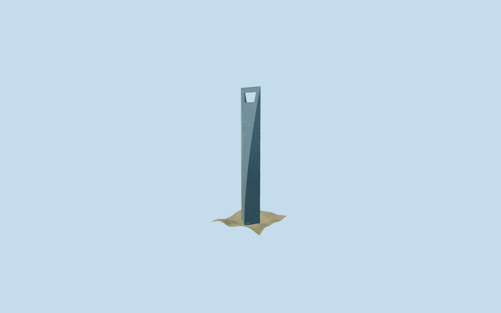

# Shanghai World Financial Center

Compact SWFC exterior preserves the original curved six-sided envelope, real crown aperture, split piers, upper bridge, curtain-wall bands and representative lobby canopies. Detailed original source remains reproducible.

## Evidence and reconstruction

Published dimensions and reconstructed details are separated in spec.json. Primary references:

- [Reference](https://www.kpf.com/project/shanghai-world-financial-center)
- [Reference](https://www.swfc-shanghai.com/about_intro.php?l=en)
- [Reference](https://www.mori.co.jp/en/img/article/090828e.pdf)
- [Reference](https://old.skyscraper.org/EXHIBITIONS/SUPERTALL/wfc.php)

No third-party geometry, photograph or bitmap texture is embedded. Shared surface graphs come from the central library; vertex tints carry model colors. Glazing uses PBR materials; transparent surfaces are declared per model.

## Model and axes

27,408 triangles; 82,224 vertices; 3 material groups; 3,291,320 bytes. Native bounds: -41.132, 0.000, -41.051 to 41.132, 492.000, 41.051. Source hash: `sha256:dcc6c7893926b740e19aa905f55dbf00e8b61d06bff7c943dd6838b9573efeab`.

{"up":"+Y","longitudinal":"+X along the crown edge/58 m square diagonal","front":"+Z through the aperture","origin":"Ground-level center of the tower square; excludes wider retail podium"}

Inspected architect skyline and oblique facade pictures confirm the curved square prism, blue-gray curtain wall and open trapezoidal crown. Preserve original492m height,58m structural square and aperture between439/474m. Existing mapped upper parts establish the crown ridge orientation and exact-QID anchor. Standard viewer PMTiles confirms the Lujiazui tower and road context; structural square remains smaller than the mapped roughly60m envelope. Off-footprint PMTiles point[-60,0]0.2921m sets approximate ground contact; center8.3629m contains coarse urban imprint. Bounded preview correction retains raw terrain separately. Exact cutback curvature, observation beam elevations, facade schedule and lobby thresholds remain authored approximations; wider retail podium excluded.

## Reproduce

Run `node packages/worldgen/scripts/generate-signature-towers.mjs --ids=shanghai_world_financial_center` (or add `--check`). The generator preserves manually edited masters by checking their baseline hashes. Import through the standard authored-model workflow with optimization disabled; then capture all QA cameras, including shared-surface views.

## Pending work

- Inspected architect skyline and oblique facade pictures confirm the curved square prism, blue-gray curtain wall and open trapezoidal crown. Preserve original492m height,58m structural square and aperture between439/474m. Existing mapped upper parts establish the crown ridge orientation and exact-QID anchor. Standard viewer PMTiles confirms the Lujiazui tower and road context; structural square remains smaller than the mapped roughly60m envelope. Off-footprint PMTiles point[-60,0]0.2921m sets approximate ground contact; center8.3629m contains coarse urban imprint. Bounded preview correction retains raw terrain separately. Exact cutback curvature, observation beam elevations, facade schedule and lobby thresholds remain authored approximations; wider retail podium excluded.
- Two canonical concrete/painted-metal graphs reused; glazing retains opaque PBR without copied images. Low tiers merge facade levels and panels, retaining the crown opening. Physical-device timings remain unmeasured.

This bundle follows the medium-fi standard. Medium-fi appearance and geographic fit are reviewed separately. Hash-bound visual acceptance is recorded separately after capture inspection.
