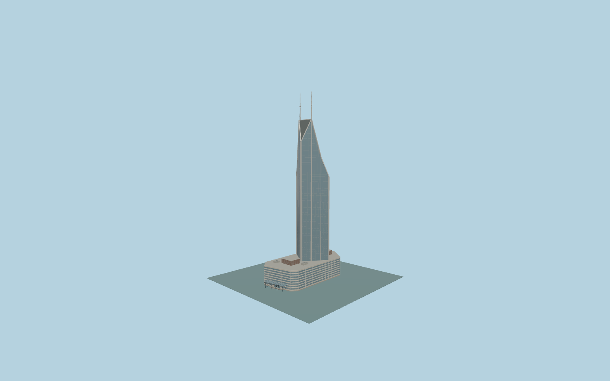

# Shimao International Plaza

Complete Shimao hotel/mall:triangular blue-gray glazed tower with pale vertical/diagonal spines,sloping lower shoulders,recessed triangular crown and twin333.3m spires above the whole low horizontal mall podium,roof pavilions/plant and original lattice entry canopy.

Original source:models/shimao-model.mjs,layout.json and attributed standard map/global-terrain controls. Rebuild with `node packages/worldgen/scripts/generate-shimao-international-plaza.mjs`;append `--check` for exact bytes. Import/LOD commands select `--ids=shimao_international_plaza`. GLBs are ignored outputs.

Five existing shared256px graphs;no private or embedded images. Detailed master and four browser tiers are separate. Actual standard-map hotel POIs and independent tower/spire parts resolve a stored reference point roughly250m south. Whole155.906x76.075m parent is the low mall,not a333m extrusion. Triangular hotel tip faces west(-X),broad wing east(+X);Nanjing Road north(-Z),Jiujiang Road south(+Z).333.3m mast tops,photo-proportional crown/shoulders and reconstructed western lattice canopy establish identity. Roof/facade/canopy inventories and grades are approximate. Native DEM raised urban returns partly bury lower eastern podium floors;no flattening oras-built site-fit certificate is claimed. See model-brief.json and qa.json for scope/current review.

Original geometry uses the repository license. Maps:© OpenStreetMap contributors,ODbL-1.0;Protomaps. Global terrain hashes/attribution:terrain-grid.json. Linked ordinary pictures are not redistributed or used as textures.
