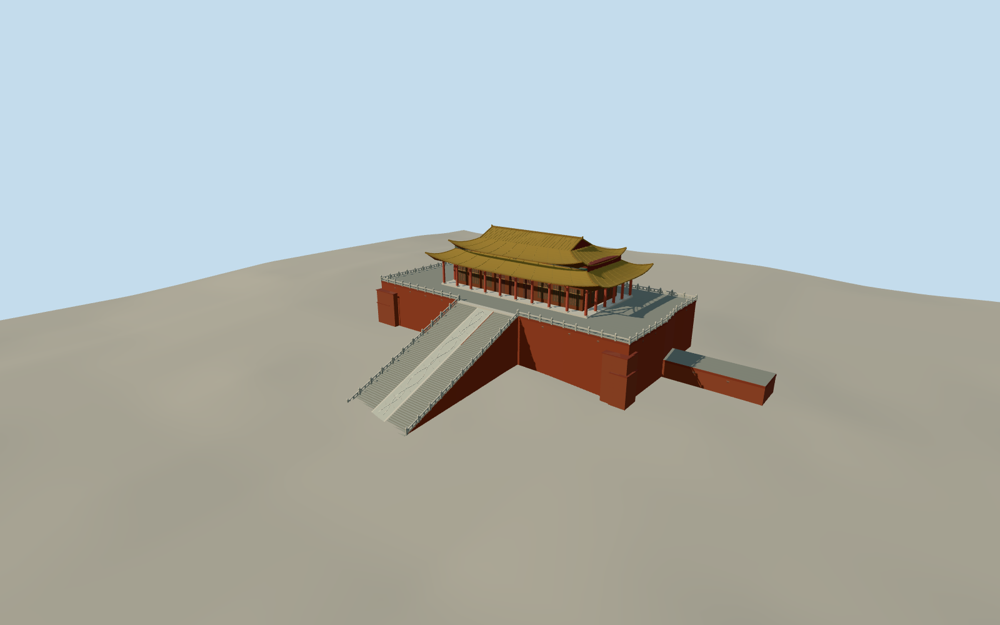

# Dragon Pavilion, Kaifeng

The standing Dragon Pavilion in Kaifeng, its golden double-eaved roof over red columns, raised masonry platform and 72-step stair with a carved dragon ramp.

Authoring state: **review-in-qa.json**. Current completion evidence is in [qa.json](qa.json) and the [completion ledger](../../../../qualla-structures/batches/qualla-003.PROGRESS.md).

- [Dragon Pavilion](https://qualla.com/dragon-pavilion/)

The recognizable exterior covers the standing pavilion, raised red platform, stone balustrades and two 72-step runs with a carved central ramp.

Official total height and platform height are used. Roof curvature, timber bay widths, small ridge figures, eastern lower extension levels and stone relief pattern are estimated from the mapped plan and public-domain photographs.

The original terrain is preserved. It is a coarse elevation field and the platform step levels are approximate. Temporary vegetation, signs and park features outside the named approach are excluded.

Build: `node content/worldgen/source/places/ww/ww1/dragon_pavilion/models/generate-dragon-pavilion.mjs`. Add `--check` to verify exact regeneration. 26316 triangles; 5 materials; no embedded photographs.
