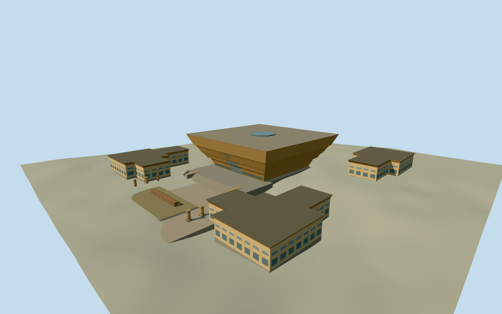

# Shanxi Museum

Taiyuan’s Shanxi Museum, with its four-story bronze-vessel silhouette, a recessed glass east entry, four corner pavilions and stone courtyard columns.

Authoring state: **review-in-qa.json**. Current completion evidence is in [qa.json](qa.json) and the [completion ledger](../../../../qualla-structures/batches/qualla-004.PROGRESS.md).

- [Shanxi Museum](https://qualla.com/shanxi-museum/)

The central roof opening, floor heights, later landscaping and parts of the two rear annexes are proportional interpretations. Individual column carvings are simplified. The neighboring natural history building is a separate structure.

Build: `node content/worldgen/source/places/ww/ww8/shanxi_museum/models/generate-shanxi-museum.mjs`. Add `--check` to verify exact regeneration. 16392 triangles; 7 materials; no embedded photographs.
