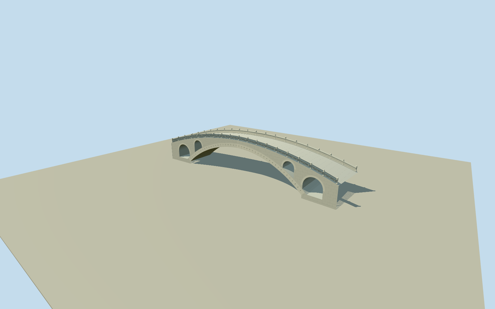

# Anji Bridge

Complete native bowed stone bridge/end outline: true37.37m/7.285mcircular segmental main vault,28parallel limestone ribs, four genuine through open-spandrel arches with sloping extrados sills, convex humpback deck, carved solid balustrades/ball and shaped posts, arch-ring joints/iron butterfly cramps and bounded native end abutments. No river, banks, park or replica. Native outline/engineering main arch controls retained; small-arch/ring/rail sections and exact grade/contact are photographic estimates.

Authoring state: **review-in-qa.json**. Current completion evidence is in [qa.json](qa.json) and the [completion ledger](../../../../qualla-structures/batches/qualla-002.PROGRESS.md).

- [Anji Bridge](https://qualla.com/anji-bridge/)

Original named OSMway564558211/ZhaozhouBridge/Q551446 supplies all8signed bridge-outline vertices, including bowed long sides and flared end cross-sections. Frame follows the midpoint-to-midpoint southwest/northeast axis, not the earlier unrelated road. Native mapped deck/abutment extent is about54m; ASCEreports about50.9mstructural length/37.37mclear main span/7.285mrise/28limestone ribs. Broader64mstory length is not used to stretch this native structural footprint. Native map is not a width/height survey; sections, vault thickness, subsidiary arches, balustrade restoration/detail and footing/host contact remain photographic medium-fi estimates.

All8native plan vertices and the two bowed sides/flared ends are retained. Actual structural extent is about54m in mapping, consistent with ASCEabout50.9mstructural length plus mapped end transitions. The broader64mstory length is not used to stretch the native bridge or adopt adjoining riverbank walls. Native widths are mapping estimates, not an independent survey.

ASCE122.6ftmain span/23.9ftrise/28parallel limestone ribs guide a genuine circular segmental vault. Ring1.12m, deckcrown4.8mabove southwest approach, small arch spans3.0/4.8m and levels, balustrade sections/post forms, footings and crossfall are original medium-fi photographic estimates. All4subsidiary arches are true full-width tunnels with sills following the main extrados.

Exact2272x1704cleared published QuallaZhao1974PublicDomainexterior and native named PD-user dedication have been inspected and bound. The misleadingCC0crop has an explicitCCBYSA3.0Panoramioparent and is excluded; museum replica and other licensed/unknown sources unused. ASCEpage supplies numeric/structural text facts only; no ASCEphotograph or image texture used.

Carved dragon/cloud/vine balustrade relief, ball/shaped caps, voussoir/course/rib seams and small iron dovetails are bounded original geometry. Exact restoration date, panel iconography, individual stone ages, irregular erosion/lichen and fine inscriptions are approximated or omitted. Delicate carving/seams and exact28rib division retire progressively with viewing distance.

Fixed southwest approach[-30,0]/modelY0was chosen before sampling. Main springing is near-4.5m and footings reach-5.25m; riverbed/bank/water and precise original foundations are not reconstructed. Host terrain contact remains unverified, source relief is retained without fitted ground/river slabs, and unrelated park/secondary bridge/boats/visitors are excluded.

Build: `node packages/worldgen/scripts/generate-authored-places.mjs --ids=anji_bridge`. Add `--check` to verify exact regeneration. 40004 triangles; 4 materials; no embedded photographs.
