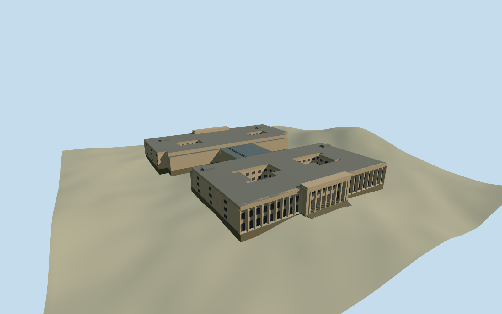

# Hebei Museum

Shijiazhuang’s Hebei Museum, with its historic north colonnade, south portal, Sunshine Hall connection and four open courts.

Authoring state: **review-in-qa.json**. Current completion evidence is in [qa.json](qa.json) and the [completion ledger](../../../../qualla-structures/batches/qualla-004.PROGRESS.md).

- [Hebei Museum](https://qualla.com/hebei-museum/)

Wing heights are estimated from the Qualla facades. Court elevations, side fenestration and roof equipment use simplified geometry. The nearby sports hall and office tower are outside the model.

Build: `node content/worldgen/source/places/ww/wwc/hebei_museum/models/generate-hebei-museum.mjs`. Add `--check` to verify exact regeneration. 3766 triangles; 5 materials; no embedded photographs.
