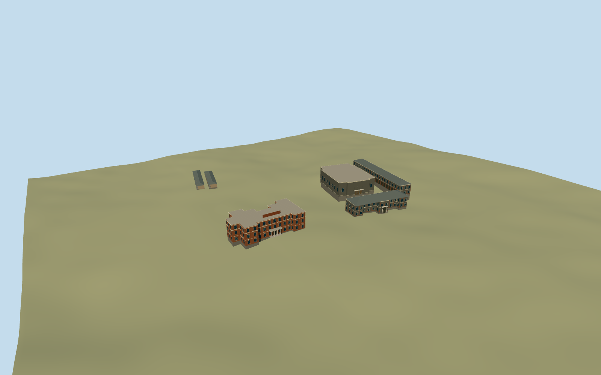

# Tianjin Nankai High School

Old Nankai school campus, including brick Boling and North buildings, Fansun Building, Ruiting Auditorium, and two Xizhai dormitory rows.

Authoring state: **review-in-qa.json**. Current completion evidence is in [qa.json](qa.json) and the [completion ledger](../../../../qualla-structures/batches/qualla-003.PROGRESS.md).

- [Tianjin Nankai High School](https://qualla.com/tianjin-nankai-high-school/)

Current named footprints are preserved. Several rooms and porch projections are simplified in the model.

Roof pitches, window counts, color, exact ornament, porch dimensions and elevations are approximate.

Original terrain remains unmodified. Individual thresholds and paving elevations are not surveyed.

No reference imagery was adopted. The exact publishing provenance of the historic exterior photographs was not confirmed; other Qualla media shows people and classroom interiors rather than the exterior.

Build: `node content/worldgen/source/places/ww/wwg/tianjin_nankai_high_school/models/generate-tianjin-nankai-high-school.mjs`. Add `--check` to verify exact regeneration. 12803 triangles; 8 materials; no embedded photographs.
