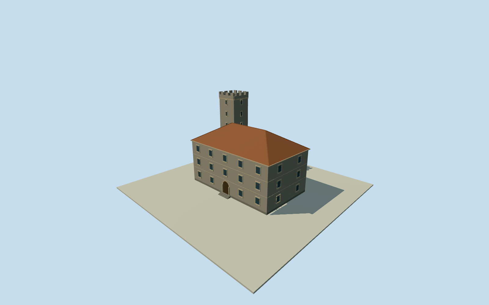

# Qingdao Imperial Observatory — original office and tower

Entire original ImperialObservatory office building and its intrinsic granite crenellated tower, three above-ground storeys/basement-exterior and all pitched tile roof slopes. Whole named original z15quantized numeric way535717632 footprint and same-ID FormerGermanImperialObservatoryPOI, independently boundQ24833163. Municipal heritage construction facts1910-1912/roughgranite/three-storeys/basement/tile-roof/crenellated21.6m tower. Exact tower plan/corner registration/roofpitch/divisions/wallheights/opening census/fittings/finish/grade estimated; no native survey or photographic claim. Independent1931western astronomicaldome/directorhouse/campus structures are separate buildings excluded, no unrelated proxy or current-world replacement.

Authoring state: **review-in-qa.json**. Current completion evidence is in [qa.json](qa.json) and the [completion ledger](../../../../qualla-structures/batches/qualla-002.PROGRESS.md).

- [Qingdao Observatory](https://qualla.com/qingdao-observatory/)

Entire original ImperialObservatory office building and its intrinsic granite crenellated tower, three above-ground storeys/basement-exterior and all pitched tile roof slopes. Whole named original z15quantized numeric way535717632 footprint and same-ID FormerGermanImperialObservatoryPOI, independently boundQ24833163. Municipal heritage construction facts1910-1912/roughgranite/three-storeys/basement/tile-roof/crenellated21.6m tower. Exact tower plan/corner registration/roofpitch/divisions/wallheights/opening census/fittings/finish/grade estimated; no native survey or photographic claim. Independent1931western astronomicaldome/directorhouse/campus structures are separate buildings excluded, no unrelated proxy or current-world replacement.

Municipal primaryheritage construction account supplies1910-1912/roughgranite/threeabovegroundstoreys/basement/beaver-tailtileroof/crenellatedgranitetower21.6m facts. Actual cached municipal paragraph read; direct originalHTTPS timedout and webopenredirectloop, no originalHTML byte claim. Sitealtitude77.76m/780m ambiguity is not buildingheight and does not set sourcefielddatum.

Whole original namedoffice numeric z15way535717632 four-corner footprint/pairedGermanImperialObservatoryPOI preserved and independentlyQ24833163bound. Mapproduct quantization/generalization not a cadastral/nativeOSMnode survey; footprint approximately24.39x14.47m, originalcontrolsretained. Independent1931western astronomydome/directorhouse/latercampusbuildings are separate physical structures excluded; no unrelateddome/campusproxy.

Estimated floor0.45m/providerrelative, main3x3.45mwallheight/3.0mdeepbasement/4.4mhiprise/0.35meaves. Entiremainhiproofprofile/ridgeposition are original reconstructions from pitchedtilefact. Mainwallheight uncertainty1.5m/roofrise1m. Wholeintrinsic7leveltower has reported21.6mheightabovefloor, but its precise7-level divisions/width/position/crownprofile are not supplied. Estimated5.2mNWcornerplan insideexactmapfootprint, horizontal tower registration uncertainty6m, width uncertainty25percent. No photograph-derived corner/roofplan or exactheight survey.

Estimated towerdeck20.15mabovefloor, continuous0.75mparapet with0.7mmerlons completing reported21.6mheight; merlon/openingcensus/profiles/stonecopings/drains/doors/windowcensus/frames/quoins/arch/mouldings/sill/roofseams/materialfinish/colors/grade are simplified estimates. Wholeofficeallfourfacades, allroofslopes/basementexterior and entireintrinsictower/crown retained, not a facade strip. No rooms/instrument/interior/poetryplaque/copiedartwork.

Original independent128m/16641height field and originaltiles acquired before floor/mainsections; datum68.1867m. Preserve frame/field/floors/mainsections through review; no terraincutout/flatten/mask/refetch/refit for pictures. Providerhill/canopy/building elevation offsets may overlaplowerwalls/floatfoundation; geographicgroundcontact andverticalregistration remain approximate/unverified. Dated2021historicaloffice preview, no current-worldreplacement.

Qualla first40families/0conflicts. All photographs/figures/videos/drawings unused, including attribution-onlymodernoffice, ambiguousoldpublication/creator images, unrelatednebula/portraits/marinebiologybuilding. Primarywrittenfacts and independentnumericmap only; no imagegrant/rightsrepair/photo trace or photographic fidelity claim.

Build: `node content/worldgen/source/places/ww/wwm/qingdao_observatory/models/generate-house.mjs`. Add `--check` to verify exact regeneration. 5299 triangles; 6 materials; no embedded photographs.
