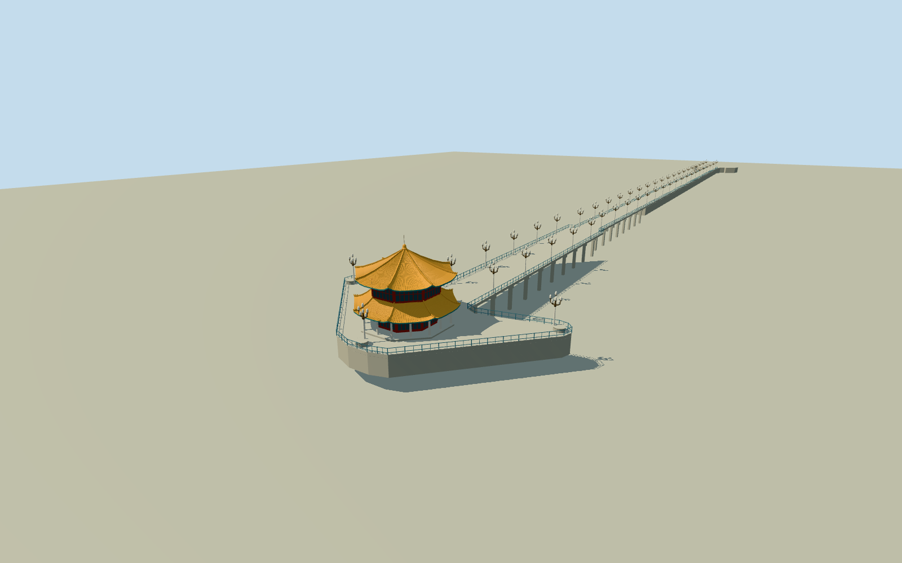

# Zhanqiao Pier

Complete native Zhanqiao Pier: stone retained shore approach, open southern bridge/discrete supports and enlarged stone head, two-storey octagonal Huilan Pavilion with swept orange-glazed double roofs, finial/red lattice/white open lower colonnade/teal bracket bands, blue perimeter rails and six-light ornamental white/bronze posts. Original native pier/roof plans, photographic estimated sections, no natural sea/shore or city/visitors/signs.

Authoring state: **review-in-qa.json**. Current completion evidence is in [qa.json](qa.json) and the [completion ledger](../../../../qualla-structures/batches/qualla-002.PROGRESS.md).

- [Zhanqiao Pier](https://qualla.com/zhanqiao-pier/)

Four exact original OSMwaypayloads establish named Zhanqiao1474305748pier plan, octagonal Huilan131985941and two roof outlines1526319733/734. Original coordinates retained, no basemap quantization. Anchor native octagon vertex mean; signed axis from longest straight pier edge. The mapped pier envelope is about400m rather than the often stated440mnominal length; preserve actual native coordinates without stretching to prose. Native roof-part5/10mheight tags are coarse shape estimates; photographic swept sections and upper finial remain explicitly estimated.

Current permanent architectural form interpreted from exact2009own-photographerCC0original after Qualla-first inspection: original image bytes, matching2018FlickreviewR2transfer and present primary ImageObjectCC0release are saved; immutableNSID matches both primary creator records.1914pre-pavilion imagery, unknown historic sources,1988aerial/1931plans, attribution-licensed modern images and unrelated subjects are unused. No photographic textures or copied painted designs/text/brands/visitors.

Exact pier and three octagonal roof/building ways are retained. Roof-height5/10mmap tags are coarse estimates, not survey; swept eave/ridge sections and finial reach14.4mplus thin lightning rod16.1mabove shore datum by photographic interpretation. White16column portico, red/dark lattice windows, teal/gold abstract bracket bands and original symbolic ridge ornaments are representative. Hidden elevations/paintings/inscriptions and precise tile/column/lantern census are not claimed.

Northern retained approach, southern open sea bridge and enlarged stone head are all modeled. The150mapproximate open span has discrete8mbents/two legs, not a continuous solid wall. Foundation depths/caps, pier-deck level, head masonry/turrets/access-stair details, blue rail subdivisions and six-light lamp spacing/sections are photographic medium-fi estimates. Far LODs simplify supports/roof curvature/windows and group lamp repeats; nominal440mprose does not override the roughly400mnative footprint.

Temporary2026conservation closure/scaffolding is excluded; model represents permanent extant heritage architecture, not a live worksite. Nearby lighthouse/museum/shore promenade/buildings, natural water/beach/earth/vegetation, banners/boats/visitors and pavilion exhibitions are outside scope.

Fixed paved northern shore approach precedes terrain acquisition. Deck top.25mrelative to shore datum, modeled lower supports to-6.4m; these are bounded structural estimates, not surveyed tidal/seabed elevations. Raw terrain preserved without flattening/fitting; isolated inspection groundY-6.8does not certify precise host water/ground contact. No natural sea/shore slab.

Build: `node packages/worldgen/scripts/generate-authored-places.mjs --ids=zhanqiao_pier`. Add `--check` to verify exact regeneration. 53870 triangles; 6 materials; no embedded photographs.
