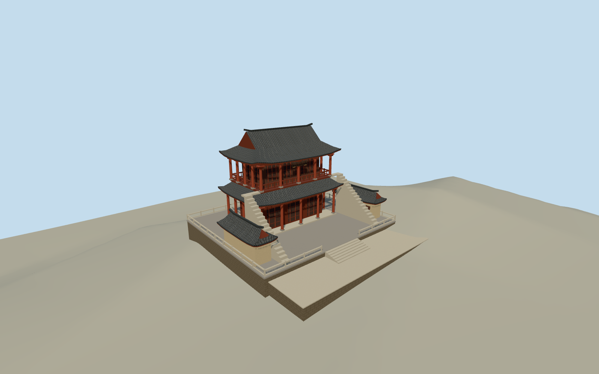

# Penglai Pavilion

The central two-storey Penglai Pavilion on Danya Hill, with gray upturned eaves, timber balconies, flanking rooms and a stone terrace, circa 1925.

Authoring state: **review-in-qa.json**. Current completion evidence is in [qa.json](qa.json) and the [completion ledger](../../../../qualla-structures/batches/qualla-003.PROGRESS.md).

- [Penglai Pavilion](https://qualla.com/penglai-pavilion/)

The reconstruction depicts the central Penglai Pavilion, its stone terrace and the paired flanking rooms, circa December 1925. Nearby temples and harbor walls are outside this model.

The main pavilion uses the 14.80 m by 9.65 m lower gallery dimensions given by the county gazetteer; the Shandong heritage survey gives a depth of 9.85 m. Bay spacing, side rooms, stairs, bracket detailing and timber tint are estimated.

The larger mapped enclosure sets the alignment. The hall position within it is approximate. Elevations were sampled from a 30 m terrain source and the original landform is preserved.

Build: `node content/worldgen/source/places/ww/wwt/penglai_pavilion/models/generate-penglai-pavilion.mjs`. Add `--check` to verify exact regeneration. 11056 triangles; 5 materials; no embedded photographs.
