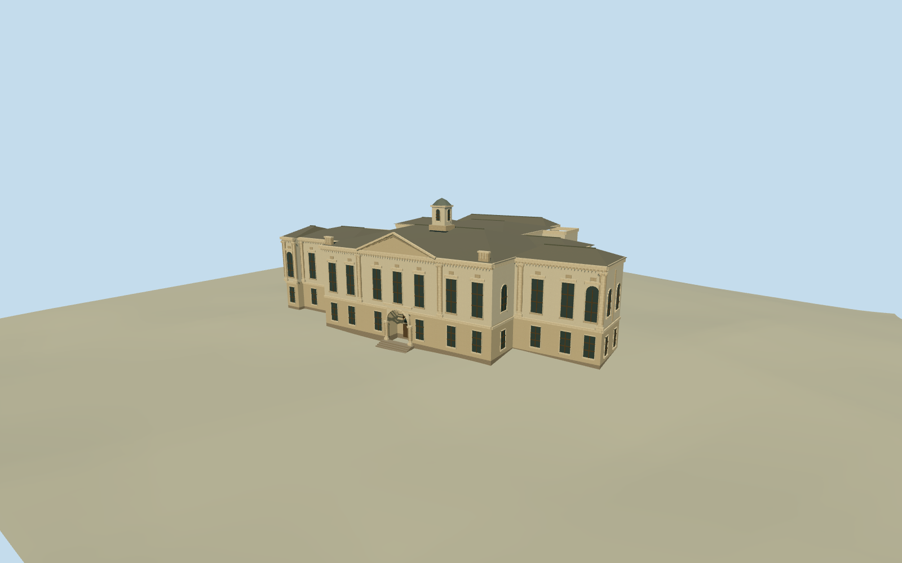

# Lüshun Museum Main Building

The historic Lüshun museum building with a tall classical north façade, an arched entrance and a small central cupola.

Authoring state: **review-in-qa.json**. Current completion evidence is in [qa.json](qa.json) and the [completion ledger](../../../../qualla-structures/batches/qualla-004.PROGRESS.md).

- [Lushun Museum](https://qualla.com/lushun-museum/)

Covered north entrance, projecting bays and central tower follow the 1925 photographic evidence. Rear wall heights, paint tones and small sculptural details are approximate.

The model covers the protected former Kwantung Government Museum and attached ranges. The later separate museum building is outside the placement.

Build: `node content/worldgen/source/places/ww/wwy/lushun_museum_main_building/models/generate-lushun-museum-main-building.mjs`. Add `--check` to verify exact regeneration. 12740 triangles; 7 materials; no embedded photographs.
