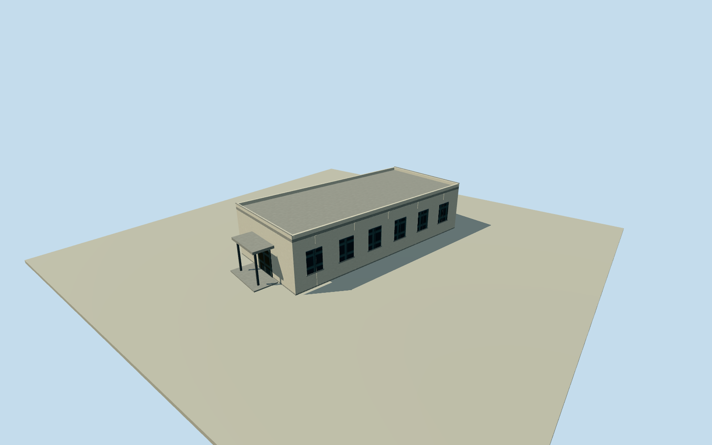

# Datong memorial exhibition hall reconstruction

Best-effort exhibition-hall reconstruction at the published Datong memorial exhibition POI. Original nearest9x19.55m numerical roof outline retained. Association to the exhibition POI4.58m outside its south edge is probable and explicitly unverified; height, flat roof, doors, windows and exact era are original estimates. This is the bounded building visualization, not a measured model of the337000m²memorial grounds, underground galleries or3500m²aggregate exhibit area. Original full Overture record52ec1fd1-44a2-4af2-8bac-4b98f9e8c039 supplies the unchanged four-corner9x19.55m roof. Amap exhibition POI is4.58m outside the south roof edge: probable but unverified building association. Museum-register address and first-party grey-white exterior observation support site context. No claim of exact physical identity, roof height, storeys or gallery capacity. Original medium-fi interpretation: one storey, flat concrete roof/parapet, pale rendered walls, dark glazed windows, south double entrance, modest canopy and foundation. Height4.2m above floor0.25m, foundation-1.25m, roof thickness0.24m and details are original estimates.3500m²reported exhibit area and337000m²site area are not extruded into an invented giant hall. Underground galleries, remains and natural terrain are outside this bounded building exterior. Own independent256m129x129 source field acquired before floor/sections. Original geographic outline and source elevation values retained; exact source date/DEM-grade registration and engineered building bench are approximate. No flattening, terrain mask or displacement of source rings. All imagery unused, including questionable1966entrance photograph and book reproductions. Four authored levels preserve the complete original footprint and estimated whole roof/walls/entrance canopy; near levels add window reveals, mullions and parapet caps. Historical approximation2024/currentWorldEligiblefalse, not a verified current as-built memorial.

Authoring state: **review-in-qa.json**. Current completion evidence is in [qa.json](qa.json) and the [completion ledger](../../../../qualla-structures/batches/qualla-002.PROGRESS.md).

- [Datong Mass Grave Memorial](https://qualla.com/datong-mass-grave-memorial/)

Best-effort exhibition-hall reconstruction at the published Datong memorial exhibition POI. Original nearest9x19.55m numerical roof outline retained. Association to the exhibition POI4.58m outside its south edge is probable and explicitly unverified; height, flat roof, doors, windows and exact era are original estimates. This is the bounded building visualization, not a measured model of the337000m²memorial grounds, underground galleries or3500m²aggregate exhibit area.

Original full Overture record52ec1fd1-44a2-4af2-8bac-4b98f9e8c039 supplies the unchanged four-corner9x19.55m roof. Amap exhibition POI is4.58m outside the south roof edge: probable but unverified building association. Museum-register address and first-party grey-white exterior observation support site context. No claim of exact physical identity, roof height, storeys or gallery capacity.

Original medium-fi interpretation: one storey, flat concrete roof/parapet, pale rendered walls, dark glazed windows, south double entrance, modest canopy and foundation. Height4.2m above floor0.25m, foundation-1.25m, roof thickness0.24m and details are original estimates.3500m²reported exhibit area and337000m²site area are not extruded into an invented giant hall. Underground galleries, remains and natural terrain are outside this bounded building exterior.

Own independent256m129x129 source field acquired before floor/sections. Original geographic outline and source elevation values retained; exact source date/DEM-grade registration and engineered building bench are approximate. No flattening, terrain mask or displacement of source rings.

All imagery unused, including questionable1966entrance photograph and book reproductions. Four authored levels preserve the complete original footprint and estimated whole roof/walls/entrance canopy; near levels add window reveals, mullions and parapet caps. Historical approximation2024/currentWorldEligiblefalse, not a verified current as-built memorial.

Build: `node content/worldgen/source/places/wx/wx0/datong_mass_grave_memorial/models/generate-house.mjs`. Add `--check` to verify exact regeneration. 1140 triangles; 4 materials; no embedded photographs.
