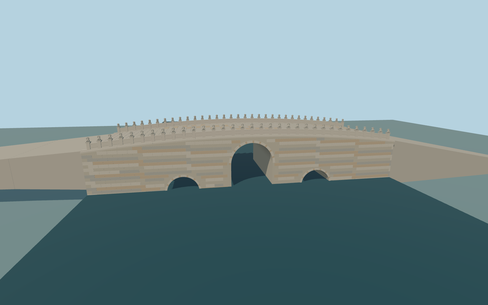

# Baliqiao (Yongtong Bridge)

Historic three-arch stone bridge with a tall narrow central opening, two small side arches, gently raised restored slab deck, ashlar/arch rings, solid carved parapet panels and33 paired sitting-lion posts.

Original deterministic source: models/baliqiao-model.mjs, alignment.json, ordinary-picture observations and retained standard viewer PMTiles/terrain. Rebuild with `node packages/worldgen/scripts/generate-baliqiao-bridge.mjs`;append `--check` for exact bytes. Targeted import/LOD commands select `--ids=baliqiao`. GLBs are ignored outputs.

Two existing shared256px stone graphs in three material groups,no private textures. Detailed master and four browser tiers are separate. The50m stone body and bounded native-fitting paved tails are distinct from the149m generalized mapped approach line. All three tunnels remain open. The66 sculpted lions are original stylized reconstructions,not replicas of individual historic carvings. Exact bridge/bank grades,original foundations and water levels remain approximate. See model-brief.json and qa.json for current scope and acceptance.

Original geometry uses the repository license. Map controls: © OpenStreetMap contributors,ODbL-1.0;Protomaps basemap. Raw global terrain hashes/attribution are retained in terrain-grid.json. Linked photos are references,not redistributed or used as textures.
