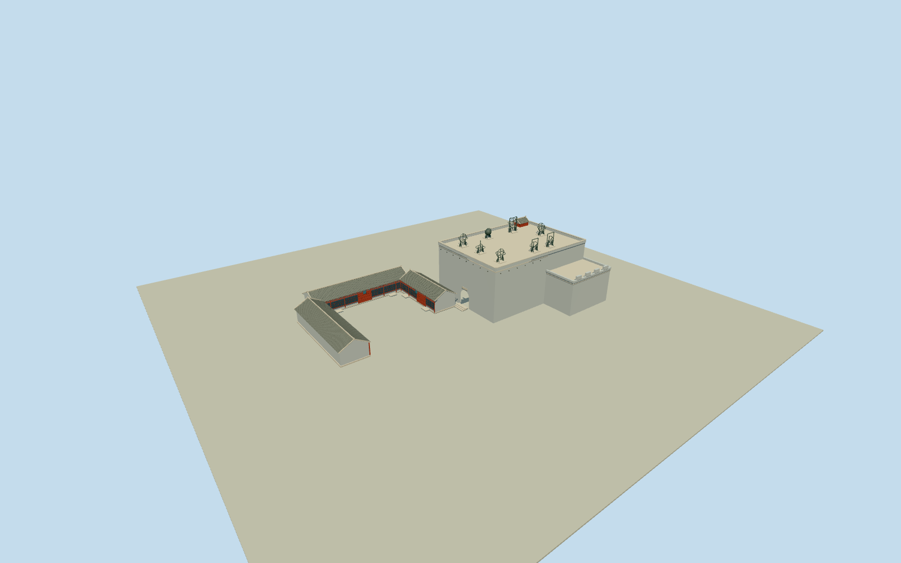

# Beijing Ancient Observatory

Complete historic observatory architecture: native8vertexTplatform/wall/stair envelope with14mcentraldeck/lowerattachedcrenellatedwalls, real arched entry and closed red arched door, cornice/scuppers/lowplainparapet/boundedsteps/stairhead;8distinct bronze Qinginstrument silhouettes, plus3explicitly estimated lowwestcourtyard grey-tiled red timber halls/blue-green eaves/doors/lattice. Native plan only controls platform; courtyard footprints and concealed details remain estimates, no surveyed low-hall positioning claim.

Authoring state: **review-in-qa.json**. Current completion evidence is in [qa.json](qa.json) and the [completion ledger](../../../../qualla-structures/batches/qualla-002.PROGRESS.md).

- [Beijing Ancient Observatory](https://qualla.com/beijing-ancient-observatory/)

Exact named nativepoint269693885/Q439299lies within the T-shaped historicplatform/wallway412429961(building=ruins); all8distinct parent vertices retained. This is the high observatory/attached wall and stair envelope, not a whole-site museum footprint or an exact instrument-deck survey. Operator/government/UNESCOtext gives about14mplatformheight and23.9x20.4minstrumentdeck, differing from combined nativeT-envelope; these are not used to stretch/replace native parent corners. Photo-inferred central high-deck/lowattachedwall/stair splits and unmapped west courtyard mainhall/two wings are explicit geometric estimates. NorthwestLway478407350has no identifying museum/historic tag and is not adopted; ChineseCustomsMuseumways637237605/606and city transport infrastructure are separate and excluded.

Operator text establishes mainhall/east-westwings, two exact cleared courtyard hall photos establish tiled red-timber/greybase architecture, native tower fixes relative east anchor. Low hall positions/footprints and unseen gallery/roof/door subdivisions are explicitly estimated, not native surveyed control polygons. Preserve open space between these three hall ranges. The estimatedeastwing ends north of the photographed west tower entry, preserving its clear approach rather than blocking the arch with an unverified hall.

Operator/governmenttextabout14mplatformheightand23.9x20.4minstrumentdeckdescribe the observing structure, not the full nativeTwall/stair envelope. Native parent corners are unchanged;14mcentralmass/9.2mattachedends/stairhead division, exact parapet/cornice/arch/stair sections and auxiliary hall elevations are photographic estimates. No surveyed low-hall positions, hidden roof/room layout or precise grade/threshold/host contact claim. Unassigned northwestLbuilding and neighboring ChineseCustomsMuseum excluded.

All8intrinsic Qingrooftop instruments represented distinctly: equatorial/ecliptic/elaboratearmillary rings, celestialglobe, sextant, horizoninstrument, quadrant andaltazimuthframe. Operatorheights set scale. Exact orientations/positions, ring thickness/counts, engraved scales and old dragon/cloud/frame sculpture anatomy are medium-fi estimates from small cleared tower photos and text; no precision operational optics/astronomical simulation. Detached garden replica/instrument collections and interior exhibits are not included.

Qualla-first3publishedPD-selforiginals and4explicit samecreator2006PD-selftower/courtyard originals inspected; nativeSHA1andprimaryauthorrelease agree. ConflictingheroEarthMoon/statuealias, otherlicensedimages, photographedlayoutwithunknownunderlyingrights, SanFranciscoreplica, unrelatedTempleofHeaven/nebula/embassy images unused. Officialoperator/governmenttextfacts only, no pageimages; no photographic texture. Older paint/fine roof/door details may differ from current restoration.

Grey brick/stone shared surfaces, grey cylindrical tiles/pale copings, red timber lattice and blue-green courtyard eaves/closed red arch doors carry identity. Exact plaque lettering/carved roof ornaments and small fixture counts simplified; no reproduced indoorart, garden sculpture, ACunits/utilitywires/flags, landscape/trees/roads/bridges/subway/vehicles/visitors. Raw terrain retained without flattened/fitted entire-site ground.

Build: `node packages/worldgen/scripts/generate-authored-places.mjs --ids=beijing_ancient_observatory`. Add `--check` to verify exact regeneration. 39114 triangles; 6 materials; no embedded photographs.
