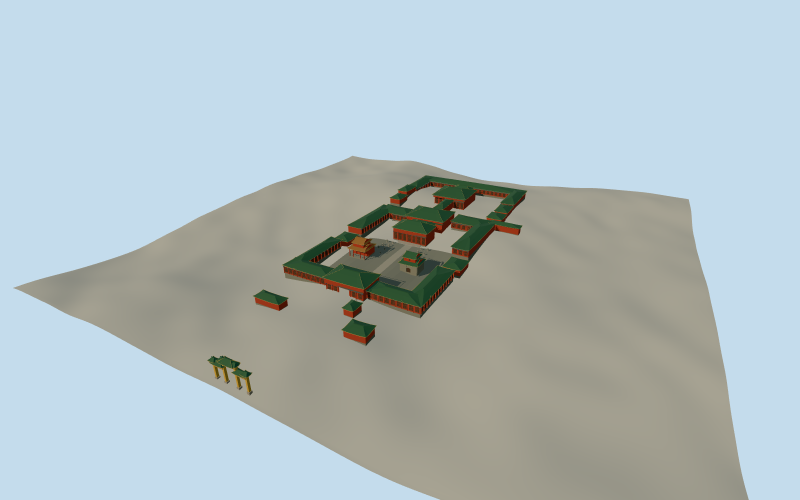

# Beijing Dongyue Temple

Dongyue Temple in Beijing in 2023, with linked central halls, green tiled courtyard galleries, the distinct bell and drum towers, and the glazed paifang across Chaoyangmenwai Avenue.

Authoring state: **review-in-qa.json**. Current completion evidence is in [qa.json](qa.json) and the [completion ledger](../../../../qualla-structures/batches/qualla-003.PROGRESS.md).

- [Beijing Dongyue Temple](https://qualla.com/beijing-dongyue-temple/)

Native OpenStreetMap controls establish sixteen compound building envelopes. Main roof breaks, axial openings, woodwork, minor roof finishes, steps and floor and ridge elevations are inferred from the cleared photographs and written descriptions.

The seven-roof Ming paifang is placed approximately at the mouth of Shenlu Street, across Chaoyangmenwai Avenue. Authorities give its overall width and approximate height. Its depth and small moulding profiles are estimated.

Representative stele positions and exterior paving are simplified. Interior exhibits, carved inscriptions, statues, foliage and minor fixtures are outside the modeled scope.

Foundations follow the frozen original source field with local averaging per building. Terrain samples do not resolve individual courtyard steps or foundation heights.

Build: `node content/worldgen/source/places/wx/wx4/beijing_dongyue_temple/models/generate-beijing-dongyue-temple.mjs`. Add `--check` to verify exact regeneration. 29802 triangles; 6 materials; no embedded photographs.
