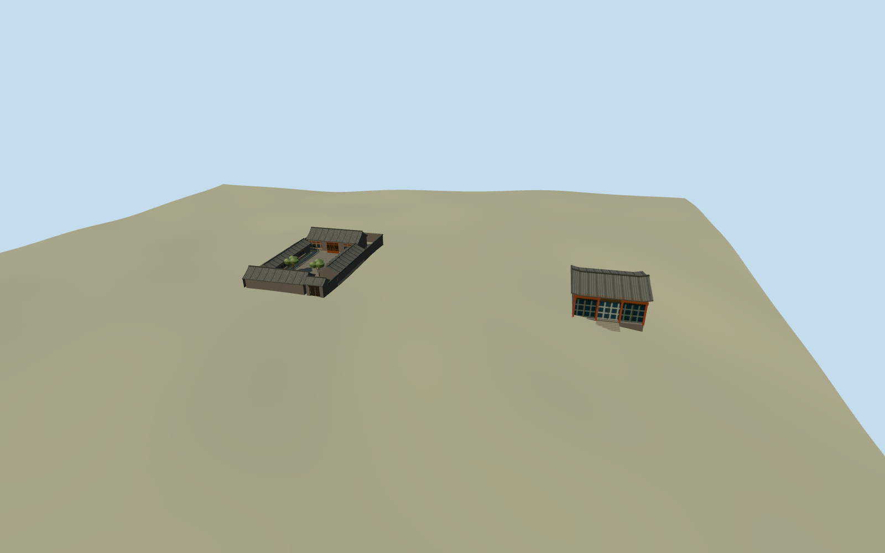

# Beijing Lu Xun Museum

The historic west siheyuan, black No. 21 entrance, short rear study and three-bay tiled entrance pavilion at Beijing Lu Xun Museum.

Authoring state: **review-in-qa.json**. Current completion evidence is in [qa.json](qa.json) and the [completion ledger](../../../../qualla-structures/batches/qualla-003.PROGRESS.md).

- [Beijing Lu Xun Museum](https://qualla.com/beijing-lu-xun-museum/)

The rooms are placed according to the museum’s documented order, the mapped roof axes and the distinct location pin for the former residence. House bay dimensions, rear fence, roof profiles and subdivision of shared neighborhood roofprints are approximate.

The standing east exhibition pavilion follows its mapped roofprint and the two 2023 creator-released exterior photos. Details of its back, steps and interior facings are simplified. The separate eastern buildings, interiors, decorative inscriptions and sculpture are outside the modeled scope.

Build: `node content/worldgen/source/places/wx/wx4/beijing_lu_xun_museum/models/generate-beijing-lu-xun-museum.mjs`. Add `--check` to verify exact regeneration. 15858 triangles; 7 materials; no embedded photographs.
