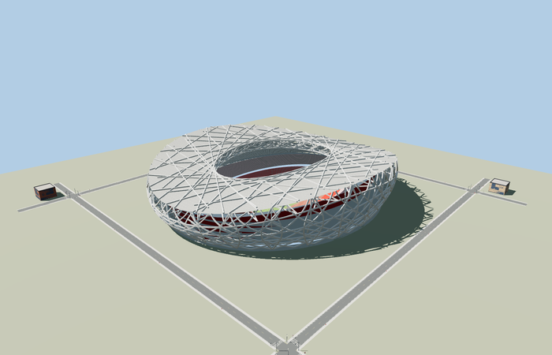
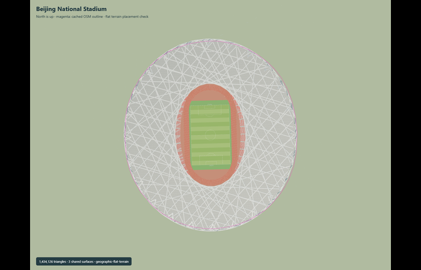

# Beijing National Stadium

Reviewed2026-10-31. **Detailed master preserved;four budgeted browser tiers and retained approximate geographic scope accepted.**

Inspected71 current images:12 portable and12 shared-material views of the preserved detailed master,28 Earth/context/LOD frames and19 actual Molen runtime-cutout views. All four browser tiers retain the saddle,24 primary support units,open crisscross pale steel,red inner bowl,three seating tiers,fixed oval roof opening,track and depressed field. District diagonal density was increased after the first images;upper seating boundaries now join continuously. Street groups19 tread levels and has coarse stair flights;closeup retains89 row bands,80 secondary facade ribbons,roof truss webs,selected secondary roof lines,two screens and grouped stair treads. The close-view roof and rails are deliberately simpler than the master. Forced-close distant levels show faceting,sparser ribbons and visible detail switches;fine steel aliases at some angles.

Three existing shared256px metal_painted,concrete_plain and membrane graphs,with metric UVs and linear vertex colors. Seating,track,turf and dark screens use local PBR palette factors. No private or embedded images. Five draws in skyline/district,six in street/closeup. Every used shared graph is read once in each loaded fixture. The opaque browser membrane aggregates the detailed clear ETFE/acoustic PTFE layers. This is a declared browser approximation;the master remains unchanged.

| Level | Triangles | Bytes | Draws |
| --- | ---: | ---: | ---: |
| skyline | 890 | 71568 | 5 |
| district | 3520 | 274584 | 5 |
| street | 15932 | 1174408 | 6 |
| closeup | 63512 | 4628132 | 6 |

Preserved detailed source master:1,434,126triangles /134,021,220bytes. Browser triangles 890 / 3520 / 15932 / 63512,bytes 71568 / 274584 / 1174408 / 4628132. Initial skyline+district 346152bytes;closeup 4628132bytes. All four ceilings and eight-draw limits pass. POSITION/NORMAL use separate GPU streams. Error values8/4/2/1m are authoring estimates,not certified Hausdorff measurements. Physical phones/laptops and downtown timing remain unmeasured.

Exact mapped pitch polygon area centroid sets origin and its southward long axis sets heading. Published structural envelope matches the orthographic mapped outline within the documented mapping discrepancy. Native Y0 is the plaza; the below-grade athletics floor is protected by the terrain cutout. Retained anchor[116.39027285127406,39.99141197188173],heading0.02719713994063493 and native+Z south are unchanged. Existing exact-QID mapped envelope and pitch-axis controls remain the basis. The original hand-mapped footprint/published-envelope discrepancy and approximate plaza-to-field height remain explicit;no new PMTiles/DEM or geodetic survey is claimed.

Actual Molen structure,terrain,worldgen and shared-material rendering on a synthetic flat plaza datum. The selected stadium shell is replaced while four independent building records and four roads remain unchanged. All1089raw heights and outside-ground probes remain unchanged. At every loaded tier the covering ground is cut above the depressed field and all120inset cutout-edge probes hit the plaza atY0(master) orY0.01(browser). The center turf/marking height lies betweenY-5.05 andY-4.90. Hide/show restores then removes pitch ground. Failed loading retains all five procedural building records and four roads;unload restores original ground geometry and leaves zero live model/support geometries. This proves scoped transform/cutout/lifecycle behavior,not Beijing terrain accuracy or current surrounding buildings.

## Reconstruction limits

- This is an architectural reconstruction of the final fixed-roof exterior, not a shop-drawing inventory of every welded junction. Secondary steel plane families, connection phase and stair flights preserve the designer’s construction logic but are reconstructed from the published drawings/photos. Individual seat counts, temporary event overlays and inaccessible service interiors are excluded. Native field grade is scaled from the engineer section; the7.1m basement story is a separate published dimension. The open red concrete bowl, gray1.2m bands,24leaf supports and saddle envelope are explicit mesh geometry.
- Original detailed source and imported design-time master remain byte-identical. Four separately authored browser levels retain the saddle envelope,24 primary support units,open crisscross lattice,red inner bowl,three seating tiers,oval fixed-roof aperture,athletics track and below-plaza field. Distant ribbons are wider and seating is aggregated;small welded junctions,individual seats,handrails and private service rooms remain outside browser detail.
- Skyline uses24 perimeter facets and double-sided broad ribbon faces;district36 facets and reduced square-section ribbon families;street60 facets,19 grouped tread levels and sloping stair flights;closeup80 facets,all89 row bands,24 diamond supports,80 secondary facade ribbons,selected roof web/secondary lines and grouped stair treads. Individual seat counts and fine steel phasing remain source approximations.
- Three existing shared256px painted metal,plain concrete and membrane graphs use metric UVs. Seating,turf,track and screens use local palette factors. No private or embedded images. The browser roof aggregates the transparent ETFE/acoustic PTFE system into opaque pale membrane faces;its fixed oval aperture stays open. This is a deliberate browser representation;the detailed master retains the layers.
- Retained mapped pitch centroid[116.39027285127406,39.99141197188173],heading0.02719713994063493 and native+Z south remain unchanged. Native plazaY0 and fieldY-5 are retained architectural relative grades,not a new terrain or geodetic survey. Existing120-point elliptical cutout remains enclosed by the plaza annulus at every browser tier. No new bespoke reference or terrain fetch.
- LOD error values8/4/2/1m are authoring estimates rather than certified whole-mesh Hausdorff errors. Faceting,coarse distant ribbon density,grouped treads and static transitions remain visible when tiers are forced close. Physical phone/laptop and downtown timing remain unmeasured.

## Reproduction

`node packages/worldgen/scripts/generate-stadium-models.mjs --ids=beijing_national_stadium --check`

`node packages/worldgen/scripts/import-structure-models.mjs --ids=beijing_national_stadium --check`

`node packages/tooling/scripts/generate-landmark-lods.mjs --ids=beijing_national_stadium`

`pnpm exec vitest run test/birds-nest-browser.test.mjs` from packages/tooling. All passed. Six current GLBs have zero Khronos errors/warnings. Current scene validates and simulates30ticks with zero events.
