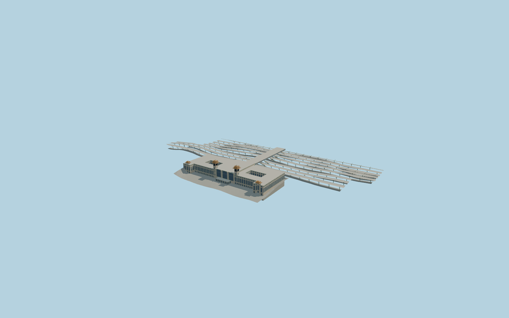

# Beijing railway station

Beijing Railway Station with its paired clock towers and glazed roofs, three recessed main windows, full passenger wings, two open courtyards, eight open platform-roof rows, raised passenger connector and fitted entrance apron.

Rebuild: `node packages/worldgen/scripts/generate-beijing-railway-station.mjs`;append `--check` for exact source bytes. Select import/LOD/placement with `--ids=beijing_railway_station`. Detailed source and four browser tiers are separate ignored GLB outputs.

Forecourt and platform elevations are visual estimates from the mapped plan and standard terrain. The platform roofs use locally fitted support heights and retain the eight modeled rows and existing rail gaps.

The model depicts the permanent passenger exterior. Fine thresholds, hidden rooms and temporary works are approximate or outside the model scope.

Original geometry:repository license. Map:© OpenStreetMap contributors,ODbL-1.0;Protomaps. Standard terrain:terrain-grid.json. Ordinary pictures stay local and are not redistributed or used as textures. Current acceptance:qa.json.
