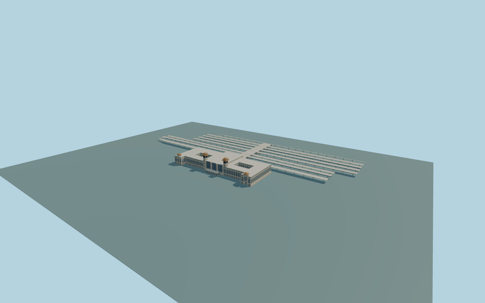

# Beijing railway station

Complete permanent Beijing railway station passenger ensemble: monumental north facade, both square clock towers with three-tier glazed Chinese roofs and finials, deep central glazed bays and rounded columns, full lateral wings and corner roof pavilions, two genuine courtyard voids, all mapped canopy bounds represented by open platform-roof wings, and the elevated connector with stairs. Preserve the native forecourt, independent service buildings, streets, rails and urban context. Exterior only; no copied signs, lettering, branding, figurative ornament, people, trains or navigable interior.

Rebuild: `node packages/worldgen/scripts/generate-beijing-railway-station.mjs`;append `--check` for exact source bytes. Select import/LOD/placement with `--ids=beijing_railway_station`. Detailed source and four browser tiers are separate ignored GLB outputs.

Complete permanent Beijing railway station passenger ensemble: monumental north facade, both square clock towers with three-tier glazed Chinese roofs and finials, deep central glazed bays and rounded columns, full lateral wings and corner roof pavilions, two genuine courtyard voids, all mapped canopy bounds represented by open platform-roof wings, and the elevated connector with stairs. Preserve the native forecourt, independent service buildings, streets, rails and urban context. Exterior only; no copied signs, lettering, branding, figurative ornament, people, trains or navigable interior.

All architectural heights and grades are original photo-proportioned controls because scoped map families have no numeric height fields. Layer1/2/3 values are retained as map facts, not heights. Closed main floor+.65m and foundation-10m share one unchanged host datum. Wings21.5m,central24.5m,clock finials43.3m,corner roofs27.8m; open canopy centres6.4m/eaves7.8m and connector floor4m/roof7.2m. Preserve open courtyards and rail/sky spaces; no blanket parent or canopy ground floor and no per-part host offsets. One unchanged standard field sample outside the north entrance[-12,-57],48.08290055999999m,defines one common Y=0. Native contact still requires current render review.

Two adequate ordinary front and selected-platform photographs inspected. Full map outlines and two court holes are retained. Hidden rear windows, canopy module inventory/sky-slot widths, detailed roof ornament and current renovation phase remain medium-fi approximations. The eight canopy rows are regularized around native rail gaps plus two inferred edge rows; they are not a surveyed inventory. The central facade is regularized to preserve all three photographed glazed bays. Exact hidden ornament, thresholds, platform levels and present works remain approximate. No copied lettering or photographic textures. Physical-device timing and numerical LOD errors remain unmeasured.

Six existing shared256px limestone,granite,glazed-tile,painted-metal,corrugated-metal andwindow-grid graphs. Six merged semantic groups,metric UVs andlinear colours,no embedded or private textures. Skyline preserves the full passenger mass,clock silhouettes,courts andallcanopyrows. District addscoarsepanes;street addsrealrecesses;close-up addsroofcurves,branchsupports,clocks andstairs;master separatelyrefinesframes andcurves. LODerrors areestimates.

Original geometry:repository license. Map:© OpenStreetMap contributors,ODbL-1.0;Protomaps. Standard terrain:terrain-grid.json. Ordinary pictures stay local and are not redistributed or used as textures. Current acceptance:qa.json.
