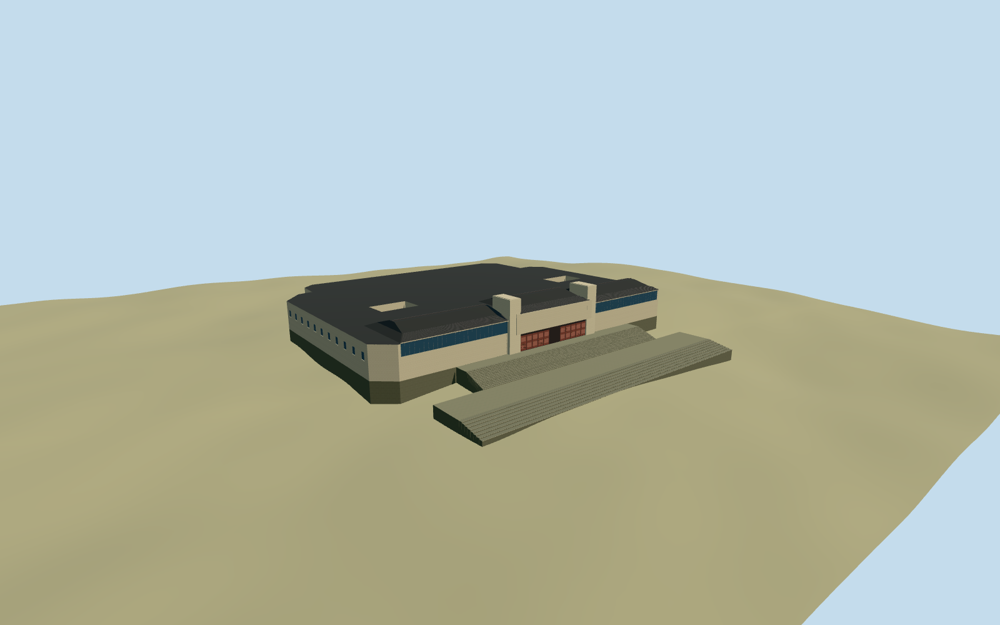

# Museum of the War of Chinese People's Resistance Against Japanese Aggression

The Wanping museum with its paifang entrance, cream stone pylons, dark tiled wings and two approach stairs.

Authoring state: **review-in-qa.json**. Current completion evidence is in [qa.json](qa.json) and the [completion ledger](../../../../qualla-structures/batches/qualla-003.PROGRESS.md).

- [Museum of the War of Chinese People's Resistance Against Japanese Aggression](https://qualla.com/museum-of-the-war-of-chinese-people-s-resistance-against-japanese-aggression/)

The southern entry and adjacent wings are based on the published CC0 photograph. Roof levels behind the façade, wall heights, window divisions, steps and materials are approximated.

Only the main standing museum and its stair approach are modeled. Interior halls, underground additions, flags, signs, landscaping, reliefs and separate monuments are outside scope.

Build: `node content/worldgen/source/places/wx/wx4/beijing_resistance_museum/models/generate-beijing-resistance-museum.mjs`. Add `--check` to verify exact regeneration. 1889 triangles; 6 materials; no embedded photographs.
