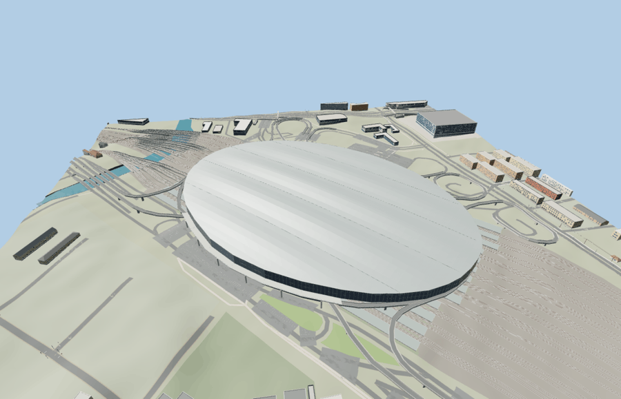

# Beijing South Railway Station

The oval roof, layered glazing, curved approach deck and thirteen separate platform islands with stairs remain visible at the expected detail levels. The train corridors stay open below the upper glazed shell.

The southern forecourt remains the common 45.72 m station datum. Local grades meet both passenger entrances and leave the thirteen platforms about one metre above the track bed. The viewer replaces the mapped station shell and keeps the other 44 buildings and all 236 road and rail records in the focused fixture.

Failed loading preserves the native layers. Eviction restores the ground and releases model geometry.

| Detail level | Triangles | Download bytes | Draws |
| --- | ---: | ---: | ---: |
| skyline | 844 | 75,744 | 1 |
| district | 3,252 | 296,480 | 5 |
| street | 13,736 | 1,228,476 | 5 |
| closeup | 23,848 | 2,224,308 | 5 |

Skyline and district total 372,224 bytes. Six GLBs pass Khronos validation and contain zero embedded images. Five shared material graphs bind in the viewer. The review covers 83 renders and 125 geographic samples.

Entrance and platform elevations are approximate visual fits. Roof bands, hidden service geometry and approach deck details follow the retained plan and photographs.

The model depicts the passenger exterior and visible concourse stairs. Independent streets, rail lines, water and neighboring buildings use the map.

Rebuild with node packages/worldgen/scripts/generate-beijing-south-station.mjs. Add --check to verify exact bytes.

[Mapped site frame](map-frame.json) · [Terrain fit](site-fit.json) · [QA evidence](qa.json)
