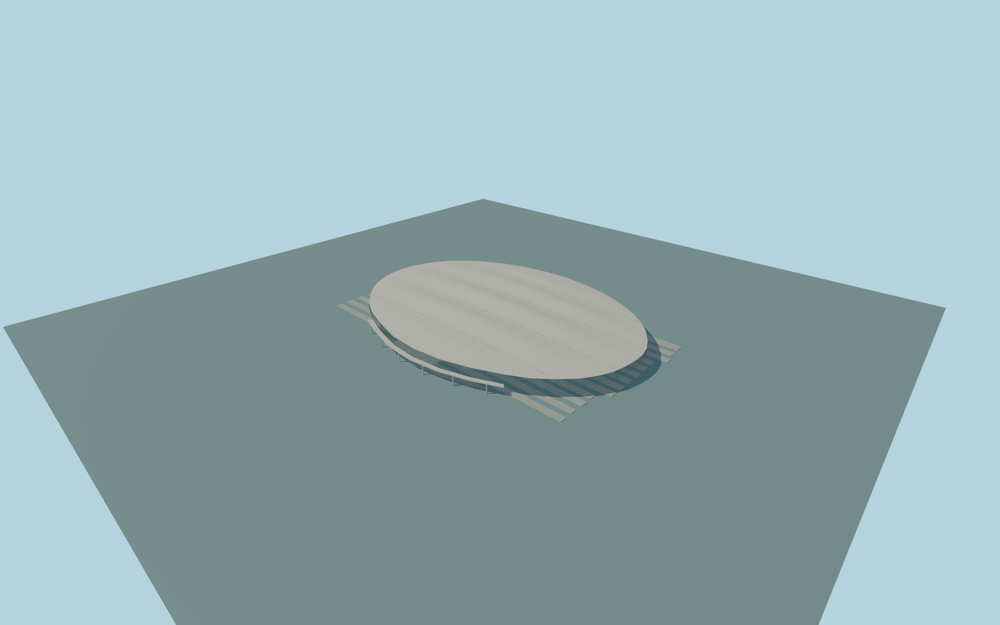

# Beijing South railway station

Whole individual Beijing South passenger station: complete mapped oval roof and both curved entrance fronts,rolled eaves/soffit and roof bands,raised transverse concourse,attached curved approach deck sections and supports,all thirteen whole native platforms and their connecting stairs. Preserve independent buildings,streets,rail lines and water. No blanket oval floor or terrain opening.

Rebuild: `node packages/worldgen/scripts/generate-beijing-south-station.mjs`;append `--check` for exact source bytes. Select import/LOD/placement with `--ids=beijingnan_railway_station`. Detailed source and four browser tiers are separate ignored GLB outputs.

Whole individual Beijing South passenger station: complete mapped oval roof and both curved entrance fronts,rolled eaves/soffit and roof bands,raised transverse concourse,attached curved approach deck sections and supports,all thirteen whole native platforms and their connecting stairs. Preserve independent buildings,streets,rail lines and water. No blanket oval floor or terrain opening.

Current named Beijing South POIs and one whole oval layer2 footprint35184415134069 associate Q163962 with this physical terminal;no exact-Q-tagged building is claimed. The thirteen full station platform polygons and railway alignment resolve signed NE/SW track and SE/NW entrance axes. Ordinary whole-roof aerial and southern-front photograph supply broad banded curved roof,rolled metal eave/deep soffit,two-level curved glazing and white approach deck/columns. Source floor+.9m and upper concourse/attached approach decks14m,wall27.3m,roof edge28m/crest42m are explicit picture/map-scale estimates,not native height facts. Use one unchanged global viewer datum at outside forecourt[25,250],45.720697m absolute. Actual grade,rail clearances,hidden elevations,internal concourse extent,roof-band controls and intermediate facade details remain unverified. Closed ground floors are only the two front/rear crescents beyond the mapped track/platform corridor;the layer2 oval roof is not a blanket ground floor. An elevated transverse concourse and13separate platform stairs provide visible physical connectivity. No copied lettering,emblems,brands,signs,trains,people,private images or navigable passenger interiors.

Only ordinary whole-roof and southern-front pictures,current standard PMTiles and unchanged global viewer terrain. The whole oval layer2 roof is not a ground floor. Exact heights,roof-band profile,hidden facades,internal concourse extent,rail clearances,approach-deck road joins and threshold/platform grades remain explicit medium-fi estimates. Only two closed entrance crescents receive occupied-floor masks;the central railway corridor remains open. Independent buildings,roads,rail lines and water remain separate. Physical-device/dense-city timing and numerical LOD errors remain unmeasured.

Five existing shared256px graphs: concrete_plain,stone_granite,metal_standing_seam,metal_painted and window_grid. Five merged near groups and one far palette group,metric UVs and linear colours. No embedded/private images. Broad roof/soffit surfaces use shared metal;actual glazing,concrete supports,granite platform/floor surfaces and painted steel retain semantic slots. All four tiers preserve the whole oval roof and both entrance fronts,open train portals,two actual closed floor crescents,raised transverse concourse and curved approach deck sections,all thirteen whole platforms and their13access stairs. Near tiers add mullions,fascia/soffit trim,rails,steps,columns and roof braces. The roof profile and unseen internal arrangement remain explicit visual interpretations.

Original geometry:repository license. Map:© OpenStreetMap contributors,ODbL-1.0;Protomaps. Standard terrain:terrain-grid.json. Ordinary pictures stay local and are not redistributed or used as textures. Current acceptance:qa.json.
