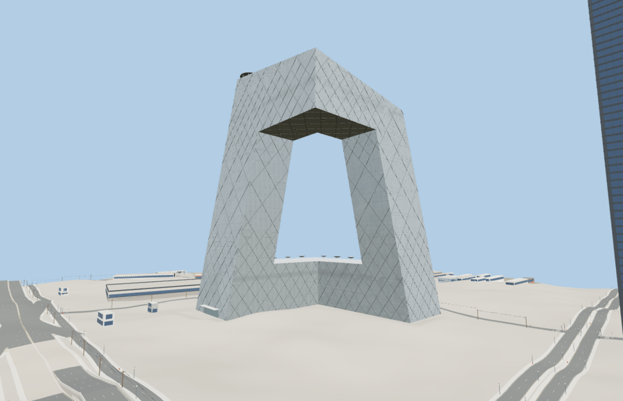

# CCTV Headquarters

The two leaning towers, northeast podium and suspended southwest connection form the complete cranked loop. All four browser levels keep the opening visible. Street and close-up show the diagonal braces, curtain-wall panels and roof details.

The original signed map axis puts the taller tower northwest and the lower tower southeast. The entrance and both tower feet use the same outdoor terrain reference, approximately 45.52 m. The fit leaves the native ground under the suspended connection intact. The viewer replaces five mapped building records, preserving 98 surrounding building records and all 111 road and rail records in the test area.

| Detail level | Triangles | Download bytes | Draws |
| --- | ---: | ---: | ---: |
| skyline | 999 | 15,608 | 1 |
| district | 3,495 | 358,256 | 3 |
| street | 15,982 | 1,578,044 | 3 |
| closeup | 63,888 | 5,324,156 | 3 |

The original detailed master contains 199,468 triangles. The first two viewer tiers total 373,864 bytes. Six GLBs pass Khronos validation and contain zero embedded images.

The viewer restores the mapped tower when the GLB fails to load. All four tiers release their geometry on unload. The review covers 63 captures and 110 placement samples.

The lower entrance grade is approximate. Building photos and mapped sections establish the exterior; exact local thresholds, brace sections and pane spacing are reconstructed.

The model covers the main headquarters exterior. The distinct Television Cultural Centre, service buildings and interiors use their own context.

[Architect photos and project overview](https://www.oma.com/projects/cctv-headquarters) · [Mapped terrain fit](site-fit.json) · [QA evidence](qa.json)
