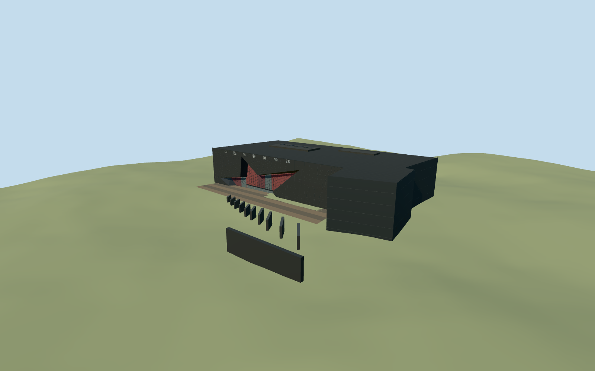

# China National Film Museum

China National Film Museum with its black metal origami façade, recessed rose glazing, pale Chinese inscription and clapperboard forecourt.

Authoring state: **review-in-qa.json**. Current completion evidence is in [qa.json](qa.json) and the [completion ledger](../../../../qualla-structures/batches/qualla-003.PROGRESS.md).

- [China National Film Museum](https://qualla.com/china-national-film-museum/)

The standing building is located with its named mapped outline. Façade height, folds and portal setback are estimates. Secondary elevations and roof equipment are generalized.

Ten separate elements follow their mapped outlines in the forecourt. Their cap profiles and the screen location and proportions are approximate.

The public entry, screen and apron are exterior features. Internal museum displays and cinema fit-outs are outside scope.

Build: `node content/worldgen/source/places/wx/wx4/china_national_film_museum/models/generate-china-national-film-museum.mjs`. Add `--check` to verify exact regeneration. 3310 triangles; 8 materials; no embedded photographs.
