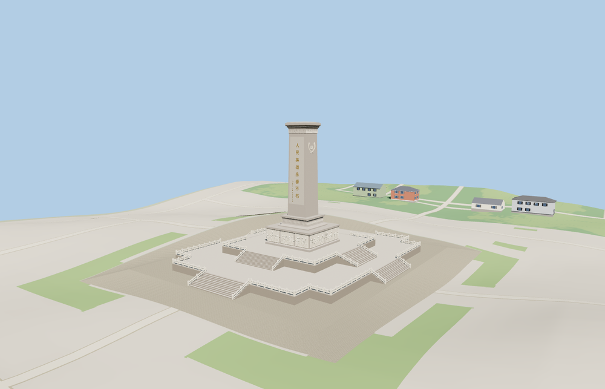

# Monument to the People’s Heroes

Tiananmen Square memorial with two terraced platforms, eight stair runs, carved white railings, ten relief compositions, the tapered granite shaft, north and south inscriptions and wreath cornices.

The 40,926-triangle source rebuilds byte for byte. Skyline, district, street and close-up use 466, 3,038, 15,236, 32,568 triangles. The first two tiers total 293,036 bytes. Six GLBs validated and 38 current views were inspected.

The four tiers preserve the 37.94 m summit, two terraces and eight stair runs. The apron replaces standard terrain within the scoped cut while the viewer retains 5 independent building records and 42 mapped transportation parts. Failed loading retains the mapped monument and native ground.

Stair, deck, plinth and shaft dimensions follow PMTiles. The small stone apron reconciles standard Terrarium samples with the level plaza seen in photographs. The rest of the square retains native terrain and map features. Individual carved figures, clouds, wreaths and historic calligraphy are represented by modeled approximations. The inscription text follows the map record. Physical-device timings are unmeasured.

Rebuild with `node packages/worldgen/scripts/generate-peoples-heroes-monument.mjs`. Append `--check` to compare exact bytes. Use `--ids=monument_to_the_peoples_heroes` for targeted import, LOD, placement and readiness.
