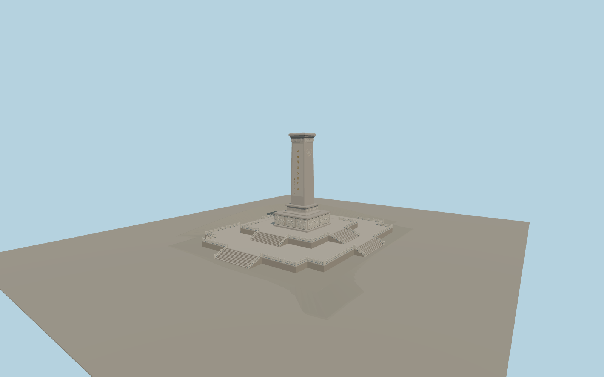

# Monument to the People’s Heroes

Tiananmen Square memorial with two terraced platforms, eight stair runs, carved white railings, ten relief compositions, the tapered granite shaft, north and south inscriptions and wreath cornices.

Run `node packages/worldgen/scripts/generate-peoples-heroes-monument.mjs` to rebuild the source master. Append `--check` to compare the exact bytes. Use `--ids=monument_to_the_peoples_heroes` for targeted import, LOD generation and placement.

Stair, deck, plinth and shaft dimensions follow PMTiles. The small stone apron reconciles standard Terrarium samples with the level plaza seen in photographs. The rest of the square retains native terrain and map features.

Individual carved figures, clouds, wreaths and historic calligraphy are represented by modeled approximations. The inscription text follows the map record.

Original geometry follows the repository license. Map data is © OpenStreetMap contributors under ODbL-1.0 via Protomaps. Terrain samples are described in terrain-grid.json. Ordinary pictures stay local and are not redistributed or used as textures. Chinese glyph outlines derive from Noto Sans CJK SC (© Adobe, SIL OFL 1.1). The font license and glyph source metadata are included under models/. Current acceptance is recorded in qa.json.
