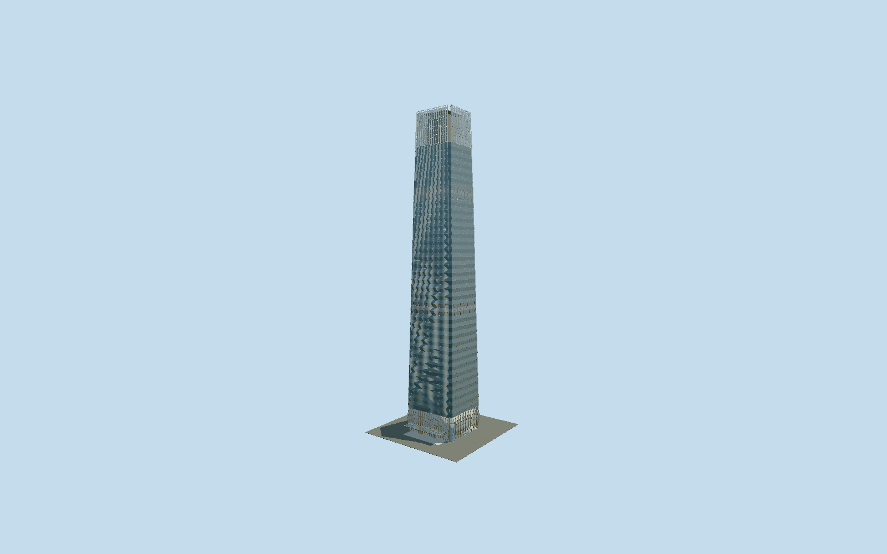

# China World Trade Center Tower III

Tapered rectangular tower with recessed glazed corners, alternating-floor curtain-wall slopes, 600 mm external glass fins, service louvre belts, diamond-pattern lobby fins, tall cross-braced crown, rooftop helipad, east hotel and west office canopies and curved glass vestibules.

## Evidence and reconstruction

Published dimensions and reconstructed details are separated in spec.json. Primary references:

- [Reference](https://www.som.com/projects/china-world-trade-center-3a/)
- [Reference](https://www.som.com/news/som-celebrates-grand-opening-of-china-world-trade-tower/)
- [Reference](https://www.mfacade.com/wp-content/uploads/2013/07/Art_Wrok_14Oct.pdf)
- [Reference](https://www.wongtung.com/en/projects/china-world-tower-a/)
- [Reference](https://www.wongtung.com/en/projects/china-world-summit-wing/)
- [Reference](https://www.aiahk.org/portfolio-item/china-world-trade-center-beijing/)

No third-party geometry, photograph or bitmap texture is embedded. Shared surface graphs come from the central library; vertex tints carry model colors. Glazing uses PBR materials; transparent surfaces are declared per model.

## Model and axes

56,000 triangles; 112,560 vertices; 6 material groups; 4,727,692 bytes. Native bounds: -30.465, 0.000, -38.900 to 30.465, 330.000, 33.800. Source hash: `sha256:db1ab9f866d7c192434286c2c41ca109d20a32282a0d05fb33e05e5205966b4d`.

{"up":"+Y","longitudinal":"+X toward north with the cached signed frame","front":"-Z toward east hotel entrance","origin":"Tower footprint center at pavement datum"}

The geographic proposal uses exact-QID OpenStreetMap evidence. Map-derived orientation and estimated architectural details require real-site visual review; preview eligibility is distinct from geographic/fidelity approval. Map attribution: © OpenStreetMap contributors, ODbL-1.0.

## Reproduce

Run `node packages/worldgen/scripts/generate-signature-towers.mjs --ids=N0233` (or add `--check`). The generator preserves manually edited masters by checking their baseline hashes. Import through the standard authored-model workflow with optimization disabled; then capture all QA cameras, including shared-surface views.

## Pending work

- Original chinaWorldTowerStudy.encodeAssembly remains byte-reconstitutable: 40771324 bytes, sha256:692047904356122c40524acc84d8d1b53e10088e1f63b426816b4fa7e6703ee3, 938584 expanded /485508 stored triangles, five mesh parts/seven placements, seven groups/four shared graphs and no embedded images. The new flattened browser source and four authored levels preserve taper, recessed chamfer returns, alternating-floor curtain wall, 600 mm glass fins at street/close, two service belts, full-height lobby diamonds, four-sided tall crown with open corner/top gaps, schematic roof plant/helipad and east hotel/west office canopies with four illustrative revolving drums. Close retains narrow flat metal fin leading edges and finer curtain rhythm instead of hundreds of thousands of solid facade prisms; street coarsens fin/diamond spacing; district groups floor rows and uses opaque crown screens; skyline keeps silhouette/service color bands, coarse diamonds and open framed crown in one opaque draw. Three canonical shared graphs (stainless metal, concrete and granite) plus opaque glazing, 52-percent clear glazing and recess palette yield six near groups with no bitmap copies. Published 74/80/81 floor labels describe different schedules and remain distinct; 70 equal tower intervals are a working facade division, not a surveyed floor schedule. Intermediate taper dimensions, alternating-depth amplitudes, service levels 122.6/134.9 and 238.8/251.3 m, 294 m crown base, braces, fine bay counts, canopy heights and dimensions, drums, generic lobby fitout, rooftop equipment and 327 m helipad datum are inferred. Helipad existence follows SOM opening report; precise platform datum and roof equipment layout are unaudited. Glass frit, LED strips, fountain courts, annexes, interiors and structural bolts are not modeled. Actual phone/laptop dense-city measurements remain pending.

This bundle follows the medium-fi standard. Medium-fi appearance and geographic fit are reviewed separately. Hash-bound visual acceptance is recorded separately after capture inspection.
