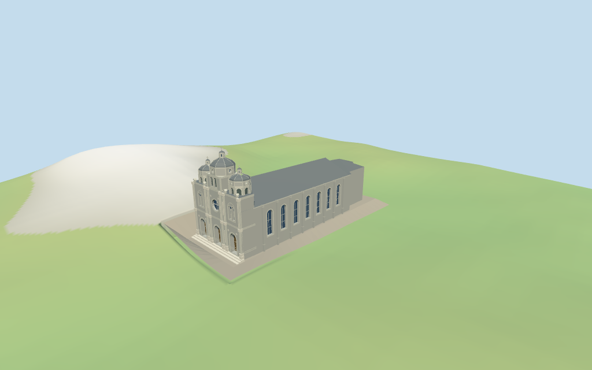

# N0396 — St. Joseph's Church, Beijing review

Reviewed 2026-10-16 against current source/runtime bytes. Accepted for medium-fi exterior and approximate horizontal placement. All heights and hidden roofs are estimates; exact host-ground joins and walking remain unverified.

## Built result

Inspected all 11 current portable/source-terrain frames. Individual gray-brick long hall and mapped irregular eastern rear, three domed/crossed west towers with higher square central paired-louver stage and polygonal side crowns, small lanterns and drum oculi. Two facade orders, three deep timber portals, a central rose with cross-shaped tracery, paired round-headed side lights, pale pilasters/cornices and plaque/medallion abstractions establish identity. Tall recessed side glazing sits between stepped buttress-pilasters. Corrected collapsed Float32 clipping slivers, a repeated cornice band, dome ribs hidden inside the cap, and terrain burying the north entrance. All three portals and broad treads are visible in the corrected source-terrain view. Fine sculpture, glass artwork, inscriptions and hidden partitions remain simplified or excluded.

Medium-fi exterior based on three actually inspected pictures: BrokenSphere 2007 upper-front and close-side views, and Another Believer 2016 whole western facade. Standard viewer PMTiles/DEM only; no bespoke surveys, research datasets or redistributed reference photographs. Photographs guide three domed towers, louvered bays, rose/paired lights, two facade orders, deep portals and side buttresses. The side picture does not establish the hidden roof/rear or numeric heights; these remain explicit estimates. Belfry/lantern panels represent opaque louvers or glazing, not open-air claims. Fine carved figures/scrollwork, inscription glyphs, stained-glass art, small dentils/drains, complete interiors/bells and engineering details are approximate or excluded. Current finish, exact host-ground joins and physical-device performance are unverified.

## Shared surfaces and placement

Inspected all 11 current shared/geographic frames. Five existing cached 256² brick, continuous limestone, standing-seam metal, plain wood and ashlar graphs serve seven merged groups; skyline uses one draw. Gray brick, pale trim and paving, muted metal caps, timber doors and blue-grey glass use linear tints and metric UVs. Architectural normals are flat. Actual brick courses, roof seams and stone repeats are visible. Corrected opaque louver wood mistakenly routed through the window/glass slot: it now uses trim and retains its dark tint. No embedded images, reference-photo maps, unique facade textures or baked lighting. Each graph loads once and eviction leaves zero live geometries. Actual ground opening activates while visible, restores on hiding, reopens on visibility and restores on unload.

Exact way/85902975, Q1064185 and multilingual 王府井天主堂/东堂 identity match current whole35184457991807. All 11 current raw points/properties and earlier 12 distinct whole points/tags remain intact. Anchor [116.405948092,39.915947886], heading 0.021888694633 rad, unchanged; +X east to the irregular rear, -X west to the three-tower entrance, +Z south along the hall. No horizontal rescale. No mapped heights, levels, parts or independent dimension facts exist; every vertical/roof partition is an estimate. The current whole and authored apron pass 48 actual footprint checks while preserving four neighbors, west-road and south-path probe regions. Standard DEM datum56.218566 m, raw whole perimeter -1.99 to +4.30 m; floor0.65 m. The original north-front mound buried a portal. A bounded76x32 m ground opening, opaque Y=0 floor and fitted perimeter apron now cover that mound beneath the architecture and approach. The actual viewer removes covered ground only while the visible model is loaded and restores it on hiding/unload. Raw DEM samples remain unchanged. Source preview uses a separately retained one-meter sampling fixture lowered only beneath the covered opening, approximating the same effect. Plaza shape/grade, actual host-edge/door joins, base clipping elsewhere, absolute altitude and walking remain unverified. Flat viewer-fixture edge slivers reflect its unmatched flat terrain, not a terrain-accuracy approval. No road replacement is enabled.

## LOD and lighting review

Inspected all 27 current medium-fi frames: Economy/High, noon/late, three distances, texture-free silhouette, six details, four matched whole LODs and four transitions. Skyline 784 triangles retains three unequal domed towers/crosses, the raised center, two-tier facade, long hall, irregular rear and apron. District 1,827 adds shared surfaces and simplified door/window/louver rhythm. Street 10,038 adds actual recesses, paired side lights, rose cross, buttress-pilasters and central front drum oculus. Closeup/master 25,233 refine dome ribs, selected capitals/plaques/medallions, louver rows and small lantern/side-drum lights. Skyline omits door recesses; district window cards and street lantern omissions are intentional. Gray-brick shophouses are fixtures. The ordinary medium-fi source-terrain scene uses a documented lowered heightmap beneath the covered opening; the actual viewer lifecycle is verified separately. Physical laptop/phone timing remains pending.

## Browser budgets

| Level | Triangles | Bytes | Draws |
| --- | ---: | ---: | ---: |
| skyline | 784 | 79,552 | 1 |
| district | 1,827 | 166,680 | 7 |
| street | 10,038 | 844,680 | 7 |
| closeup | 25,233 | 2,052,660 | 7 |

Initial skyline plus district: **246,232 bytes** of geometry. Master: **3,032,140 bytes / 25,233 triangles**. Five shared 256² graphs; zero embedded images. Download bytes exclude graph definitions and runtime texture generation. Physical-device timing remains pending.

## Verification

Targeted byte reproduction,source/import/LOD/input/report hashes,source/recipe inventory/schema,scene validation and30-tick simulation pass. Six Khronos validations have zero errors,warnings and images. **421 geometry probes**, **48 actual viewer-footprint checks** and **49 inspected current frames** pass. Actual shared graph read-once/unload,split vertex streams,equal CPU/GPU reservations and reversible ground-opening lifecycle pass. Simulation hash: sha256:d8d26e18a978a5a9f42608a47d61046adb00cbcf3f8fbcd9fefd6feb4bb8fe95.

Source hash: sha256:3e830a7d0d8515a279fffc3fe6596a4f2e470406cd2093b8c4185fb5cf8687b2. Runtime hash: sha256:9664a869f948c591b13ec196b4996879b969eb015aff23f8e7aee333d99d666c. Input hash: sha256:925ab97a1384dfee0c51174d118c9a0a592d7d1407b5a92ba7e5c3ec204457b5.

Commands: targeted generate/import/LOD/register-landmark-previews --ids=N0396; generate-additional-landmarks.mjs --ids=N0396 --check; capture-next-1000-models --ids=N0396 --reflections --antialias --fit-shadows; capture-landmark-library --ids=N0396 --reflections --adaptive-clipping --bounded-placement; capture-medium-fi --ids=n0396_st_joseph_s_church_beijing --reflections; molen validate; molen sim run --ticks30 --hash. Bulk captures remain ignored. Next routine full source checkpoint: N0392–N0409.

## Limits

- No mapped height,levels or independent dimension facts are present. All vertical partitions are picture-led estimates:main body eave12.7 m/ridge17.2 m,western screen16.4 m,lower cornice8.1 m,central tower square stage20.1 m/octagonal drum22.4 m/dome24.4 m/lantern26.1 m/cross27.3 m,and side towers18.6 m/drum20 m/dome21.4 m/lantern22.8 m/cross23.6 m above the estimated0.65 m floor. Rear irregular roof15.3 m and hidden joins are inferred from the standard footprint. Approximate roof shape,window/door and tower-stage divisions are not surveys. All current11 raw points and earlier12 distinct whole points/tags retained without horizontal rescale.
- Standard viewer DEM datum56.218566 m,raw control perimeter-1.99..4.30 m. Estimated floor0.65 m;footings crossY=0 and extend below samples. Western approach steps are picture-led.No flattening,host DEM change or road replacement.Exact pavement/door joins,base clipping,absolute altitude and walking remain unverified. Standard DEM rises4.30 m at the north-front raw control and buried its portal in the first current render. A bounded76x32 m visual ground opening covers the authored church and paved apron only. Complete opaque floor atY=0 and a fitted perimeter apron from the retained standard DEM edge cover the opening;three entrance treads rise to the estimated0.65 m floor. Original terrain returns when the model hides/unloads. No source DEM heights,roads or neighboring buildings are changed. The plaza shape/grade is reconstructed,not surveyed;exact host-edge/door joins and walking remain unverified.
- Standard DEM rises4.30 m at the north-front raw control and buried its portal in the first current render. A bounded76x32 m visual ground opening covers the authored church and paved apron only. Complete opaque floor atY=0 and a fitted perimeter apron from the retained standard DEM edge cover the opening;three entrance treads rise to the estimated0.65 m floor. Original terrain returns when the model hides/unloads. No source DEM heights,roads or neighboring buildings are changed. The plaza shape/grade is reconstructed,not surveyed;exact host-edge/door joins and walking remain unverified.
- Medium-fi exterior from three inspected2007/2016 front/side pictures and standard viewer PMTiles/DEM only.Hidden roof/rear partitions and all heights are estimates.Fine carved figures,scrollwork,inscriptions,stained-glass art,small dentils,drains,complete interiors/bells and engineering are approximate or excluded.Dark belfry/lantern panels are louver/glass backing,not claims of open air.Current finish,exact terrain joins and physical-device timing unverified.
- Skyline retains three domed towers/crosses,raised central stage,two-tier front,long hall and irregular rear.District adds shared surfaces and simplified facade/window/louver rhythm.Street adds actual portal/window recesses,paired side lights,rose cross,buttress-pilasters,drum oculi and trim.Closeup/master refine dome ribs,selected column/capital/plaque/medallion and louver rhythms.Regional neighboring shophouses are fixtures.

This accepts the recorded exterior and approximate horizontal scope. The1,000-candidate project remains incomplete.
