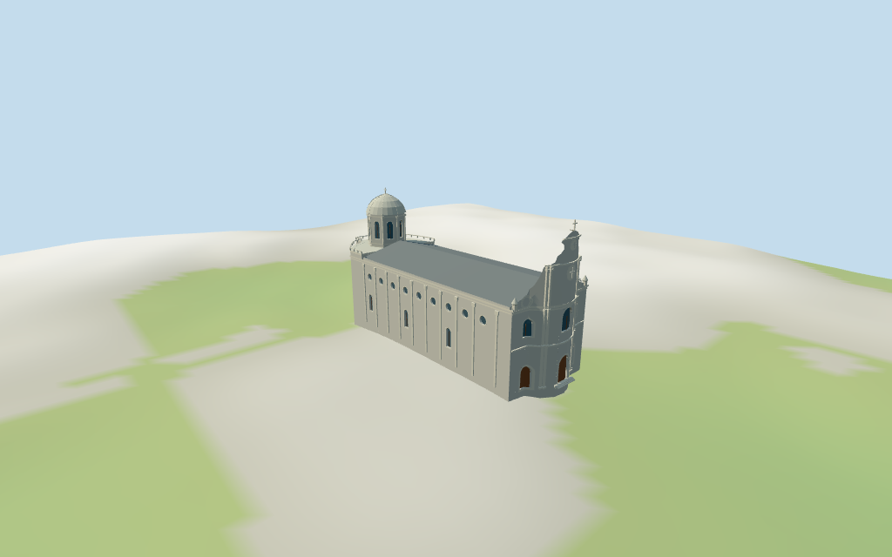

# Cathedral of the Immaculate Conception

Individual medium-fi Beijing Nantang: curved three-bay grey-brick Baroque front with paired pilasters, shoulder scrolls, central arched light/medallions, shaped crown/cross, long low grey-roofed hall with round oculi and pilasters, irregular northern rear terrace and octagonal ribbed pale dome/drum/cross. Five shared graphs, six groups and four browser LODs. Entire current church outline retained; exact details/heights estimated. Courtyard buildings, shrine/gate and street context excluded.

## Evidence and reconstruction

Published dimensions and reconstructed details are separated in spec.json. Primary references:

- [Reference](https://commons.wikimedia.org/wiki/File:Nantang_NW.jpg)
- [Reference](https://commons.wikimedia.org/wiki/File:Beijing_-_Cathedral_of_the_Immaculate_Conception_-_1.jpg)
- [Reference](https://commons.wikimedia.org/wiki/File:Nantang_from_the_street.JPG)
- [Reference](https://commons.wikimedia.org/wiki/File:Nantang.jpg)

Five existing shared256² brick,raw limestone,flat tile,painted metal and plain wood graphs serve six merged groups including local blue-grey glass. Grey brick/pale trim,low grey roof and pale dome use linear tints,metric UVs and flat architectural normals. No embedded images,unique facade photographs,bespoke textures or baked lighting.

## Model and axes

12,363 triangles; 37,089 vertices; 6 material groups; 1,487,312 bytes. Native bounds: -32.257, -2.371, -11.175 to 32.874, 31.000, 11.085. Source hash: `sha256:10beba58c10bc398c1d51b28d80f916077b56e6b827706272e18e8804633ec10`.

{"x":"south toward main facade/street","y":"up","z":"west toward courtyard"}

Standard viewer DEM datum52.489617m; selected perimeter-2.02 to-0.05m relative to it. Floor0.5m; adaptive footings crossY=0 and extend below retained samples. No flattening, cutout or road replacement. Exact courtyard/street levels, threshold/steps/base joins, concealed adjoining walls, altitude and walking remain unverified.

## Reproduce

Run `node packages/worldgen/scripts/generate-additional-landmarks.mjs --ids=N0406` (or add `--check`). The generator preserves manually edited masters by checking their baseline hashes. Import through the standard authored-model workflow with optimization disabled; then capture all QA cameras, including shared-surface views.

## Pending work

- Exact retained way/442394489 and Q1188864 identify Beijing Nantang / Cathedral of the Immaculate Conception Xianwumen. Current standard viewer whole35184814483321 and same-ID named place-of-worship POI; all18 raw outline points/properties and earlier outline/multilingual tags retained. Anchor[116.369212569,39.899511376] and heading−1.56861635065rad unchanged; no horizontal rescale. Native+X points south toward the main Baroque facade and Xuanwumen East Avenue, −X north toward the irregular rear/drum, +Z west toward courtyard. Signed facing follows the street-side facade photograph and standard road map, with approximate3° uncertainty. Separate western courtyard building35184814483322, boundary/gate, trees, street/utility lines and surrounding town remain host content. Detailed facade, drum and roof sub-plans are picture estimates inside the selected church envelope.
- No current height/level tags or independent height/dimension facts. Every vertical dimension is a picture estimate above floor0.5m: nave wall15.2m, cornice15.8m and low roof ridge18.4m; rear terrace16.3m and parapet16.8m; front curved lower screen15.8m, paired central pilasters to22.4m, scroll/crown profile to27.8m and cross29.6m. Northern octagonal drum16.5–24.5m, pale faceted dome29.0m and cross30.5m. Every recess, medallion, volute, cornice, balustrade, dome rib and doorway/step profile is estimated or abstracted.
- Standard viewer DEM datum52.489617m; selected perimeter-2.02 to-0.05m relative to it. Floor0.5m; adaptive footings crossY=0 and extend below retained samples. No flattening, cutout or road replacement. Exact courtyard/street levels, threshold/steps/base joins, concealed adjoining walls, altitude and walking remain unverified.
- Individual medium-fi exterior from four inspected2003/2005/2010 pictures and standard viewer PMTiles/DEM. All heights and detailed partitions are estimates. Curved Baroque screen,volutes,medallions,capitals,cornices,balustrades,roof and dome/ribs are abstractions. Hidden lower/side/rear doors,faithful coat of arms,inscriptions,stained-glass art,fine sculpture,interiors/bells,current finish,engineering and exact courtyard/street/threshold/base contact remain simplified,excluded or unverified. Glazing fields are recessed blue-grey panes; no claim of open interior passage. Courtyard building,gate/shrine,trees/wires,street and neighboring town remain host content. East Asian attached neighbors are synthetic fixtures;physical phone/laptop timing unverified.
- Skyline retains the curved high south screen/cross,long low nave roof and northern octagonal drum/dome/cross. District adds shared materials,simplified front portals/lights,medallions,paired pilasters,round nave oculi and drum lights. Street adds full bay rhythm,lower lights,volutes,pedestals/steps,rear attic balusters and dome ribs. Close-up/master refine curved sampling.

This bundle follows the medium-fi standard. Medium-fi appearance and geographic fit are reviewed separately. Hash-bound visual acceptance is recorded separately after capture inspection.

## Additional geographic data

©OpenStreetMap contributors;Protomaps;Mapzen/USGS terrain tiles.
