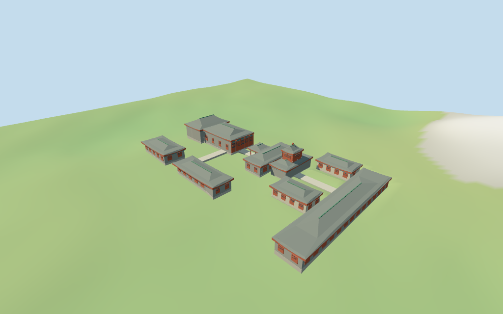

# N0470 — Niujie Mosque

Reviewed2026-10-18 for the declared medium-fi exterior and approximate map fit. Nine mapped plans and a named mosque point provide controls;functional roles,roof forms and all heights remain estimates.

## Exterior and shared materials

Inspected11 current portable views,including the retained1024×640 summary. Original medium-fi geometry retains nine mapped plans. The notched hall carries two adjoining curved roof volumes and a red timber door/screen facade. Small pavilion bays are open around a central screen. The tower has two stacked grey roofs,green ridges and a red gourd-like finial. Side ranges retain their spacing. Corrected roof-ring folding/pale gaps,closed raised eave edges and shortened ridge caps to meet their roof tops. Fine dougong,roof-end sculpture,floral painting,inscriptions,temporary braces,fences,trees and furnished interiors are omitted.

Inspected11 current shared-material/geographic-flat views and the placement overlay. Six existing256² graphs serve seven merged roles: brick,lime plaster,raw limestone,plain wood,ceramic tile,glazed tile and local opaque glazing. Blue-green beams and red timber use shared wood with linear vertex tints. Meter-scaled UVs,zero embedded images,no unique facade atlas. Each graph is read once;eviction disposes geometry and restores host ground. Nine nearby mapped host buildings remain separate,including the north annex and east apartment. Flat placement verifies pose/replacement behavior;exact courtyard grade remains approximate.

## Browser levels

| Level | Triangles | Bytes | Draws |
| --- | ---: | ---: | ---: |
| skyline | 568 | 59956 | 1 |
| district | 2802 | 246668 | 6 |
| street | 7753 | 648940 | 7 |
| closeup | 17770 | 1620792 | 7 |

**306,624 bytes for initial skyline plus district**,plus six existing shared256² material graphs. Seven merged roles;zero embedded images.

Inspected27 current medium-fi views: Economy/High,noon/late light,street/block/skyline,silhouette,six details,four matched levels and four transitions. All nine masses,the split hall roof and stacked tower remain at distance. Skyline collapses timber screens and pavilion openings into opaque masses;district restores pavilion posts,simple panels and green ridges;street/closeup restore curved eaves,lattice and post capitals. The pavilion opening at the skyline-to-district switch is an intended distant abstraction. Physical laptop,phone/tablet and full-city timing remain pending.

## Placement and limitations

Q603256 retained reference point and current Niujie Mosque POI35184402873739 agree on this Beijing compound. Nine nearby mapped plans /52 vertices guide the declared core. The named buildings-layer record is an address point, not a footprint. No unique exact-QID building polygon is resolved. Heading 0.050976279861132366 rad follows the main hall long edge. Functional labels, compound membership, the east-facing prayer entry and roof partitions are visualization estimates. The large north annex35185690555180, adjacent apartment52776565667843 and all other host buildings remain excluded. Ordinary viewer Protomaps20261014 plus Mapzen/USGS terrain extractN0470; datum 53.43290878237333 m. 254 footprint/path samples span -1.2486484037218162 to 3.4948150833544176 m. Floor 1.3562017450026775 m is the median of 275 outer samples plus0.28 m. Foundations sample edges at<=2.5 m stations. Cutouts follow the nine plans plus two narrow estimated connecting paths; remaining ground, north park, large annex and east apartment stay host content. Preview terrain is seated under these masks only. Exact thresholds and courtyard grade are unverified. Independently remerged all52 selected vertices from ordinary raw PMTiles geometry and reproduced the main-hall edge heading. The named mosque POI is deduplicated;the buildings-layer address point is not treated as a polygon. All108 footprint checks across six GLBs pass: nine selected plans are covered and nine nearby buildings remain host content. All1624 FrontSide probes pass for roof coverage,soffits,tower total,pavilion open bays/ceiling and seated foundations.254 under-mask terrain samples,275 outer samples and455 seated preview points/required16-bit height fixture reproduce. Two northern park points remain outside the cutout masks.

Individual Niujie Mosque compound: the mapped notched prayer hall and auxiliary ranges, small square pavilion, stacked Chinese tower, grey upturned tile roofs with green glazed accents, red timber screens/doors and blue-green beam accents. Paired side ranges and two narrow connecting paths retain the mapped spacing. Fine dougong, roof-end sculpture, floral painting, inscriptions, planting, temporary supports and furnished interiors are omitted. Functional labels and unpictured roof forms remain explicit estimates. No retained height/width/length facts or current building height tags are available. Horizontal dimensions follow nine mapped plans. All vertical dimensions are picture-guided estimates: hall walls6.6 m and roof about10.7 m, stacked tower about13.5 m, small pavilion5.8 m and auxiliary ranges6–7 m. No independent survey or engineering precision is claimed. This declared Chinese-style compound is guided by two inspected2006/2008 pictures and current ordinary PMTiles/DEM. The pictures establish the tiered roof and red/blue-green timber vocabulary;they do not prove the current complete roof plan. Functional assignments,membership,entry facing,roof forms,bay counts,all heights and two connecting paths remain estimates. Current appearance,roof construction,decorative patterns,interiors,engineering and exact ground/street joins are unverified.

## Verification

49 current views inspected,1624 FrontSide probes,108 footprint checks and six zero-error/zero-warning Khronos validations. Current model,input,material,render,report and placement hashes agree. Raw controls and required16-bit terrain fixture reproduce. Source/placement --check,scene validate/sim30,selected LOD layout and recipe/registration Biome pass. Bulk captures remain ignored.

Source: sha256:562888eedefa9a162e1d4102e88143fea85d2a6d2a6c2cb4142f5c8e5d1d0e42

Runtime: sha256:9f878f7b3446ee8db36b6f6449bd6a37fcca448807b9645054e687bb8e223479

Input: sha256:bce4f926b51a6580042edfacd7df00f8945fe493f1af81d414a09eec916b2a8a

Commands: targeted generate-additional-landmarks/import-next-1000-models/generate-landmark-lods/register-landmark-previews --ids=N0470;source/placement --check;capture-next-1000-models --reflections --antialias --fit-shadows;capture-landmark-library --reflections --adaptive-clipping --bounded-placement;capture-medium-fi --ids=n0470_niujie_mosque --reflections;scene validate/sim30;selected LOD layout;Biome. Reuse package builds. Next full source checkpoint is due at a meaningful later batch milestone.

## Inspected picture references

[Smartneddy — 2006-06-24; displayed file contrast adjusted2019](https://commons.wikimedia.org/wiki/File:Niujie_Mosques02.jpg). CC-BY-SA-2.5. Tiered Chinese-style tower: turned-up eave corners, grey barrel-tile lower roofs, green glazed ridge/eave accents, red timber posts/screens, blue/green painted crossbeams and red gourd-like roof finial. Broad lower roof/side wings and a smaller upper roof. Planting, fence, signs and temporary supports are not core building geometry. Exact tier/bay dimensions are estimates.

[Antoine Taveneaux — 2008-06-06,11:11 in file metadata](https://commons.wikimedia.org/wiki/File:Niujie_Mosque.jpg). CC-BY-SA-3.0 (one of the listed choices); viewed only. Prayer-hall entry/detail: red lacquered timber doors and columns, upper diamond lattice screens, green/red rafters and blue/green painted beams. A view into the hall supplies finish colors; it does not establish the overall exterior roof plan. No calligraphy, ornate painting, photo textures or furnished interior will be copied.
