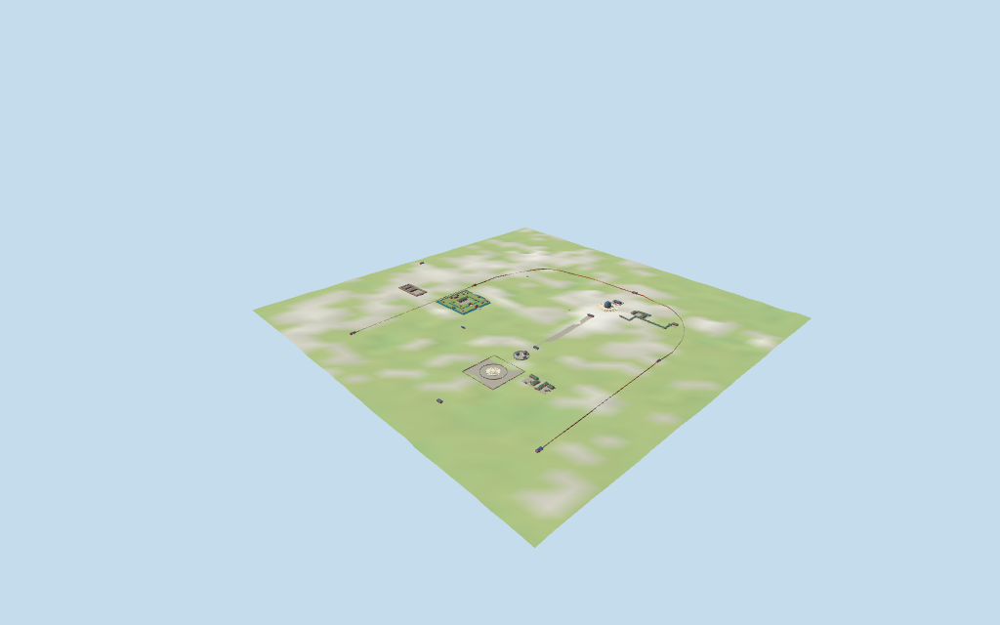

# Temple of Heaven

Temple of Heaven principal exterior site:Hall of Prayer,northern halls,Imperial Vault,Circular Mound Altar,Palace of Abstinence,music/service groups,Long Corridor,Longevity Pavilion,selected precinct gates/walls and processional paving. Geographic integration is an explicitly approximate reconstruction from standard viewer data;fine ground ornaments,interiors and unverified southern wall links are omitted.

## Evidence and reconstruction

Published dimensions and reconstructed details are separated in spec.json. Primary references:

- [Reference](https://commons.wikimedia.org/wiki/File:Beijing_China_Hall-of-Prayer-for-Good-Harvests-01.jpg)
- [Reference](https://commons.wikimedia.org/wiki/File:Hall_of_Prayer_for_Good_Harvest_full_exterior_view.jpg)
- [Reference](https://commons.wikimedia.org/wiki/File:Beijing_-_Temple_of_Heaven_Park_IMG_5064_Imperial_Hall_of_Heaven.jpg)
- [Reference](https://commons.wikimedia.org/wiki/File:2017-05-02_Imperial_Vault_of_Heaven.jpg)
- [Reference](https://commons.wikimedia.org/wiki/File:Beijing_-_Temple_of_Heaven_Park_IMG_5012_Echo_Wall_-_Imperial_Vault_of_Heaven.jpg)
- [Reference](https://commons.wikimedia.org/wiki/File:Halles_des_Himmelgew%C3%B6lbes_Himmelstempel_Peking.jpg)
- [Reference](https://www.nipic.com/show/482280.html)
- [Reference](https://commons.wikimedia.org/wiki/File:Beijing_2006_3-17.jpg)
- [Reference](https://commons.wikimedia.org/wiki/File:Temple_of_Heaven_-_Circular_Mound_Altar_02.jpg)
- [Reference](https://commons.wikimedia.org/wiki/File:Hall_of_Abstinence_east_gate_2.JPG)
- [Reference](https://commons.wikimedia.org/wiki/File:%E5%8C%97%E4%BA%AC%E5%A4%A9%E5%9D%9B%E6%96%8B%E5%AE%AB%E5%A4%A7%E6%AE%BF.jpg)
- [Reference](https://xinwen.bjd.com.cn/content/s6989c0aae4b0cd719e9d6d42.html)
- [Reference](https://www.travelchinaguide.com/attraction/beijing/temple-of-heaven/north-divine-kitchen.htm)
- [Reference](https://www.viator.com/en-SG/tours/Beijing/Private-Layover-Tour-to-Hutong-with-Spa-Experience/d321-67316P225)
- [Reference](https://k.sina.cn/article_6942584044_p19dcf6cec00100rwxs.html)

Seven existing shared256² graphs across nine roles,merged into eight near materials including one flat local ground/water surface. Linear tints,metric UVs,no embedded images or unique atlas. Original coarse decoration;no copied inscriptions or historic artwork.

## Model and axes

53,681 triangles; 161,043 vertices; 8 material groups; 6,446,436 bytes. Native bounds: -1053.331, -14.475, -240.367 to 454.970, 34.452, 1012.817. Source hash: `sha256:a9cc9bb22e0e84587831978d60b00c1959ee31b4af4583fdb2f7865ddb0e5116`.

{"x":"east","y":"up","z":"south"}

Approximate site fit from retained standard viewer PMTiles and DEM plus ordinary exterior pictures. Native+X is east,+Z south;fixed heading0 and the main hall footprint center define the pose. NativeY0 is the original DEM sample at that anchor,not a surveyed floor. Thirteen separately covered ground pockets preserve the park between groups. The building-only mask preserves independent mapped buildings,including attached shared edges. Host terrain data must resolve the same reference coordinate;architectural floor grades,gate forms,wall routes and exact facing remain visualization estimates.

## Reproduce

Run `node packages/worldgen/scripts/generate-additional-landmarks.mjs --ids=N0488` (or add `--check`). The generator preserves manually edited masters by checking their baseline hashes. Import through the standard authored-model workflow with optimization disabled; then capture all QA cameras, including shared-surface views.

## Pending work

- Temple of Heaven principal exterior site:Hall of Prayer,northern halls,Imperial Vault,Circular Mound Altar,Palace of Abstinence,music/service groups,Long Corridor,Longevity Pavilion,selected precinct gates/walls and processional paving. Geographic integration is an explicitly approximate reconstruction from standard viewer data;fine ground ornaments,interiors and unverified southern wall links are omitted.
- Retained Q125445 way/24824550 is the whole Temple of Heaven park boundary. It is preserved as evidence, never extruded. Current standard PMTiles identifies Hall of Prayer for Good Harvests as building/POI35184416009971 (OSM way43921139), with a19-vertex circular footprint and height38m. This staged source is anchored at that footprint center with +X east,+Z south. The broader site has140 provisional building-layer records, including overlapping parts and possible courtyard/container boundaries; they are retained for deliberate component review, not blindly extruded.
- The mapped main hall height38m sets the approximate overall top above its local grade; its datum is unspecified. Its mapped diameter is about28.64m. Three roof overhangs, wall/drum heights, finial, balcony bands, stairs and marble terrace radii are picture-guided estimates. Standard path/steps vertices about50m from the hall center support the outer terrace extent. No survey, exact artwork, structural joints or historic inscriptions are claimed. Imperial Vault retains the mapped19.02m overall height above its chosen court floor;its round map extent constrains the eave radius. Roof/body divisions,platform and annex heights remain picture-guided estimates. Three1.7m rises,rail heights,gate heights,blue coping and stair profiles are picture-guided exterior estimates. No mapped altitude or surveyed dimensions are claimed for the altar. Ground seating is median16 retained standard DEM samples around32m radius plus0.15m. All palace heights are picture-guided estimates:main hall raised0.9m with walls to7.4m and green roof ridge12.5m;east gate wall7m/roof11.8m;ancillary roofs4.8–6.6m. No mapped height or surveyed threshold is claimed. Court grade is the median16 retained standard DEM building-center samples plus0.15m;moat surface is0.65m below that floor. Heights are picture-guided visualization estimates,not survey values:music main/rear walls5.8m,roofs10.4/9.6m;entry4.7/8m;attached ranges3.8/6m;principal kitchen halls4.9/8m;other halls3.5/5.8m;hexagonal pavilion roofs7.2m. Roof envelopes follow each mapped axis and footprint extent;small protrusions retain wall outlines but share simplified roof envelopes. Bay counts and roof/gate details are approximate. Picture-guided estimates:Long Corridor deck follows retained DEM+0.25m,eaves about4m above deck,ridge5.7m;red columns repeat about4m close up. Longevity lower eave3.9m,upper eave5.4m,roof7.3m and two finials8.2m. Gate walls5.7m/roof8.5m,small Sixty-Year gate3.5/5.4m,red walls3.2m plus blue coping. Gate arch forms,roof types and colors are visualization estimates,not individually verified architectural measurements.
- Approximate site fit from retained standard viewer PMTiles and DEM plus ordinary exterior pictures. Native+X is east,+Z south;fixed heading0 and the main hall footprint center define the pose. NativeY0 is the original DEM sample at that anchor,not a surveyed floor. Thirteen separately covered ground pockets preserve the park between groups. The building-only mask preserves independent mapped buildings,including attached shared edges. Host terrain data must resolve the same reference coordinate;architectural floor grades,gate forms,wall routes and exact facing remain visualization estimates. The source-local lowered review terrain remains an approximate fixture. Final site review also uses the original unmodified standard DEM with13separate covered ground pockets,partitioned access paths,and preserved independent map buildings. Host DEM differences can alter edge seating;physical device and full-city measurements remain pending.
- Approximate exterior reconstruction from standard map/DEM and ordinary pictures. Gate forms, wall routes, floor grades and exact facing are visualization estimates. Interiors, fine ornaments and unverified southern wall links are omitted. Physical-device/full-city performance remains pending.

This bundle follows the medium-fi standard. Medium-fi appearance and geographic fit are reviewed separately. Hash-bound visual acceptance is recorded separately after capture inspection.

## Additional geographic data

©OpenStreetMap contributors;Protomaps;Mapzen/USGS terrain.
