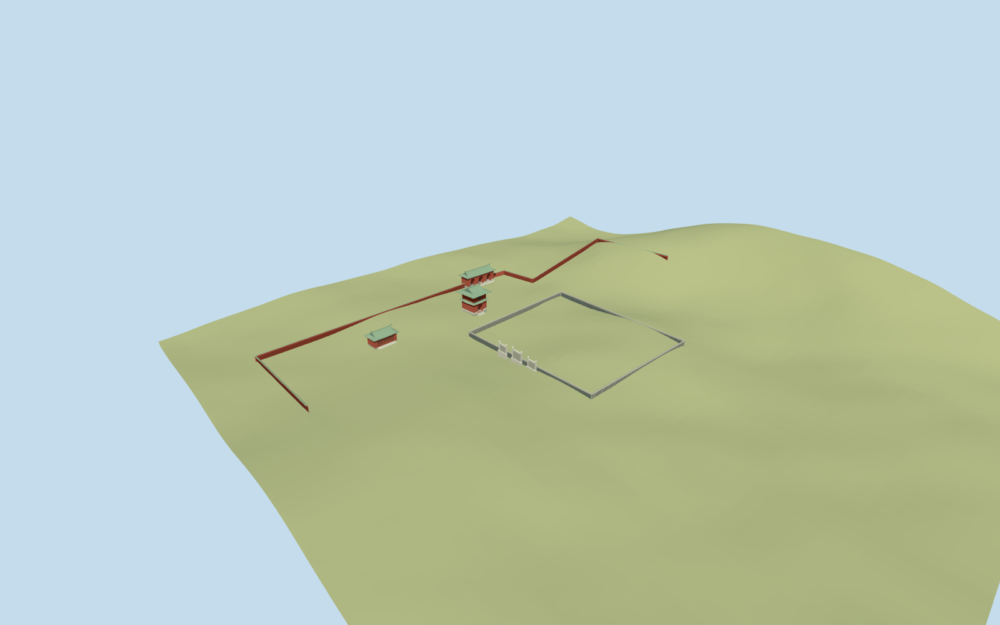

# Temple of the Moon

Standing Temple of the Moon heritage compound: mapped red double-eaved green-roofed bell tower with real ground arch and recessed upper lattice, mapped triple-arched roofed park gate with open center/closed side leaves, and mapped west hall with swept green roof/red lattice doors. Include approximate surviving gray inner enclosure/three blocked pale Lingxing portals and short mapped northern outer-wall runs. Original simplified painted-beam/ridge/finial vocabulary, no copied text/photo atlas. Do not reconstruct the no-longer-intact altar. Modern lattice transmission mast and southern park landscaping/pavilions remain host context, not part of this heritage-building model.

## Evidence and reconstruction

Published dimensions and reconstructed details are separated in spec.json. Primary references:

- [Reference](https://commons.wikimedia.org/wiki/File:Bell_Tower(Temple_of_Moon).JPG)
- [Reference](https://commons.wikimedia.org/wiki/File:North_Holy_Gate_(Temple_of_Moon).JPG)
- [Reference](https://commons.wikimedia.org/wiki/File:Dressing_Hall(Temple_of_Moon).JPG)
- [Reference](https://commons.wikimedia.org/wiki/File:Lingxing_Gate(Temple_of_Moon).JPG)

Standing Temple of the Moon heritage compound: mapped red double-eaved green-roofed bell tower with real ground arch and recessed upper lattice, mapped triple-arched roofed park gate with open center/closed side leaves, and mapped west hall with swept green roof/red lattice doors. Include approximate surviving gray inner enclosure/three blocked pale Lingxing portals and short mapped northern outer-wall runs. Original simplified painted-beam/ridge/finial vocabulary, no copied text/photo atlas. Do not reconstruct the no-longer-intact altar. Modern lattice transmission mast and southern park landscaping/pavilions remain host context, not part of this heritage-building model.

## Model and axes

6,490 triangles; 19,470 vertices; 5 material groups; 782,216 bytes. Native bounds: -130.350, -5.715, -109.586 to 99.350, 14.676, 30.350. Source hash: `sha256:f0a82e615a606027f65d289c269f0994f1cf656a0901d3cd22a1e9fc08fd9848`.

{"x":"east","y":"up","z":"south"}

The geographic proposal uses exact-QID OpenStreetMap evidence. Map-derived orientation and estimated architectural details require real-site visual review; preview eligibility is distinct from geographic/fidelity approval. Map attribution: © OpenStreetMap contributors, ODbL-1.0.

## Reproduce

Run `node packages/worldgen/scripts/generate-additional-landmarks.mjs --ids=N0551` (or add `--check`). The generator preserves manually edited masters by checking their baseline hashes. Import through the standard authored-model workflow with optimization disabled; then capture all QA cameras, including shared-surface views.

## Pending work

- Standing Temple of the Moon heritage compound: mapped red double-eaved green-roofed bell tower with real ground arch and recessed upper lattice, mapped triple-arched roofed park gate with open center/closed side leaves, and mapped west hall with swept green roof/red lattice doors. Include approximate surviving gray inner enclosure/three blocked pale Lingxing portals and short mapped northern outer-wall runs. Original simplified painted-beam/ridge/finial vocabulary, no copied text/photo atlas. Do not reconstruct the no-longer-intact altar. Modern lattice transmission mast and southern park landscaping/pavilions remain host context, not part of this heritage-building model.
- Named Bell Tower POI35184978202234 coincides with its building control; Yuetan Park POI/landuse35184604818092 correlates candidateQ680679. Three roof outlines35184978202234/35185035849079/35184978202235 establish bell tower, northern park gate and west hall position/size/bearing. Anchor116.346005,39.915867, heading0/native east-south axes; each roof uses its own measured near-east-west axis. Bell entrance faces approximately south; gate is north-facing/two-sided; hall front approximately south. Gate/hall historical name allocation is approximate. Inner enclosure/Lingxing gate lack distinct map footprints: their70x82m allocation inside open northern park, western-facing gate centered[-38,-15], is an explicit picture-led fit with roughly25m location/20degree bearing uncertainty, not a surveyed reconstruction.
- Ordinary-picture/map estimates: bell tower upper roof reaches about15m above its local floor; ground arch3.8m wide/5.4m tall, lower red chamber6.0m, upper chamber from7.0m to10.9m, two green roofs. Gate eave6.7m/ridge9.8m with three approximately4.2m wide arches. West hall eave4.5m/ridge7.3m and six lattice door panels. Lingxing center stone portal5.5m high, sides4.8m, gray blocked panels2.9m; inner wall3m high, short red outer walls3.2m. Absolute heights, painted/roof/door inventories, inner enclosure dimensions and hidden rooms remain approximate.
- Retain original pinned standard6m Mapzen ground, native park paths/water and all independent buildings. Each occupied building uses a level floor just above its sampled roof-envelope ground maximum, individually buried footing and narrow graded approaches. Enclosure footings/coping follow the sampled ground. No broad park slab, terrain flattening, water/ground cutout or invented reconstructed altar platform. Coarse DEM cannot resolve paving/door thresholds; absolute floor levels remain approximate.
- No intact altar reconstruction. Four2009 ordinary photographs establish standing heritage forms; later changes and hidden interiors are unverified. Gate/hall historical names are approximate, and Lingxing portal/enclosure allocation lacks separately mapped footprints. Modern transmission mast and southern park pavilions/landscaping remain host context. No copied text, sculpture or image atlas.

This bundle follows the medium-fi standard. Medium-fi appearance and geographic fit are reviewed separately. Hash-bound visual acceptance is recorded separately after capture inspection.

## Additional geographic data

©OpenStreetMap contributors; Protomaps; Mapzen/USGS terrain.
