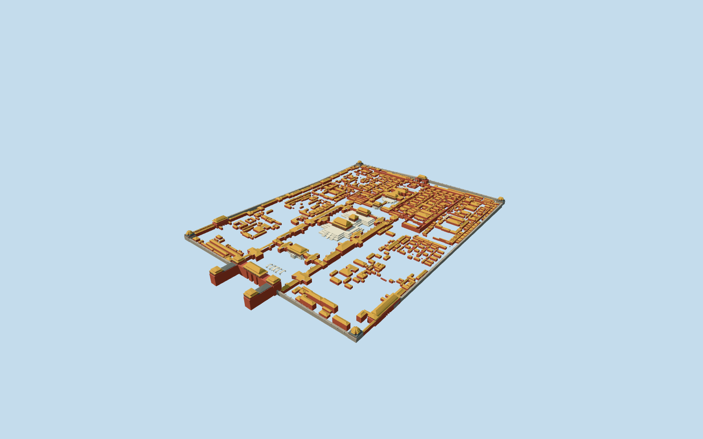
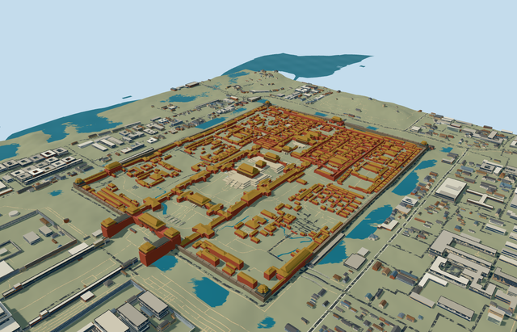

# N0738 — Forbidden City

Reviewed2026-10-20 in one author/build/inspect/fix pass.

## Appearance

Inspected60 current final source, shared-material, medium-fi and native views. The specific complete mapped Forbidden City exterior retains828 individually clipped subsidiary roof footprints, court/perimeter walls, the three central Harmony halls/triple stone terraces, inner palaces, U-shaped Meridian Gate/five pavilions, northern gate, east/west gates with open arch passages, four crossed-roof corner towers and five individually mapped Golden Water footbridges. Red timber/columns, gold swept roofs/teal beam belts, grey lower roofs and pale stone stairs/rails retain the photographed organization. Corrected the wall crown grades, central plaza datum, exposed southern step flights/closed ceremonial ramp and door-panel material within one construction/review pass. No copied inscriptions, murals, banners, crowds or furnished collection interiors.

## Shared surfaces and browser budgets

Four existing256px graphs: wood_plain, tile_ceramic, stone_limestone and brick. Red painted structure/opaque timber door panels/trim/teal belts, gold and grey roofs, pale terraces/rails and grey masonry share these graphs. Five near draws/one skyline draw; each required graph read once, no new graph, embedded image, private atlas or local bitmap. Timber panels approximate joinery without claiming its exact fine lattice. Separate POSITION/NORMAL streams and equal CPU/GPU accounting.

| Level | Triangles | Bytes | Draws |
| --- | ---: | ---: | ---: |
| skyline | 948 | 86252 | 1 |
| district | 3936 | 387504 | 4 |
| street | 14239 | 1363392 | 5 |
| closeup | 63694 | 6205796 | 5 |

Four authored browser levels: 948/3936/14239/63694triangles; 86252/387504/1363392/6205796bytes. Initial skyline plus district 473756bytes, below3MB phone/6MB laptop initial asset targets. Skyline uses162 roof-area-scaled flat patches and separate major three-dimensional forms; district/street use162/357 coarse roof groups and closeup retains828 independent footprint-clipped subsidiary roofs; principal halls, gates/corner towers and the open central courts remain distinct. Near levels add curved roof bands, columns/panels, rails, crenellations and bridge arches. Physical ordinary-laptop/phone/tablet and dense-city timings remain pending.

## Approximate native placement

Retained Q80290/relation9511883 and named native Forbidden City POI52776567645131 establish identity. 2470 integrated native building/part records within the retained historic boundary guide the full approximately752x1051m compound. Main hall POIs/footprints control the central axis; southern Meridian Gate establishes positive internalZ. Anchor[116.390807753,39.916348348]/world heading0/internal X[0.9992843702173692,-0.037825222263404915]/Z[0.037825222263404915,0.9992843702173692]. Separate Tiananmen/Duanmen, Jingshan, moat and surrounding neighborhood remain native. Fine facing/working roof profiles are approximate. The retained historic boundary plus35 exact edge-component outlines replaces only2470 integrated Forbidden City records. All1620 independent resident buildings of4090 originals and all2525 wider independent buildings of4995 remain unchanged. The original6m grid, roads and1185267.2218153737square metres native water remain unchanged.2800 actual PMTiles13/14/15 cases pass, including2753 owned detailed fragments covering all2470 distinct owned records. Failure retains4090 originals; all levels unload restore terrain/water/zero live model geometry. Retain the original standard6m Mapzen grid, native roads, central Golden Water stream, moat and every independent neighboring building. Coarse samples contain roof/terrain variation; individual occupied foundations extend below original local grades and selected hall terraces share an approximate datum. Ground openings are bounded by actual occupied model floors, never a whole palace-precinct ground slab. Replace only integrated native components; detailed coverage99.5percent/generalized bounded clipping. Failed loading retains originals; unloading restores terrain and releases model geometry. The three central halls/terraces share original plaza grade-6.288943978990174m; bounded stair-floor openings reveal the occupied steps without changing source samples. Synthetic flat contexts can hide below-datum roofs, bridge feet and gate openings; native views establish placement. The unmodified coarse DEM locally hides parts of native water and creates uneven margins near gates; this review records approximate model fit and does not certify corrected real terrain or water levels.

## Limits

Five ordinary photographs actually viewed:2018 oblique north gate/side roofs,2017 Meridian Gate/Golden Water courtyard,2017 full Jingshan panorama,1991 Supreme Harmony hall/terraces and2017 northwest corner tower/moat. Pictures viewed only/no copied pixels or bespoke archive/survey/terrain research. Standard map heights/min-heights have unqualified datum. Main controls supply working central hall ridges41/32/35m, triple terraces3/6/9m, Meridian Gate roof peaks up to45m and north gate28m. These values are retained as visualization controls, not surveyed measurements. Unqualified smaller buildings use footprint-led picture estimates; generic lower roofs, bays, ridge ornaments, roof-tier/railing/column inventories and absent gate arch dimensions remain approximate. Five photographs from1991/2017/2018 establish visible form, not current condition or a certified room/roof inventory. Ceremonial floor datum-6.288943978990174m comes from the original southern plaza samples rather than the roof-influenced anchor; triple terrace heights and central hall profiles are relative to that working floor. Fine lattice, roof-ridge beasts, inscriptions, hidden plant, furnishings, landscaping trees and collection artworks are not reconstructed; mapped exterior forms and original context define this structure scope.

## Selected checks

Six Khronos files: zero errors/warnings.658 actual mesh/contact checks,60 current inspected views,2800 actual native map cases. Selected source/import/placement/strict medium-fi/scene/sim30/lint checks pass. Sim30 hash0c2dfcde9e1534e53ed4faf12de544afea2c8c8e702a541a081964342b5468e4. Source/runtime/input pins recorded.

Source sha256:aa4a99a8e5e64c6a94c4a6d08ca45b46fe5d3da8da9f6788c526ac8c5790dcf4

Runtime sha256:0194e8688d6892046ef0c0507584dcd2e7ecb4cd1b0dd37e5bf3435f9cceb091

Input sha256:08da7c248f8fc9c2f48bcd81919d3470f12864a204b6924aabd2ce6ffbd80c15

Rebuild: node packages/worldgen/scripts/generate-additional-landmarks.mjs --ids=N0738; node packages/worldgen/scripts/import-next-1000-models.mjs --ids=N0738; node packages/tooling/scripts/generate-landmark-lods.mjs --ids=N0738 --force.

## Ordinary picture references

https://commons.wikimedia.org/wiki/File:China_(Beijing)_Aerial_view_of_Forbidden_City_(38884882275).jpg — https://thumb.wikimedia.org/wikipedia/commons/thumb/b/bf/China_%28Beijing%29_Aerial_view_of_Forbidden_City_%2838884882275%29.jpg/960px-China_%28Beijing%29_Aerial_view_of_Forbidden_City_%2838884882275%29.jpg; Güldem Üstün; 2018-01-19; CC-BY-2.0. Viewed only/no copied pixels.

https://commons.wikimedia.org/wiki/File:Forbidden_City_IMG_4303_Meridian_Gate_-_Gate_of_Supreme_Harmony.jpg — https://upload.wikimedia.org/wikipedia/commons/thumb/a/a7/Forbidden_City_IMG_4303_Meridian_Gate_-_Gate_of_Supreme_Harmony.jpg/960px-Forbidden_City_IMG_4303_Meridian_Gate_-_Gate_of_Supreme_Harmony.jpg; Bjoertvedt; 2017-07-10; CC-BY-SA-4.0. Viewed only/no copied pixels.

https://commons.wikimedia.org/wiki/File:Forbidden_City,_as_viewed_from_Jingshan.jpg — https://thumb.wikimedia.org/wikipedia/commons/thumb/8/8a/Forbidden_City%2C_as_viewed_from_Jingshan.jpg/960px-Forbidden_City%2C_as_viewed_from_Jingshan.jpg; Picrazy2; 2017-12-24; CC-BY-SA-4.0. Viewed only/no copied pixels.

https://commons.wikimedia.org/wiki/File:Forbidden_City,_Hall_of_Supreme_Harmony_(9854242723).jpg — https://thumb.wikimedia.org/wikipedia/commons/thumb/f/f7/Forbidden_City%2C_Hall_of_Supreme_Harmony_%289854242723%29.jpg/960px-Forbidden_City%2C_Hall_of_Supreme_Harmony_%289854242723%29.jpg; Gary Todd; 1991-07-02 (source description; scanned slide); CC0-1.0. Viewed only/no copied pixels.

https://commons.wikimedia.org/wiki/File:The_northwest_corner_tower_of_the_Forbidden_City_(May_2017).jpg — https://thumb.wikimedia.org/wikipedia/commons/thumb/4/40/The_northwest_corner_tower_of_the_Forbidden_City_%28May_2017%29.jpg/960px-The_northwest_corner_tower_of_the_Forbidden_City_%28May_2017%29.jpg; Windmemories; 2017-05-07; CC-BY-SA-4.0. Viewed only/no copied pixels.
