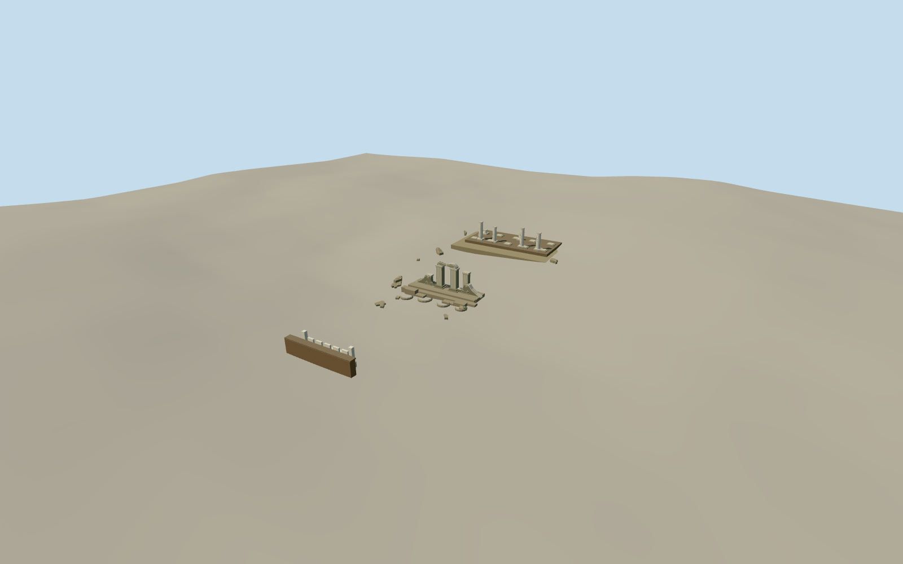

# Old Summer Palace, Great Fountain Ruins

The present Great Fountain, Yuanyingguan and Fountain View ruins at the Old Summer Palace, including the broken Baroque arch, white marble columns, and five-panel viewing screen.

Authoring state: **review-in-qa.json**. Current completion evidence is in [qa.json](qa.json) and the [completion ledger](../../../../qualla-structures/batches/qualla-003.PROGRESS.md).

- [Old Summer Palace](https://qualla.com/old-summer-palace/)

The model covers three visible remains on the Western Mansions axis, anchored at the Great Fountain on the story’s original site. The wider park grounds and other ruins occupy separate places.

The standing fragments, carved shapes and collapsed courses follow the surviving form documented by public-domain photography. Precise stone profiles, restoration joints, heights and fragment positions are estimates.

The original terrain preserves the broad site grade. Low ruin platforms reproduce above-ground shapes. Lost fountains, bronze sculpture, original palace interiors and temporary visitor barriers are outside the modeled scope.

Build: `node content/worldgen/source/places/wx/wx4/old_summer_palace/models/generate-old-summer-palace.mjs`. Add `--check` to verify exact regeneration. 5695 triangles; 5 materials; no embedded photographs.
