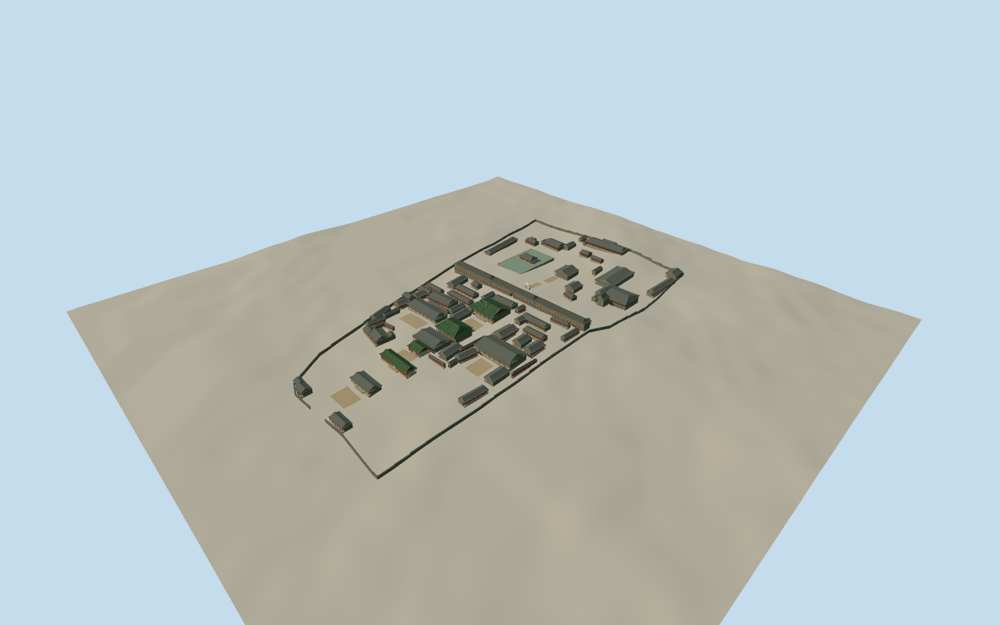

# Prince Gong’s Mansion

Beijing’s Prince Gong mansion and garden, with the green-roofed ceremonial axis, gray tiled courts, rear screen building, marble garden arch and pond pavilion.

Authoring state: **review-in-qa.json**. Current completion evidence is in [qa.json](qa.json) and the [completion ledger](../../../../qualla-structures/batches/qualla-003.PROGRESS.md).

- [Prince Gong's Mansion](https://qualla.com/prince-gong-s-mansion/)

Individual heights, painted motifs and secondary roof shapes are interpreted. Supplemental roofprints locate roof cover rather than exact wall lines.

The Rear Building follows about 152 m of the mapped garden boundary. The overall 183 m length reported by the museum could not be located precisely from the available footprints.

The garden gate, theatre association and paths are approximated from mapped geometry and the museum’s written route. The pond water and pavilion terrace levels are fitted to the original elevation field and are approximate. Open ground and rockeries retain that field. Interiors are outside the model scope.

Build: `node content/worldgen/source/places/wx/wx4/prince_gong_s_mansion/models/generate-prince-gong-mansion.mjs`. Add `--check` to verify exact regeneration. 53262 triangles; 6 materials; no embedded photographs.
