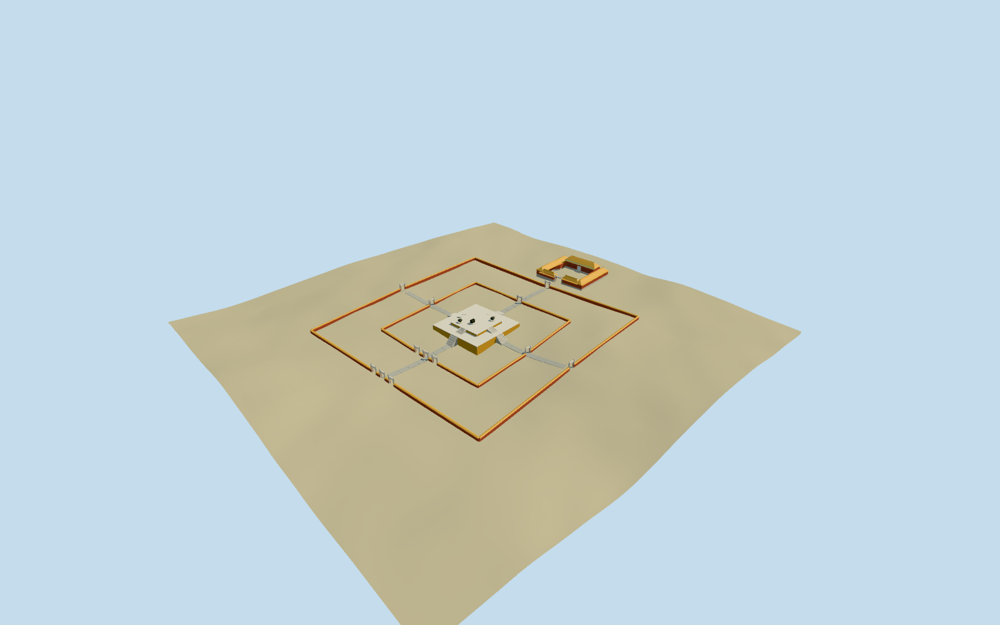

# Temple of Earth

Specific Temple of Earth ceremonial core: two-tier square yellow-brick Fangze altar with pale stone coping/corner dressings, four aligned stairways per tier, square red enclosures with yellow tile coping and open white stone Lingxing gateways, axial approaches and original simplified bronze ritual vessels. Include the mapped southern Huangqi hall court with yellow hipped roofs, red facade, open central doorway, painted beam trim and flanking L-shaped wings. Larger Ditan Park, the distant entrance paifang, gardens and other park compounds remain host context. Internal allocations, terrace/wall heights, gate/vessel inventory and carving are approximate exterior visualization.

## Evidence and reconstruction

Published dimensions and reconstructed details are separated in spec.json. Primary references:

- [Reference](https://commons.wikimedia.org/wiki/File:Erdaltar_01.jpg)
- [Reference](https://commons.wikimedia.org/wiki/File:Beijing_Temple_of_Earth_pic_3.jpg)
- [Reference](https://s.visitbeijing.com.cn/attraction/117830)

A deterministic site recipe and reusable Khmer geometry helpers build the specific square Fangze altar, open white stone gateways, red/yellow enclosures and mapped southern Huangqi hall court. Six reused256-square granite/brick/plaster/tile/wood/bronze graphs, metric UVs, linear tints and four authored browser levels; no embedded images or copied narrative atlas.

## Model and axes

8,436 triangles; 25,308 vertices; 7 material groups; 1,016,668 bytes. Native bounds: -72.604, -2.442, -72.604 to 72.604, 12.207, 109.130. Source hash: `sha256:4240b94f86169583af12bad8da1d08e0fed5a0be3a1ae7c3550ea0816b94fc93`.

{"x":"east","y":"up","z":"south"}

The geographic proposal uses exact-QID OpenStreetMap evidence. Map-derived orientation and estimated architectural details require real-site visual review; preview eligibility is distinct from geographic/fidelity approval. Map attribution: © OpenStreetMap contributors, ODbL-1.0.

## Reproduce

Run `node packages/worldgen/scripts/generate-additional-landmarks.mjs --ids=temple_of_earth` (or add `--check`). The generator preserves manually edited masters by checking their baseline hashes. Import through the standard authored-model workflow with optimization disabled; then capture all QA cameras, including shared-surface views.

## Pending work

- Specific Temple of Earth ceremonial core: two-tier square yellow-brick Fangze altar with pale stone coping/corner dressings, four aligned stairways per tier, square red enclosures with yellow tile coping and open white stone Lingxing gateways, axial approaches and original simplified bronze ritual vessels. Include the mapped southern Huangqi hall court with yellow hipped roofs, red facade, open central doorway, painted beam trim and flanking L-shaped wings. Larger Ditan Park, the distant entrance paifang, gardens and other park compounds remain host context. Internal allocations, terrace/wall heights, gate/vessel inventory and carving are approximate exterior visualization.
- Exact-QID Q615178/way78050667 supplies the132.344x131.955m main ceremonial enclosure; named standard PMTiles point35184450139499 corroborates identity. Root heading0, internal angle+1.474895246492rad, +u approximately south and +v west. Standard native footprints35184749931995/35184756358521/35184756358522 fix the southern Huangqi hall and L-shaped side court. The main altar/enclosure has no native building shell. Its inner wall, terrace dimensions, gateway allocations and vessels are photo-led approximations within the named square. Replace only the three southern matching shells, preserving the other park buildings. Do not treat the whole Ditan Park as one solid building.
- Picture-led35m lower square/20.5m upper square altar, about1.05m/1.45m rises above a local base; outer/inner walls1.8m/1.5m, stone frames roughly4.6m, southern hall body4.7m/hipped ridge7.6m and side-wing ridges5.7m above separately seated floors. These are approximate visual dimensions; no surveyed ceremonial stair counts, gate inventory, vessel/sculpture catalogue or exact painted motif is claimed.
- Retain pinned standard Protomaps2026-10-14/Mapzen13-14 original6m forest/urban terrain, water and independent buildings. Altar and each southern hall/court footing have separate local level tops with buried bottoms. Long enclosure walls/coping and approach strips follow sampled grade; gateway feet are locally seated. Courtyard ground stays open except narrow grade-following approach strips; do not flatten the132m precinct or cut ground/water. Forest DEM varies several meters across the enclosure and does not resolve ceremonial paving, exact thresholds or landscaped moat levels.
- Inner enclosure and terrace dimensions, gate allocations, ceremonial vessel inventory, hall heights and secondary facades are photo-led approximations within the mapped ceremonial core. Larger Ditan Park, distant park gateways and neighboring compounds remain host context. No copied readable inscriptions or exact ceremonial sculpture/paving survey is claimed.

This bundle follows the medium-fi standard. Medium-fi appearance and geographic fit are reviewed separately. Hash-bound visual acceptance is recorded separately after capture inspection.

## Additional geographic data

©OpenStreetMap contributors; Protomaps; Mapzen/USGS terrain.
