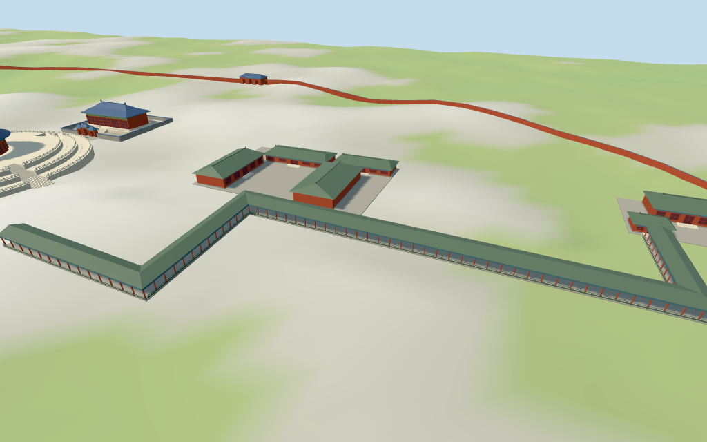

# temple_of_heaven — Temple of Heaven

Reviewed 2026-10-18 for the declared principal exterior and approximate map fit.

## Exterior scope

The model includes the Hall of Prayer, northern halls, Imperial Vault, Circular Mound Altar, Palace of Abstinence, music and service groups, Long Corridor, Longevity Pavilion, selected precinct gates and walls, and processional paving. Open bays, stairs, rails, gate openings and roof silhouettes are represented at their intended detail levels.

Fine ornaments, artwork, inscriptions, navigable interiors, vegetation and unverified southern wall links are omitted. Architectural heights, grades, gate forms, wall routes and facing remain visualization estimates. Orientation uncertainty is 10 degrees.

## Shared materials and browser levels

Seven existing shared 256² material graphs serve nine semantic roles. The near model has eight merged materials, including explicit matte ground and water. Tinted glazed tile, wood, ceramic, brick, marble and bronze use metric UVs and linear colors. There are no embedded images, photo textures or unique atlases. Browser captures load each shared graph once and release model geometry on unload.

| Level | Triangles | Bytes | Draws |
| --- | ---: | ---: | ---: |
| Skyline | 979 | 102,028 | 1 |
| District | 3,998 | 387,696 | 8 |
| Street | 15,985 | 1,478,532 | 8 |
| Closeup | 50,721 | 4,577,696 | 8 |

Initial skyline plus district: **489,724 bytes**, plus shared graphs. Detailed source: **53,681 triangles / 6,446,436 bytes**. Source, runtime and closeup bytes are unchanged from the completed precinct stage. Remote levels intentionally omit small annexes, columns and some gates. All levels retain the same causeway deck profile and covered terrain openings.

## Map, terrain and streaming

Placement uses retained standard viewer PMTiles and the original unmodified 161² DEM, supplemented by ordinary exterior pictures. No bespoke survey or terrain download was used. The main-hall center anchors +X east and +Z south with heading zero. The host samples that exact reference coordinate; model height at the reference is zero.

Thirteen separate ground openings preserve park terrain between groups. All 52 combinations of LOD and opening pass 16,584 floor samples. The explicit building mask covers 68 authored map controls and preserves all 784 independent retained building polygons. The actual DEM tile contains 431 buildings; all 363 independent records remain unchanged. Two quantized shared-edge remnants total 0.1802 m²; a third has zero area.

Mapped access paths retain their separate native line parts. The pavilion's original low review camera was inside a neighboring covered passage; a north-side actual-site view confirms the pavilion is clear. That passage retains the normal procedural fallback, so its height and appearance are approximate.

The partial 512 m residency check preserves terrain outside the loaded model piece. Failed model loading retains terrain and all mapped buildings. Unloading restores terrain and disposes model geometry. This review found and fixed a runtime defect that opened ground beyond resident tiles; 27 targeted tests pass.

## Inspected evidence

The current review covers 230 views: 53 portable, 52 shared-placement, 84 medium-fi and 41 actual standard-DEM/map-context views. Of the official captures, 122 are byte-identical to the inspected preceding stage; 67 changed/new official views and 41 actual-site views were inspected now. Economy and High, noon and late light, three distances, matched LODs and transitions use the shared Earth rig.

Six Khronos validations have zero errors or warnings. All 303 FrontSide geometry probes pass. The scene validates and simulates for 30 ticks. Source registration, selected placement and four LOD layouts pass. Current hashes, cameras, frame paths and browser state are recorded in qa.json and the three capture reports. Bulk images stay ignored; two small summary previews remain in source.

Stale stage-only terrain prose was corrected after integration. Exact comparisons confirmed all six model files, all 189 official images and the placement were unchanged; the existing inspection was carried forward with that correction recorded in qa.json.

## Reproduction and remaining limits

Generate and register temple_of_heaven with generate-additional-landmarks, index-structure-authoring, generate-landmark-lods and register-landmark-previews. Use the selected source and placement checks. Capture with capture-structure-models --reflections --antialias --fit-shadows; capture-landmark-library --reflections --adaptive-clipping --bounded-placement; and capture-medium-fi --ids=temple_of_heaven --reflections. Source retains the standard map and DEM controls, context polygons and partitioned paths.

The source-local lowered terrain and flat placement fixture are approximate review surfaces. Actual standard-DEM context supplements them; the flat fixture alone cannot verify separate court elevations. Host DEM choice and resolution can alter edge seating. Physical laptop, phone, tablet and dense-city measurements remain pending. This is an original medium-fi exterior visualization, not a surveyed reconstruction.
