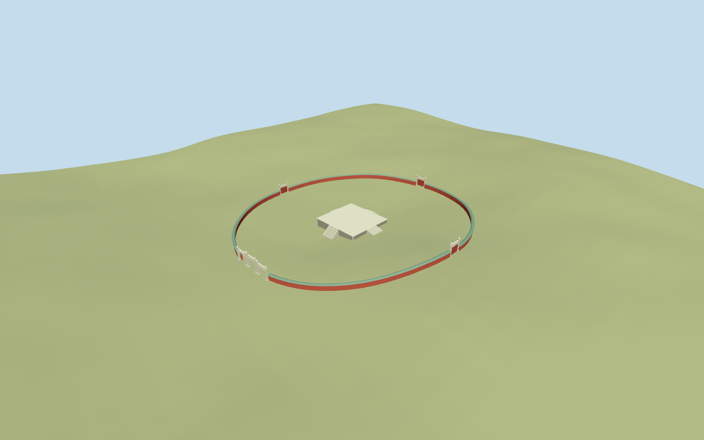

# Temple of the Sun

Specific standing Ritan ritual core: mapped low square gray altar/pale coping and corner strips, four straight cardinal stair flights with splayed pale cheeks, circular low red enclosure/green tiled coping, three open west stone portals and one closed red-leaf stone portal on each other cardinal approach. Original simplified pointed finials/scroll ends and shallow stone decoration. No roofed central temple, invented altar balustrade or copied inscriptions/sculpture/mural atlas. Other park pavilions, northwest auxiliary halls, Sun Worship mural and landscaping remain separate host context, not claimed authored in this ritual-core model.

## Evidence and reconstruction

Published dimensions and reconstructed details are separated in spec.json. Primary references:

- [Reference](https://commons.wikimedia.org/wiki/File:Sonnenaltar.jpg)
- [Reference](https://commons.wikimedia.org/wiki/File:%E7%A5%AD%E6%97%A5%E5%8F%B0_-_Altar_of_the_Sun_-_2012.04_-_panoramio.jpg)

Specific standing Ritan ritual core: mapped low square gray altar/pale coping and corner strips, four straight cardinal stair flights with splayed pale cheeks, circular low red enclosure/green tiled coping, three open west stone portals and one closed red-leaf stone portal on each other cardinal approach. Original simplified pointed finials/scroll ends and shallow stone decoration. No roofed central temple, invented altar balustrade or copied inscriptions/sculpture/mural atlas. Other park pavilions, northwest auxiliary halls, Sun Worship mural and landscaping remain separate host context, not claimed authored in this ritual-core model.

## Model and axes

5,640 triangles; 16,920 vertices; 5 material groups; 680,196 bytes. Native bounds: -36.245, -1.599, -43.979 to 39.735, 9.471, 31.611. Source hash: `sha256:5e543af225b608803b28687b1de08203c450d326f928c32fa6bbde9f7cee018f`.

{"x":"east","y":"up","z":"south"}

The geographic proposal uses exact-QID OpenStreetMap evidence. Map-derived orientation and estimated architectural details require real-site visual review; preview eligibility is distinct from geographic/fidelity approval. Map attribution: © OpenStreetMap contributors, ODbL-1.0.

## Reproduce

Run `node packages/worldgen/scripts/generate-additional-landmarks.mjs --ids=temple_of_the_sun` (or add `--check`). The generator preserves manually edited masters by checking their baseline hashes. Import through the standard authored-model workflow with optimization disabled; then capture all QA cameras, including shared-surface views.

## Pending work

- Specific standing Ritan ritual core: mapped low square gray altar/pale coping and corner strips, four straight cardinal stair flights with splayed pale cheeks, circular low red enclosure/green tiled coping, three open west stone portals and one closed red-leaf stone portal on each other cardinal approach. Original simplified pointed finials/scroll ends and shallow stone decoration. No roofed central temple, invented altar balustrade or copied inscriptions/sculpture/mural atlas. Other park pavilions, northwest auxiliary halls, Sun Worship mural and landscaping remain separate host context, not claimed authored in this ritual-core model.
- Named standard PMTiles Altar of the Sun POI35184495982750 and its central platform building35185801754351 correlate candidateQ964720. Platform four measured corners fix15.843x16.774m envelope/center[1.891951470026,-6.183890072934] and near-east-west cross axis; retain its slight mapped skew through explicit x/z vectors rather than inventing an orthogonal survey. Pedestrian courtyard35184495982750 supplies the approximately74.6m circular boundary. Native approaches35185801754350 support four cardinal portals and the west axis. Anchor116.438111111,39.914416666, heading0/native east-south axes. Circular wall/gates approximately centered on the altar, west triple facing west. Fine gate foundations lack separate footprints; radius37.3m, portal positions/open/closed assignments are picture/map approximations with about3m/5degree uncertainty, not exact-QID footprint registration.
- Two ordinary pictured-state references: altar top about1.2m above its sampled upper ground envelope, nine nearby stair rises/four cardinal approaches. Enclosure red body1.55m above sampled grade plus green coping0.24m; west center stone portal4.7m, side portals4.3m, other three4.0m above their local threshold. Three west openings3.4m wide/2.65m tall; other gates3.2m wide with closed red leaves. Counts, leaf studs/scroll relief, heights and absolute threshold levels are estimates. The central altar has no roof/balustrade; old intact ceremonial interiors are not reconstructed.
- Original standard6m Mapzen grid, native pedestrian courtyard/paths/water and all independent buildings remain unchanged. Only corresponding central platform shell35185801754351 is replaced. Altar occupied footing is buried below sampled ground and each narrow cardinal approach descends to sampled grade. Circular wall footings and coping follow the retained ground; gate footings are individually buried. No broad court/park slab, ground or water cutout, terrain flattening or invented whole-park reconstruction. Native coarse park ground cannot resolve archaeological paving and actual altar/stair thresholds; courtyard paving stays a host surface.
- Two ordinary2009/2012 photographs establish the standing ritual core. Gate/relief inventories, heights and later alterations are approximate. Other park pavilions, auxiliary halls, Sun Worship mural and landscaping stay separate host context, not claimed authored. No roofed central shrine, invented altar balustrade or copied text/sculpture/mural atlas.

This bundle follows the medium-fi standard. Medium-fi appearance and geographic fit are reviewed separately. Hash-bound visual acceptance is recorded separately after capture inspection.

## Additional geographic data

©OpenStreetMap contributors; Protomaps; Mapzen/USGS terrain.
