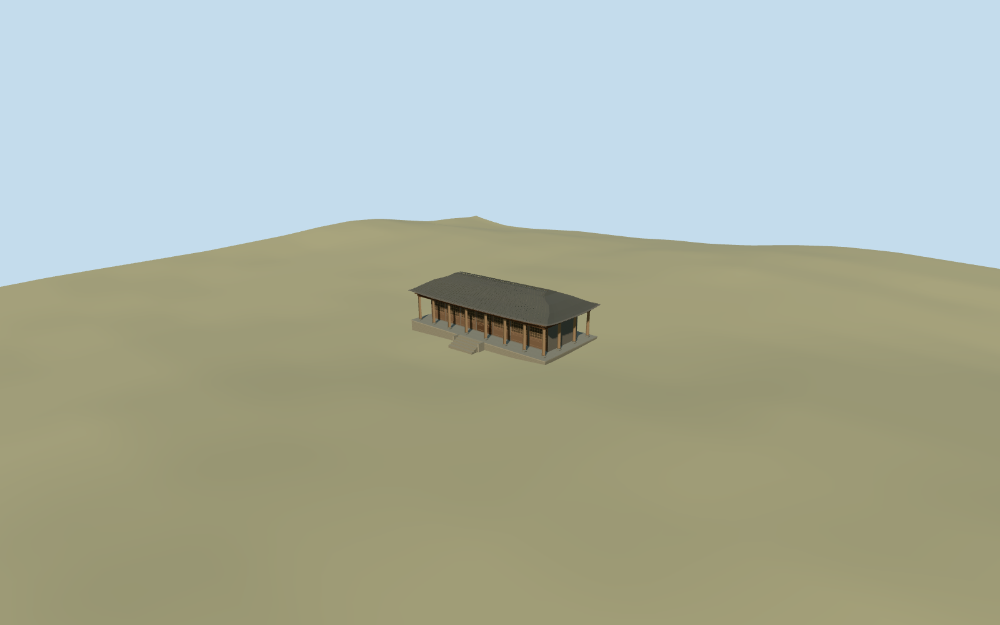

# Danbo Jingcheng Hall

The Danbo Jingcheng audience hall at Chengde Mountain Resort, with unpainted nanmu columns, seven screened bays, stone terrace and a single gray rolled-ridge roof.

Authoring state: **review-in-qa.json**. Current completion evidence is in [qa.json](qa.json) and the [completion ledger](../../../../qualla-structures/batches/qualla-003.PROGRESS.md).

- [Chengde Mountain Resort](https://qualla.com/chengde-mountain-resort/)

The principal Danbo Jingcheng audience hall is represented. Adjoining gates, the rest of the imperial palace, the gardens and the outer temples are outside this placement.

The mapped 30.7 by 9.1 metre core anchors the model. The surrounding gallery extends the model to approximately 35.0 by 16.7 metres consistent with the documented building area. Roof rise, doors, plinth, stairs and secondary joinery are estimated.

Actual courtyard paving and minor terrain grading are simplified over unchanged source terrain. The owner waypoint identifies the nearby visitor approach and is distinct from the building center.

Build: `node content/worldgen/source/places/wx/wx7/danbo_jingcheng_hall/models/generate-danbo-jingcheng-hall.mjs`. Add `--check` to verify exact regeneration. 9768 triangles; 5 materials; no embedded photographs.
