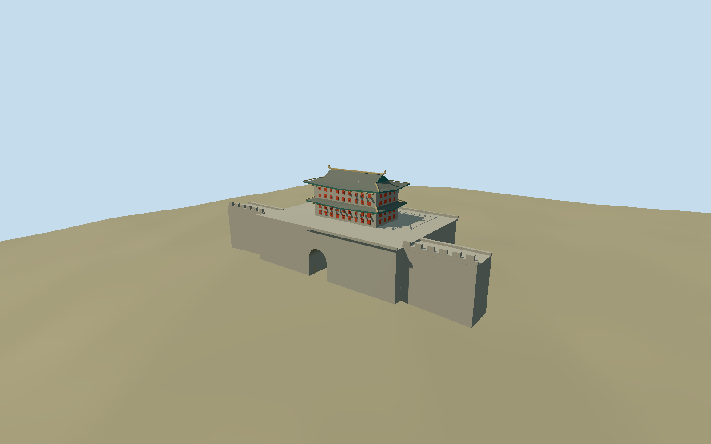

# Shanhai Pass

Zhendong Gate: deep arched masonry platform, two upturned roof tiers, hip-and-gable crown and red upper gallery with a pale five-character plaque. Short city-wall attachments; no wider pass or coastal fortress.

## Evidence and reconstruction

Published dimensions and reconstructed details are separated in spec.json. Primary references:

- [Reference](https://www.shgjq.com/xwzx/283.jhtml)
- [Reference](https://artsandculture.google.com/story/MwWhBZEOAqWBCQ?hl=zh-CN)
- [Reference](https://www.openstreetmap.org/way/414001373)

No third-party geometry, photograph or bitmap texture is embedded. Shared surface graphs come from the central library; vertex tints carry model colors. Glazing uses PBR materials; transparent surfaces are declared per model.

## Model and axes

4,522 triangles; 9,714 vertices; 4 material groups; 406,724 bytes. Native bounds: -38.000, -3.793, -15.650 to 38.000, 25.570, 15.650. Source hash: `sha256:c871108e5be14e468103d45a29c3e13025444131cfe882f3f98c6f9220b596f2`.

{"up":"+Y","longitudinal":"+X northwest along mapped gate face","front":"+Z outward northeast","origin":"Signed mapped gate anchor; Y0 decoded26 m working datum."}

Fresh named way414001373 v6 agrees with every retained outline vertex within0.000664 m. It has no exact Wikidata tag: Q1048381 identifies the broader pass; this model covers Zhendong Gate only. Anchor[119.753742,40.009332], heading2.5025517303973333: native +X northwest306.614348 degrees along the long gate face, +Z northeast36.614348 degrees toward the outward east side. West town-facing gallery and plaque are -Z. Primary operator photos sign the asymmetrical faces. Retained16641-value2 m terrain grid uses decoded working datum26 m;3.659135 m raster pixel interval is not verified native resolution or survey accuracy. Architecture rises0.12 m above maximum occupied retained grade, buried foundation ends at-3.793 m. Host ground remains inside the real5.8 m wide/7.5 m high portal. No ground opening or whole-city plinth. Ground underneath buildings may be contaminated; datum/vintage unverified.

## Reproduce

Run `node packages/worldgen/scripts/generate-signature-towers.mjs --ids=N0259` (or add `--check`). The generator preserves manually edited masters by checking their baseline hashes. Import through the standard authored-model workflow with optimization disabled; then capture all QA cameras, including shared-surface views.

## Pending work

- Original5338-triangle/460532-byte detailed master remains reproducible at sha256:264019eec2598887face6903d649a43be545adde05f337cde20cfd10c265667f from unchanged shanhai-pass-model.mjs#shanhaiStudy.build.
- Fresh named way414001373 v6 agrees with every retained outline vertex within0.000664 m. It has no exact Wikidata tag: Q1048381 identifies the broader pass; this model covers Zhendong Gate only. Anchor[119.753742,40.009332], heading2.5025517303973333: native +X northwest306.614348 degrees along the long gate face, +Z northeast36.614348 degrees toward the outward east side. West town-facing gallery and plaque are -Z. Primary operator photos sign the asymmetrical faces. Retained16641-value2 m terrain grid uses decoded working datum26 m;3.659135 m raster pixel interval is not verified native resolution or survey accuracy. Architecture rises0.12 m above maximum occupied retained grade, buried foundation ends at-3.793 m. Host ground remains inside the real5.8 m wide/7.5 m high portal. No ground opening or whole-city plinth. Ground underneath buildings may be contaminated; datum/vintage unverified.
- Two-meter diagnostic grid resamples coarse public terrain;3.659135 m source pixel interval is not verified native resolution or survey accuracy. Vertical datum/vintage and under-building contamination unknown; no outlier filter.
- Highest occupied platform/stub sample plus0.12 m selects rigid architecture shift; foundations extend to minimum occupied sample minus0.8 m. The original numeric host surface remains the gateway floor. No ground cut or whole landscape replacement.
- Platform uses published44×30.4×11.75 m and gate7.5 m high/5.8 m wide; map footprint is irregular and original cached envelope simplified. Stub extent76 m/stair alignment/roof ornaments reconstructed. The scoped gateway does not represent the whole fortification system or coastal Laolongtou.
- Primary operator publishes44×30.4×11.75 m platform,20×10.1×13.7 m tower,5.8×7.5 m portal and5.9×1.55 m plaque. Existing irregular mapped platform is approximately44×27.5 m; published rectangular envelope is used for reconstructed masonry. Exact plan corner/stair registration is not surveyed. Short76 m wall attachments and access stair are interpreted; broader city walls/barbican/coastal Laolongtou are excluded. The broad riding ramp in operator photographs is not included as a georegistered reconstruction.
- Town-facing west upper red gallery/plaque differs from brick outward north/east/south arrow-window faces. District and nearer tiers represent68 red shutter positions; exact archaeological positions, shutter fittings, complex painted decoration and roof ridge beasts are simplified. Small dark aiming circles are opaque reserves, not modeled interior holes. Cream five-character plaque strokes are simplified reconstructed calligraphy, not a photographic facsimile. Single-eave wording on the operator page disagrees with visible two roof skirts and the second primary exhibition double-eave wording; retained geometry follows the actual photos. Conserved exterior interpretation, no exact2026 daily-condition survey; temporary flags, floral displays, snow and scaffolding excluded.
- Three common graphs supply long-format brick, plain wood and slate with component tints. One local opaque recess group supplies aiming circles, gallery darkness and plaque strokes. Skyline bakes measured common linear means. No embedded photographs/images. Interiors, walkability/collision and physical laptop/phone measurements are outside this review.

This bundle follows the medium-fi standard. Medium-fi appearance and geographic fit are reviewed separately. Hash-bound visual acceptance is recorded separately after capture inspection.

## Additional geographic data

Map data © OpenStreetMap contributors, ODbL-1.0. Reference photographs are linked evidence, not textures or redistributed files.
