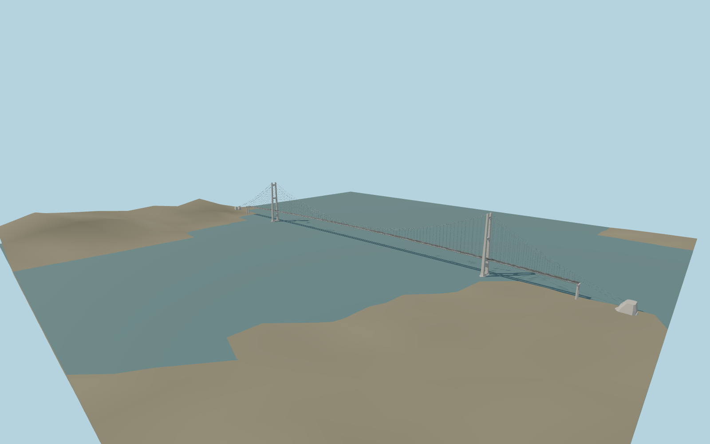

# Yi Sun-sin Bridge

Compact Yi Sun-sin crossing: inclined H tower legs/crossbeams, twin aerodynamic deck boxes, wind slot, cables and representative hangers, unequal anchorages and simple rail/light fittings. Original detailed recipe preserved.

## Evidence

- [Primary reference](https://yscms.yeosu.go.kr/tour/leisure/bridge/yisunsin_bridge)
- [Primary reference](https://www.lusas.com/case/bridge/yi_sun_sin.html)
- [Primary reference](https://m.dlenc.co.kr/m/pr/InfoView.do?cd_mnu=KM030&no_ntc_plte_sral=7111)
- [Primary reference](https://www.gleitbau.com/en/projects/yi-sun-sin-grand-bridge)
- [Primary reference](https://www.gleitbau.com/en/download/project/248)
- [Primary reference](https://trid.trb.org/View/1100291)
- [Primary reference](https://doi.org/10.2749/101686612X13216060213158)
- [Primary reference](https://doi.org/10.1016/j.engstruct.2015.06.031)
- [Primary reference](https://www.openstreetmap.org/way/165044187)
- [Primary reference](https://www.openstreetmap.org/way/643846203)

Published dimensions and reconstruction assumptions are separated in spec.json. Source photos were consulted; no photos or third-party geometry are embedded. Map plan attribution: © OpenStreetMap contributors, ODbL-1.0.

## Source

51996 triangles; 6242620 bytes; 5 material groups. SHA256: sha256:aaa1c873609792124ed80e62d7299461bde5e04e2e27c9f4083c322ba1a1b05e.

Shared surfaces (concrete_plain, metal_painted, metal_stainless) are loaded through the central library; any transparent materials use local PBR parameters. Axis and provisional vertical datum are in spec.json.

Regenerate with node packages/worldgen/scripts/generate-researched-bridges.mjs --ids=N0025; append --check to verify. Import and capture through the standard next-1000 scripts. Geometry validation does not substitute for current-frame visual review.

## Reconstruction limits

- One inspected VisitKorea picture confirms the tall inclined H towers, suspension line, narrow twin roadway and shoreline context. Standard viewer PMTiles paired bridge roads and bay agree with the retained near-north/south foundation-centred frame. Retain2260m suspended deck,1545m central span and2545m cable anchorage spacing; longer3794.742m map approach extent is separate. Source sea-level0m agrees with coarse mapped bay samples. Deck height/vertical curve, foundation pads, tides and terminal joins remain approximate; adjoining mainland/Myodo approach roads are supplied by the viewer and are outside this model.
- Skyline merges twin boxes and end-pier legs; low tiers use two-sided suspension ribbons. District/street/closeup restore wind slot and closer levels cylindrical cables, paired closeup hangers, sockets, bands, simple rails and sparse lights. Fine formwork courses, exact cable shrouds, foundation rails, inspection fixtures and bolts are omitted; original master remains independently reproducible.
- Shared concrete/stainless/painted metal are reused, with flat road and marking materials. Physical-device timings remain unmeasured.
