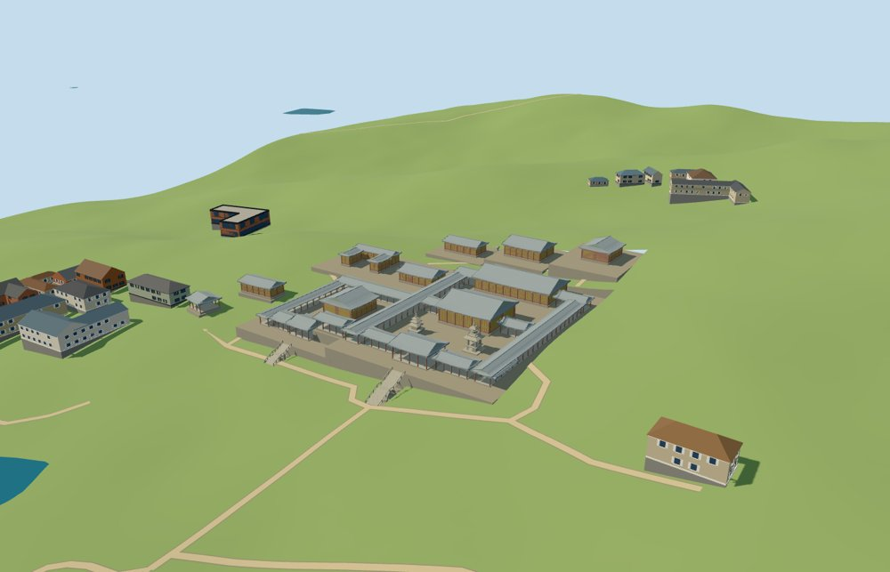

# bulguksa — Bulguksa

Reviewed2026-10-19. Accepted for the specific medium-fi principal temple exterior and approximate full-site PMTiles/DEM fit. Partial architectural completeness/contact remains pending.

## Exterior and shared materials

Inspected all11 portable views. Sixteen individually mapped halls,27 roof ribbons, the paired courts, higher Birojeon/Gwaneumjeon/Nahanjeon terraces, two entrance stone bridges and three distinct pagodas form the specific Bulguksa exterior. Curved hip-and-gable roofs, red timber posts, muted green bracket bands and yellow wall fields are geometry. The main entrance has a real open barrel vault; the western entrance has lintel-and-pier supports. Dabotap retains four open pillars and four stairs, while Seokgatap has three solid decreasing storeys. The small sarira stupa is separately placed. The wider religious park and independent surrounding buildings are outside this model. Fine dancheong painting and sculpture are simplified. Portable fallback lighting is lighter than the textured Earth view; terrain and foundations were inspected separately in the actual-site renderer.

Inspected all11 shared-material views. Six surface roles merge to five materials and reuse four common256-square wood, slate, granite and lime-plaster graphs with metric UVs and linear tints. The red timber and green trim share the wood graph; stonework and paved courts share granite. No embedded image, copied photo or unique atlas is shipped. Each graph loads once and eviction frees model geometry. The geographic flat review stage exposes deliberately buried retaining faces; it is not a geographic contact test. Full-site terrain contact was reviewed on the unchanged retained DEM separately.

## Browser levels

| Level | Triangles | Bytes | Draws |
| --- | ---: | ---: | ---: |
| skyline | 973 | 102356 | 1 |
| district | 3531 | 331712 | 5 |
| street | 14563 | 1314576 | 5 |
| closeup | 33463 | 2970644 | 5 |

Inspected all27 medium-fi views: street, block and skyline with procedural neighbors at noon/late afternoon in Economy/High, an untextured silhouette, six architectural details, four complete-compound levels and all transitions. Levels973/3531/14563/33463 meet their budgets. Skyline retains both courts, the hall roof hierarchy, entrance stairs and distinct pagodas; district adds open gallery bays, grouped panels and hip-and-gable roofs; street adds bracket bands and railings; closeup adds selected timber lattice and finial rings. Skyline+district initial geometry is434068bytes, plus four shared material graphs. There are five near draws and one skyline draw. Separate attribute streams avoid duplicate GPU uploads. Changes in posts, roof curvature and finials are visible across upgrades. Synthetic context is a style check; physical-device and dense-city measurements remain pending.

## Geographic fit

Reviewed approximate full-site fit on the unchanged 161-square/6m standard DEM. Sixteen mapped halls retain raw east/south coordinates; the main hall east axis is9.67 degrees north of east and the stairs face the southern approach. Individual court levels step up the hillside. Twenty-seven occupied floor pockets merge to ten level meshes, each with a complete opaque top and continuous retaining foundation. Entrance bridge walks have inward cut-bank joins to the coarse DEM. First-render foundation gaps were corrected; the open stone vault remains real geometry. These buried joins and court/threshold levels are visualization estimates, not surveyed basement walls. Only bounded occupied floors open ground; sixteen individual guarded roof envelopes replace authored buildings. All115 independent source-map records were checked outside these envelopes. Full-site loading replaces16 authored roofs and preserves42 independent tile buildings exactly. Three native water features retain19263.106301357795 square metres. Failure keeps all58 native tile buildings and terrain; eviction restores surfaces and frees geometry. Synthetic64m residency clips the architecture, including part of the entrance bridge, and retains the existing temporary-boundary contact limitation. Partial architectural completeness/contact is not approved. Only the portable source preview seats terrain under authored floors; production uses the unmodified retained grid.

## Scope and limitations

Accepted for the specific medium-fi principal Bulguksa exterior and approximate full-site standard-map/DEM fit. Six ordinary references, including one visitor-style layout diagram, guide identity; pinned PMTiles roof/point controls determine horizontal placement. All16 actual roof controls and102 vertices remain intact. The main hall east axis is9.67 degrees north of east. Gallery ribbons are rectified within approximately55cm of their map envelope to suppress sub-metre jitter. Pagoda nominal heights10.4m/8.2m/2.1m follow ordinary reference descriptions, with approximate body/finial allocation. Heights, court thresholds, stair dimensions, curved roof sections, bays, brackets and stone profiles are visualization estimates. Twenty-seven floor pockets merge to ten meshes; six bounded openings affect only occupied ground. First-render foundation gaps were corrected with continuous retaining faces and inward entrance cut-bank joins, preserving the open vault. The original161-square/6m DEM is unchanged; only the portable source preview has occupied-floor seating. Partial loading clips the temple and bridge at temporary tile edges, so partial architectural completeness/contact remains pending. Exact carved details, inscriptions, deity figures, navigable interiors and the wider religious park are outside scope. No bespoke survey or archival research was used.

## Reproducible source and checks

Two registered recipes plus retained map, terrain and reference metadata rebuild the master and four browser levels. Master33463triangles/4018956bytes. Six Khronos validations have zero errors/warnings;195 shape/opening probes,102 map vertices and7904 floor samples pass. Inspected49 official and24 site/failure/partial frames. Bulk images stay local.

Source retains all131 local map buildings:16 authored roof controls and115 independent records. The960m production tile contains58 records:16 authored roofs are replaced and42 independent buildings remain byte-identical. Three native water features retain19263.106301357795m². Failure preserves native terrain and all58 tile buildings; eviction restores ground/water and disposes model geometry. Retaining/cut-bank joins are visualization estimates for the coarse DEM.

Selected source/import/placement checks, strict medium-fi audit, scene validate and sim30 pass. The next full source rebuild and lock refresh belong to a meaningful batch milestone. No full rebuild, dependency audit, Git mutation or upload was performed.

Rebuild: node packages/worldgen/scripts/generate-additional-landmarks.mjs --ids=bulguksa; node packages/worldgen/scripts/import-structure-models.mjs --ids=bulguksa; node packages/tooling/scripts/generate-landmark-lods.mjs --ids=bulguksa.

Source: sha256:b3bc204ba4bb6aaa597947fe8b7675c5da0bdab0113c71b33b537f82f3228b0c

Runtime: sha256:48d39ff8a8080fffa3e5d51ced9ee9ff4668f014a29f492590e96cd1c9757a2e

Input: sha256:26a9055b99d15cfd484e88bc9325e5a9fb8d3cbea072a4fcd4e967592f6b0a9e

## Ordinary reference pictures

https://commons.wikimedia.org/wiki/File:Lotus_Flower_Bridge_and_Seven_Treasure_Bridge_at_Bulguksa_in_Gyeongju,_Korea.jpg — Unknown author / Korea Copyright Commission; Public Domain; viewed only. No pixels shipped.

https://commons.wikimedia.org/wiki/File:Bulguksa-map.svg — Rémi Cormier; CC BY-SA 3.0; viewed only. No pixels shipped.

https://commons.wikimedia.org/wiki/File:Daeungjeon,_Bulguksa_02.jpg — Bernard Gagnon; CC0; viewed only. No pixels shipped.

https://commons.wikimedia.org/wiki/File:Bulguksa_01.jpg — Bernard Gagnon; CC0; viewed only. No pixels shipped.

https://commons.wikimedia.org/wiki/File:%EA%B2%BD%EC%A3%BC_%EB%B6%88%EA%B5%AD%EC%82%AC_%EB%8B%A4%EB%B3%B4%ED%83%91.jpg — Asadal; CC BY-SA 4.0; viewed only. No pixels shipped.

https://commons.wikimedia.org/wiki/File:Seokgatap_Pagoda.jpg — Bernard Gagnon; CC0; viewed only. No pixels shipped.
