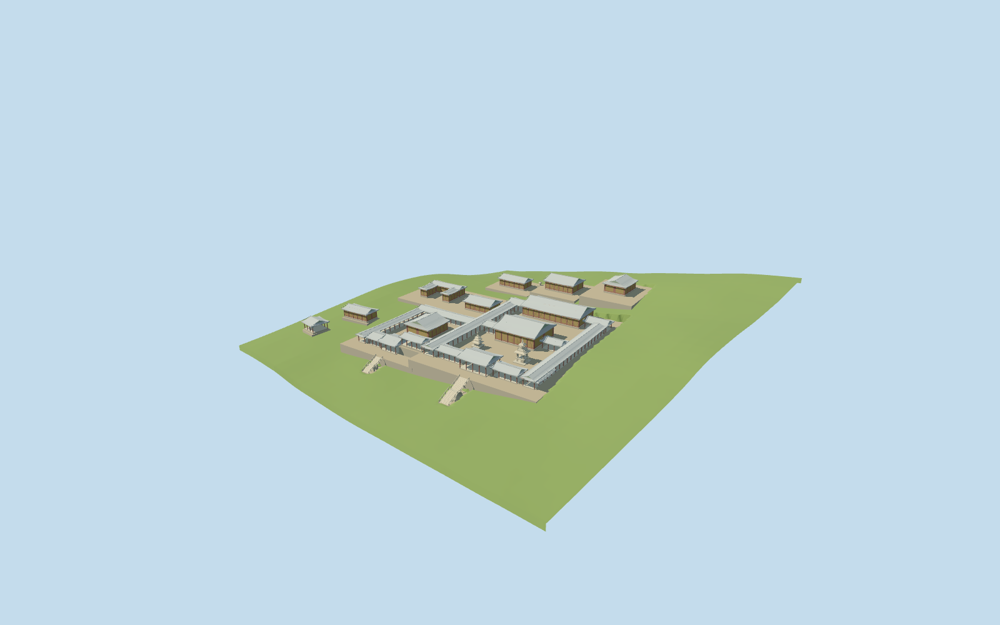

# Bulguksa

Specific principal Bulguksa compound exterior: sixteen mapped halls/galleries and western auxiliary buildings, two courts, higher Birojeon/Gwaneumjeon/Nahanjeon, both entrance stone stair bridges, Dabotap, Seokgatap and the small sarira stupa. The large373m religious park boundary is not one building and remains outside this model.

## Evidence and reconstruction

Published dimensions and reconstructed details are separated in spec.json. Primary references:

- [Reference](https://commons.wikimedia.org/wiki/File:Lotus_Flower_Bridge_and_Seven_Treasure_Bridge_at_Bulguksa_in_Gyeongju,_Korea.jpg)
- [Reference](https://commons.wikimedia.org/wiki/File:Bulguksa-map.svg)
- [Reference](https://commons.wikimedia.org/wiki/File:Daeungjeon,_Bulguksa_02.jpg)
- [Reference](https://commons.wikimedia.org/wiki/File:Bulguksa_01.jpg)
- [Reference](https://commons.wikimedia.org/wiki/File:%EA%B2%BD%EC%A3%BC_%EB%B6%88%EA%B5%AD%EC%82%AC_%EB%8B%A4%EB%B3%B4%ED%83%91.jpg)
- [Reference](https://commons.wikimedia.org/wiki/File:Seokgatap_Pagoda.jpg)

Four shared256-square material graphs, metric UVs and linear tints. Timber bays, bracket bands, roof curvature, stone bridges and distinct pagodas are geometry. No unique atlas or copied photograph is shipped. Two registered recipes rebuild the master and browser levels.

## Model and axes

33,463 triangles; 100,389 vertices; 5 material groups; 4,018,956 bytes. Native bounds: -112.450, -8.984, -103.860 to 24.700, 14.473, 42.657. Source hash: `sha256:b3bc204ba4bb6aaa597947fe8b7675c5da0bdab0113c71b33b537f82f3228b0c`.

{"x":"east","y":"up","z":"south"}

The original161-square/6m standard Mapzen-USGS grid is retained with247.399m raw datum. Courtyard levels follow samples at the mapped halls and step up the hillside. Every bounded occupied court/foundation has an opaque top and sampled edge joins at every level. Only these occupied floors open terrain; surrounding paths, water and independent buildings remain native. The source preview seats terrain below authored floors solely for viewing. Exact archaeological threshold heights and canopy-influenced DEM levels are not surveyed.

## Reproduce

Run `node packages/worldgen/scripts/generate-additional-landmarks.mjs --ids=bulguksa` (or add `--check`). The generator preserves manually edited masters by checking their baseline hashes. Import through the standard authored-model workflow with optimization disabled; then capture all QA cameras, including shared-surface views.

## Pending work

- Specific principal Bulguksa compound exterior: sixteen mapped halls/galleries and western auxiliary buildings, two courts, higher Birojeon/Gwaneumjeon/Nahanjeon, both entrance stone stair bridges, Dabotap, Seokgatap and the small sarira stupa. The large373m religious park boundary is not one building and remains outside this model.
- Q408318/way382655135 identifies the wider site. Sixteen actual normal-map roof footprints identify the principal halls and gallery arms; point controls17598413339131/17598413339130/17596588194605 place Dabotap, Seokgatap and the sarira stupa. The ordinary visitor-style layout guides names and relative courts, while current PMTiles geometry controls metric positions. Raw east/south coordinates retain the signed front approach; the main hall east axis is9.67 degrees north of east. Concave gallery roof ribbons are rectified within approximately55cm to suppress sub-metre map jitter; original control vertices remain unchanged in source.
- Building wall/roof heights and courtyard levels are picture/DEM visualization estimates. Ordinary article heights10.4m Dabotap,8.2m Seokgatap and2.1m sarira stupa guide their nominal tops. Main entrance stairs use34 approximate risers split16/18; western stairs use17 split10/7. Roof curvature, brackets, panel bays, pagoda finial/body allocation, bridge arch and rail geometry are simplified estimates rather than surveys.
- Reviewed approximate full-site fit on the unchanged 161-square/6m standard DEM. Sixteen mapped halls retain raw east/south coordinates; the main hall east axis is9.67 degrees north of east and the stairs face the southern approach. Individual court levels step up the hillside. Twenty-seven occupied floor pockets merge to ten level meshes, each with a complete opaque top and continuous retaining foundation. Entrance bridge walks have inward cut-bank joins to the coarse DEM. First-render foundation gaps were corrected; the open stone vault remains real geometry. These buried joins and court/threshold levels are visualization estimates, not surveyed basement walls. Only bounded occupied floors open ground; sixteen individual guarded roof envelopes replace authored buildings. All115 independent source-map records were checked outside these envelopes. Full-site loading replaces16 authored roofs and preserves42 independent tile buildings exactly. Three native water features retain19263.106301357795 square metres. Failure keeps all58 native tile buildings and terrain; eviction restores surfaces and frees geometry. Synthetic64m residency clips the architecture, including part of the entrance bridge, and retains the existing temporary-boundary contact limitation. Partial architectural completeness/contact is not approved. Only the portable source preview seats terrain under authored floors; production uses the unmodified retained grid.
- Building heights, floor levels, curved hip-and-gable roofs, bracket bays, stair dimensions, rail profiles and stone pagoda sculptures are picture/map-guided medium-fi approximations. Fine dancheong painting, inscriptions, exact carved reliefs, deity figures, navigable interiors and the wider religious park are outside scope. Current review status is recorded in qa.json.

This bundle follows the medium-fi standard. Medium-fi appearance and geographic fit are reviewed separately. Hash-bound visual acceptance is recorded separately after capture inspection.

## Additional geographic data

©OpenStreetMap contributors; Protomaps; Mapzen/USGS terrain.
