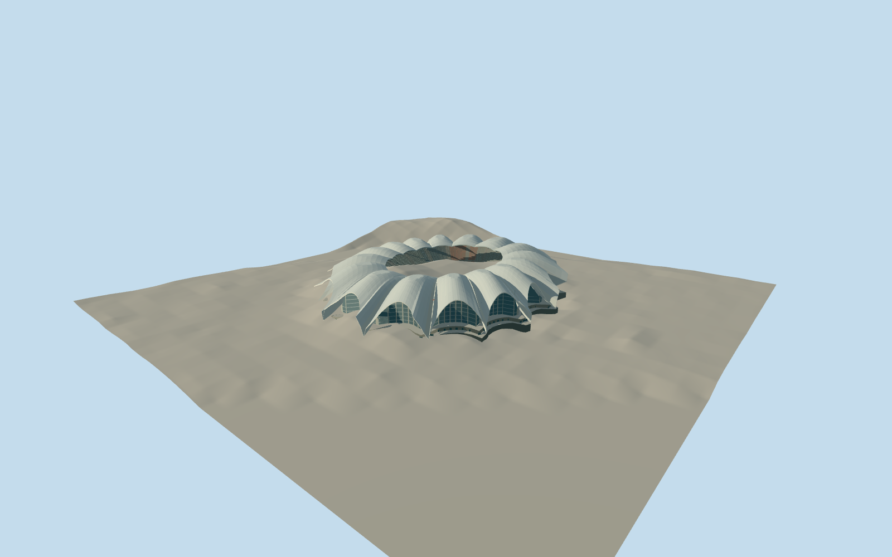

# Rungrado 1st of May Stadium

Elliptical stadium with sixteen pale scalloped roof shells, tall glazed bays, tiered bowl, athletics track and a mapped soccer pitch.

Authoring state: **review-in-qa.json**. Current completion evidence is in [qa.json](qa.json) and the [completion ledger](../../../../qualla-structures/batches/qualla-003.PROGRESS.md).

- [Rungrado 1st of May Stadium](https://qualla.com/rungrado-1st-of-may-stadium/)

Roof seam paths, lower facade articulation, modern cladding colors, stand sections and track dimensions are estimates. The pitch orientation and perimeter are mapped.

The roofed stands cover an open field and running track. The original Copernicus surface has roof imprint around the stadium and can obscure its lower interior in the unmasked terrain view. Field height and foundation grade are approximate.

Build: `node content/worldgen/source/places/wy/wyc/rungrado_1st_of_may_stadium/models/generate-rungrado-1st-of-may-stadium.mjs`. Add `--check` to verify exact regeneration. 29232 triangles; 5 materials; no embedded photographs.
