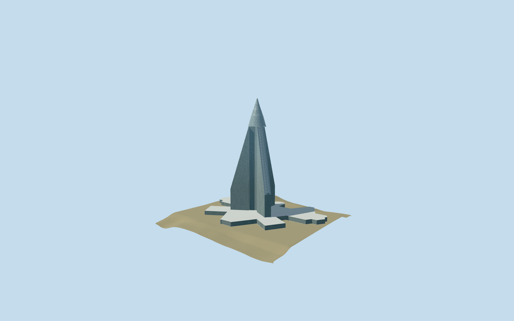

# Ryugyong Hotel

Compact Ryugyong exterior preserves all mapped radial wings, their sloping roofs and setbacks, separate central shaft, conical crown and podium. Low tiers coarsen facade grids and crown rings; original master remains reproducible.

## Evidence and reconstruction

Published dimensions and reconstructed details are separated in spec.json. Primary references:

- [Reference](https://koryogroup.com/blog/ryugyong-hotel-special-report)
- [Reference](https://www.skyscrapercenter.com/building/wd/377)
- [Reference](https://doiserbia.nb.rs/img/doi/0350-3593/2021/0350-35932102117P.pdf)
- [Reference](https://www.openstreetmap.org/way/407995272)
- [Reference](https://www.openstreetmap.org/way/1279085957)

No third-party geometry, photograph or bitmap texture is embedded. Shared surface graphs come from the central library; vertex tints carry model colors. Glazing uses PBR materials; transparent surfaces are declared per model.

## Model and axes

36,147 triangles; 108,441 vertices; 4 material groups; 4,340,456 bytes. Native bounds: -190.148, 0.000, -128.053 to 190.148, 330.000, 128.053. Source hash: `sha256:eae3317b4c37caad3f004dd61b3b80a6e7f2fda24c607bc944ccbf89495a74d8`.

{"up":"+Y","longitudinal":"+X along the mapped building long axis","front":"+Z","origin":"Mapped podium frame; tower center from separate mapped central shaft"}

One inspected daylight exterior photograph confirms the blue-gray three-wing pyramid, narrow ribs, intermediate outer-wing shoulders and conical ringed crown. Preserve original330m height, concave mapped podium, separate central shaft and mapped wing roof directions77/197/317degrees. Standard viewer PMTiles confirms the tower/plaza and surrounding roads. Off-podium PMTiles point[0,150]26.1845m sets approximate ground contact; center36.7994m remains coarse. Bounded rectangular preview correction covers the large podium while retaining raw heights separately. Facade panel schedule, precise shoulder heights, crown ring sections, podium entrances and thresholds remain approximations. The2012 picture does not certify current LED/display installations or occupancy.

## Reproduce

Run `node packages/worldgen/scripts/generate-signature-towers.mjs --ids=ryugyong_hotel` (or add `--check`). The generator preserves manually edited masters by checking their baseline hashes. Import through the standard authored-model workflow with optimization disabled; then capture all QA cameras, including shared-surface views.

## Pending work

- One inspected daylight exterior photograph confirms the blue-gray three-wing pyramid, narrow ribs, intermediate outer-wing shoulders and conical ringed crown. Preserve original330m height, concave mapped podium, separate central shaft and mapped wing roof directions77/197/317degrees. Standard viewer PMTiles confirms the tower/plaza and surrounding roads. Off-podium PMTiles point[0,150]26.1845m sets approximate ground contact; center36.7994m remains coarse. Bounded rectangular preview correction covers the large podium while retaining raw heights separately. Facade panel schedule, precise shoulder heights, crown ring sections, podium entrances and thresholds remain approximations. The2012 picture does not certify current LED/display installations or occupancy.
- Three shared granite/concrete/painted-metal graphs reused; glazing uses opaque PBR with no copied imagery. Low tiers keep the whole three-wing silhouette while merging panel grids and replacing crown tubes with narrow surface bands. Physical-device timings pending.

This bundle follows the medium-fi standard. Medium-fi appearance and geographic fit are reviewed separately. Hash-bound visual acceptance is recorded separately after capture inspection.
