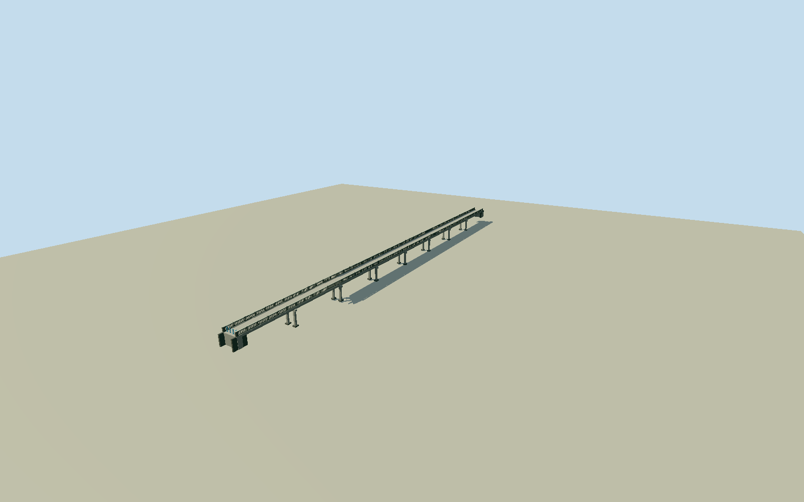

# Bridge of No Return, Panmunjom

Whole original native six-vertex Bridge of No Return and both mapped bridge-axis halves, approximately144.68m long/4.74m wide. Low straight concrete slab/girder crossing with narrow carriageway, curbs, repeated pierced vertical-slot concrete parapets, heavier panel/end posts, concrete top rails, four light-blue cylindrical south/east entry bollards, integral low abutments and bounded partly concealed supporting bents. Exclude checkpoint buildings, MDL sign, adjacent roads, trees, people, vehicles, river water, full border plaza/site floor and other nearby bridges. Preserve full six-vertex deck perimeter, both original axis halves, open carriageway, actual through slots and visible gaps between all bollards. Concrete end posts slightly taper, dark weathered rail faces, lighter horizontal cap faces. Open low girder/bent supports rather than closed embankment; hidden supports explicitly bounded, no suspension cables/towers. Lower support extents are geometry assumptions, not a terrain bathymetry reconstruction. All four LODs preserve whole length/bollard count and open passage. Freeze independent400m field first; no fit/flatten/reacquisition.

Authoring state: **review-in-qa.json**. Current completion evidence is in [qa.json](qa.json) and the [completion ledger](../../../../qualla-structures/batches/qualla-002.PROGRESS.md).

- [Bridge of No Return](https://qualla.com/bridge-of-no-return/)

Original man_made=bridge way1190761298/Q483844, all six original area vertices and both road bridge ways91440695/1300933882 with all three original axis nodes. Combined native axis144.6802m; geographic split is a border edit, not evidence of a physical deck discontinuity. Full mapped envelope retained as low straight concrete crossing; no unsupported84m truncation or invented94m/50m ground-vs-deck partition. Whole1975 elevated photograph supports continuous deck/parapet; abutment/support stations and partly landward spans are bounded photo interpretation. Native bridge:structure=suspension conflicts with all accepted concrete photographs and is not adopted.

Three published Qualla originals individually inspected/native SHA1 matched: Edward N Johnson Army Public Affairs2008/PD-USGov-Military-Army and Wbfergus own1975/1976 PD-user. Existing published PD policy passes unchanged; fourth summer Army image excluded. No copied photograph/diagram, photo texture, generated bitmap or downloaded mesh.

Native whole144.68m extent and all six original perimeter vertices preserved, with both road-bridge axis halves. Straight low concrete girder/slab deck, open narrow passage, curbs, pierced concrete parapets/heavier endposts, and exactly four blue bollards. No suspension cables/towers, checkpoint buildings, MDL sign, roads, people, vehicles, trees, river water or site floor.

Photo-proportioned deck0.15m/0.45m slab/0.65m girders/parapet1.15m/48panels/six bars and four1.18m entry bollards, seven representative low twin-column bents/abutments are original estimates. Vegetation hides most underside; support census/heights/foundations/landward limits and fine current cosmetics are not engineering survey. Lower supports extend to-5.6m as bounded geometry, not derived river bathymetry.

Independent400m129x129/16641 samples/two original Terrarium tiles frozen before geometry; datum15.0243m, whole relative field[-5.4068,2.3288]m unchanged/no fit/flatten/reacquire. Portable/shared isolated stage Y-6m exposes low supports separately from native ground. Geographic preview/replaceFootprint=false; real host terrain/threshold and bank attachment unverified.

Build: `node packages/worldgen/scripts/generate-authored-places.mjs --ids=bridge_of_no_return`. Add `--check` to verify exact regeneration. 26452 triangles; 5 materials; no embedded photographs.
