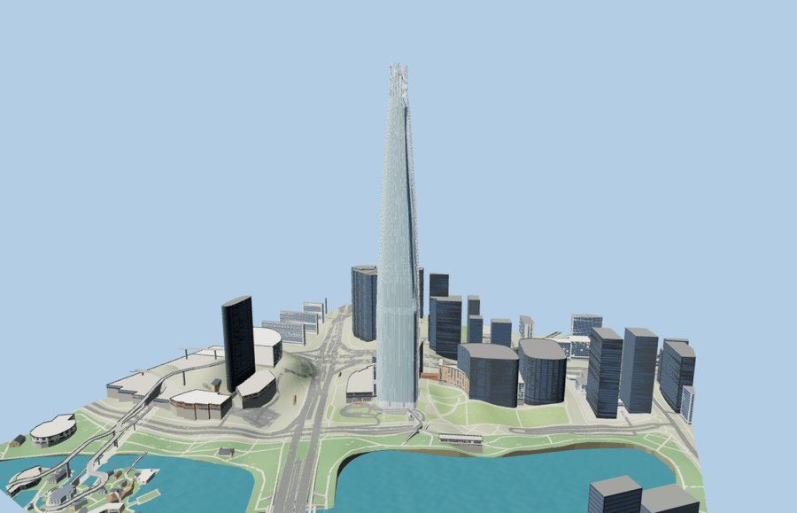

# Lotte World Tower

Original tapered curtain wall, paired recesses, glazed lobby, white fins, two open crown ears and 11 m Sky Bridge. All four browser tiers retain the crown split and place the Sky Bridge deck at 541 m above the model origin. Near tiers add the diagonal braces, lobby columns, entry framing, and maintenance platforms. The close-up tier adds the maintenance stairs.

The signed tower footprint matches the two opposed base seams. A western outdoor terrain sample sets the approximately 20.75 m base. Bounded grades meet the entrance apron. The fixture replaces 33 tower records, preserving the two mapped mall records, the other native buildings and all 353 road and rail records.

| Detail level | Triangles | Download bytes | Draws |
| --- | ---: | ---: | ---: |
| skyline | 872 | 83,648 | 1 |
| district | 3,872 | 337,120 | 6 |
| street | 11,004 | 934,196 | 6 |
| closeup | 51,900 | 4,213,404 | 6 |

The original detailed master contains 563,015 triangles. The first two viewer tiers total 420,768 bytes. Six GLBs pass Khronos validation and contain zero embedded images.

The viewer restores the mapped tower when the GLB fails to load. All four tiers release their geometry on unload. The review covers 59 captures and 95 placement samples.

Terrain fit is approximate and uses the retained Terrarium samples. Photos and mapped sections establish the exterior; pane spacing, service details and brace sections are reconstructed.

The mall and other buildings use the surrounding map. The asset covers the tower exterior and the visible crown access geometry.

[Architect photos and project overview](https://www.kpf.com/project/lotte-world-tower) · [Mapped terrain fit](site-fit.json) · [QA evidence](qa.json)
