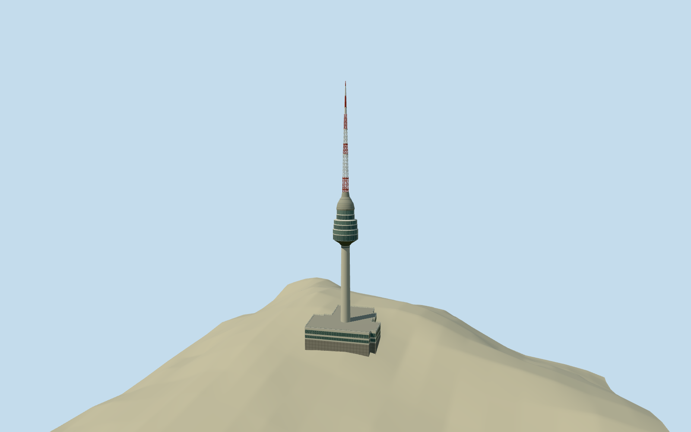

# N Seoul Tower

N Seoul Tower with its mapped low pavilion, white concrete stem, stepped green-gray glazed observation levels and red-and-white steel antenna.

Authoring state: **review-in-qa.json**. Current completion evidence is in [qa.json](qa.json) and the [completion ledger](../../../../qualla-structures/batches/qualla-004.PROGRESS.md).

- [N Seoul Tower](https://qualla.com/n-seoul-tower/)

Glazing divisions, podium cladding, antenna bracing and equipment details are generalized.

The model depicts the integral tower and podium exterior. It omits the separate neighboring lattice tower, paths and plaza shelters.

Build: `node content/worldgen/source/places/wy/wyd/n_seoul_tower/models/generate-n-seoul-tower.mjs`. Add `--check` to verify exact regeneration. 17595 triangles; 5 materials; no embedded photographs.
