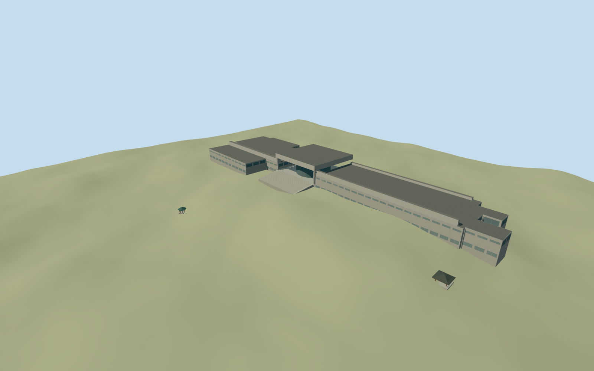

# National Museum of Korea

Long fortress-like granite wings and an open covered public plaza at the National Museum of Korea, with the glass rotunda and garden pavilions.

Authoring state: **review-in-qa.json**. Current completion evidence is in [qa.json](qa.json) and the [completion ledger](../../../../qualla-structures/batches/qualla-003.PROGRESS.md).

- [National Museum of Korea](https://qualla.com/national-museum-of-korea/)

The building’s dimensions and open central plaza follow the museum’s published description and mapped outline. Partition locations, facade bay rhythms, open-plaza soffit details and small roof levels are estimated.

Thirty-metre Copernicus radar returns corroborate the higher eastern and central wings and lower northern structures. Precise heights, the attachment point for the published maximum and stair landings are approximate. The higher portions are narrow, since the 30 m cells average roof and open space.

The Celadon and Bosingak exterior pavilions retain their mapped footprints. Decorative framing, surface design and lower corner details are generalized.

Build: `node content/worldgen/source/places/wy/wyd/national_museum_of_korea/models/generate-national-museum-of-korea.mjs`. Add `--check` to verify exact regeneration. 3395 triangles; 8 materials; no embedded photographs.
