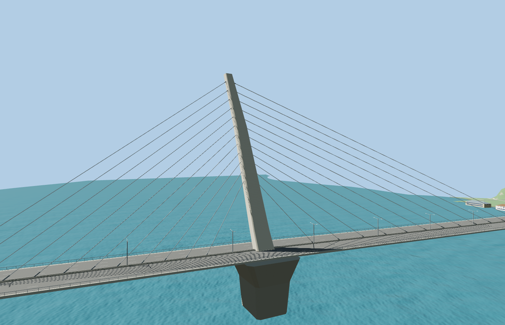

# World Cup Bridge

A single pale mast leans toward the south bank over the Han. Unequal fans of stays run in the median above the six-lane deck. A flared tower pier and repeating concrete approach piers support the crossing, which curves into the interchanges at either end.

OpenStreetMap relation 19843816 and the PMTiles carriageways place the crossing north-northeast from Yangpyeong toward Sangam. The model follows the skewed bearing lines and leaves the connecting ramps and lower roads in place. Eight lane and ramp joins pass at each tier, with a maximum height difference of 1.2 cm. The original crossing returns when the model fails to load. Native terrain, water, approach ramps and lower paths remain.

The 29,234-triangle source rebuilds byte for byte. The first two runtime tiers total 294,684 bytes. Six GLBs validated and 36 current views were inspected.

The mapped outline and carriageway traces set the deck geometry. Mast dimensions, stay spacing and individual piers use exterior photo estimates. The south approach deck grade clears a ridge in the standard viewer terrain. Elevations and pier spacing are visual approximations.

Rebuild with `node packages/worldgen/scripts/generate-world-cup-bridge.mjs`. Append `--check` to compare exact bytes. Use `--ids=world_cup_bridge` for targeted import, LOD, placement and readiness.
